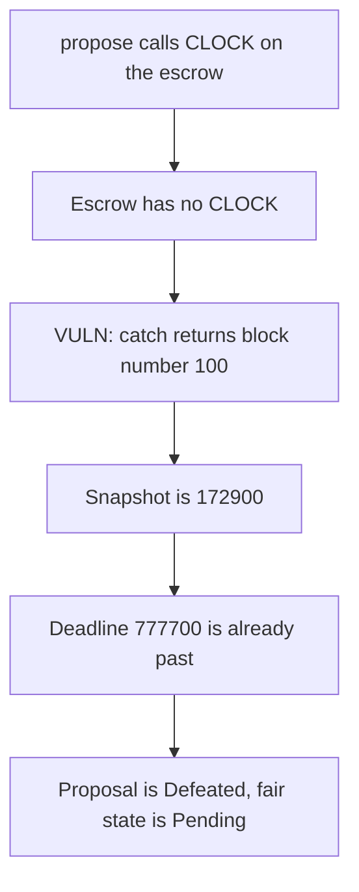

# EYWA — ProposalManager.CLOCK returns the block number

> **Vulnerability classes:** vuln/governance/timelock-bypass · vuln/logic/wrong-condition

<!-- non-defihacklabs -->
<!-- source-auditvault: https://github.com/Auditware/AuditVault/blob/main/findings/44336-incorrect-proposalmanagerclock-behaviour-mixbytes-none-eywa.md -->
<!-- date: 2024-11 -->

## Key info

| | |
|---|---|
| **Protocol** | EYWA DAO |
| **Finding** | MixBytes, November 2024, AuditVault 44336 |
| **Vulnerable code** | `ProposalManager.CLOCK` catch returns `block.number` |
| **Harm** | Snapshot is 172900 and the proposal is Defeated. The timestamp snapshot 1700172800 is still Pending. |
| **Chain** | local synthetic (audited Ethereum contracts) |

## TL;DR

`ProposalManager` treats `EscrowManager` as the voting token and asks it for `CLOCK()`. The escrow has no such function. The call fails, and the catch returns `block.number`.

`votingDelay` is 2 days. On block 100 at timestamp 1700000000 the snapshot is `100 + 172800 = 172900`. The voting period is one week, so the deadline is 777700. That is already behind the current timestamp, and `state` is Defeated. A timestamp clock would snapshot at 1700172800 and the proposal would still be Pending.

## The vulnerable code

```solidity
try IClock(address(token)).CLOCK() returns (uint48 timepoint) {
    return timepoint;
} catch {
    // @> VULN: the catch returns block.number instead of block.timestamp.
    return uint48(block.number);
}
```

The report's fix is to return `block.timestamp` from that catch.

## Root cause

The Governor-style clock helper assumes that a token without `CLOCK()` is block-number mode. EYWA's escrow is timestamp mode and simply does not implement the function. The fallback therefore mixes a block number with a delay that was configured as 2 days of seconds. The vote window is placed in 1970 and is already closed.

## Preconditions

Block number 100. Timestamp 1700000000. Both are fixed for the whole transaction. `votingDelay` is 2 days and `votingPeriod` is 1 week. The token has no `CLOCK()`.

## Attack walkthrough

1. `propose` calls `CLOCK()`.
2. The escrow call reverts. The catch returns 100.
3. `proposalSnapshot` is 172900. `proposalDeadline` is 777700.
4. `state` is 2, Defeated, because the timestamp is past the deadline.
5. `fairSnapshot` is 1700172800. `fairState` is 0, Pending.

## Diagrams



## Impact

A proposal created through this clock cannot be voted. Its snapshot and deadline are block-number-sized. The same proposal on a timestamp clock would not open for another 2 days.

## Remediation

Return `block.timestamp` from the catch, or implement `CLOCK()` on the escrow so the try succeeds.

## How to reproduce

```bash
cd 44336-incorrect-proposalmanagerclock-behaviour-mixbytes-none-eywa_exp
forge test -vv
```

## Sources

- AuditVault finding: https://github.com/Auditware/AuditVault/blob/main/findings/44336-incorrect-proposalmanagerclock-behaviour-mixbytes-none-eywa.md
- MixBytes report: https://github.com/mixbytes/audits_public/blob/master/EYWA/DAO/README.md
- Audited commit `29465033f28c8d3f09cbc6722e08e44f443bd3b2`, `contracts/ProposalManager.sol`. Audit window started 14 Nov 2024.
