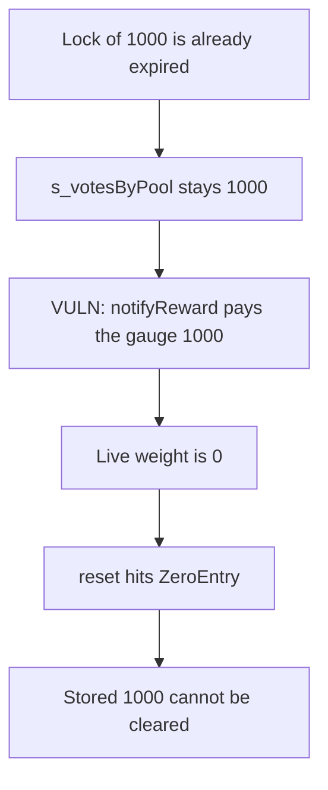

# EYWA — expired locks keep directing gauge rewards

> **Vulnerability classes:** vuln/governance/proposal-manipulation · vuln/logic/state-update

<!-- non-defihacklabs -->
<!-- source-auditvault: https://github.com/Auditware/AuditVault/blob/main/findings/44338-s-votesbypoolm-pool-persists-indefinitely-leading-to-rewards.md -->
<!-- date: 2024-11 -->

## Key info

| | |
|---|---|
| **Protocol** | EYWA DAO |
| **Finding** | MixBytes, November 2024, AuditVault 44338 |
| **Vulnerable code** | `notifyReward` pays `s_votesByPool`, and `reset` reverts at `ZeroEntry` |
| **Harm** | The gauge receives 1000. Live voting power is 0, and reset cannot clear the weight. |
| **Chain** | local synthetic (audited Ethereum contracts) |

## TL;DR

`s_votesByPool[pool]` is increased by the locked amount and is not reduced when the lock expires. Reward distribution reads that stored weight. After expiry `getVotesByTokenId` is 0, so `reset` hits `ZeroEntry` and nobody can zero the weight.

A lock of 1000 whose end is already past still has `s_votesByPool` of 1000. `notifyReward` transfers 1000 to the gauge. The live weight is 0. The reset call reverts and the stored 1000 remains.

## The vulnerable code

```solidity
uint256 weight = s_votesByPool[m_pool];
// @> VULN: s_votesByPool[m_pool] is not cleared when the lock expires.
reward.transfer(m_pool, weight);
```

```solidity
if (m_votesForPool == 0) {
    // @> VULN: live votes are 0, so the stored pool weight can never be cleared.
    revert ZeroEntry();
}
```

`m_votesForPool` is `getVotesByTokenId`, which returns 0 once `block.timestamp >= lockEnd`.

## Root cause

Votes are a stored sum, not a per-epoch checkpoint. Expiry changes the escrow's live power and does not write `s_votesByPool`. The only cleaners are `vote`, `poke`, and `reset`, and those refuse a zero live weight. An expired lock therefore keeps its pool in the reward index forever.

## Preconditions

The lock amount is 1000 and `lockEnd` is already behind the block timestamp, so this is the post-expiry state in one block. The reward pot holds 1000. No second timestamp.

## Attack walkthrough

1. Create the lock with end 0. `getVotesByTokenId` is 0.
2. `vote` adds the locked 1000 into `s_votesByPool`. The stored weight does not read the live vote.
3. `notifyReward` transfers 1000 to the gauge.
4. `fairWeight` is 0.
5. `reset` reverts. `s_votesByPool` is still 1000.

## Diagrams



## Impact

The gauge is paid 1000 reward that a live vote of 0 should not direct. Because reset cannot clear the weight, the next distribution does it again.

## Remediation

Pay and store votes per epoch from the live escrow power, and allow a zero live vote to clear `s_votesByPool` instead of reverting.

## How to reproduce

```bash
cd 44338-s-votesbypoolm-pool-persists-indefinitely-leading-to-rewards_exp
forge test -vv
```

## Sources

- AuditVault finding: https://github.com/Auditware/AuditVault/blob/main/findings/44338-s-votesbypoolm-pool-persists-indefinitely-leading-to-rewards.md
- MixBytes report: https://github.com/mixbytes/audits_public/blob/master/EYWA/DAO/README.md
- Audited commit `29465033f28c8d3f09cbc6722e08e44f443bd3b2`, `contracts/EscrowVoteManagerV1.sol`. Audit window started 14 Nov 2024.
