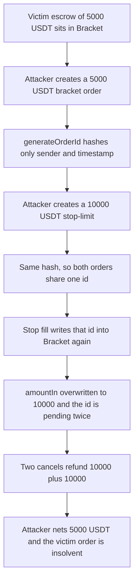

# Oku — stop-limit and bracket orders share one id and a cancel pays twice

> **Vulnerability classes:** vuln/logic/missing-validation · vuln/logic/missing-check · vuln/logic/incorrect-state-transition

> **Reproduction:** cheatcode-free local synthetic. `AutomationMaster.generateOrderId` is the audited body. Full trace: [output.txt](output.txt). PoC: [test/44377-h-7-stoplimit-id-collision-with-bracket-orders-due-to-no-val_exp.sol](test/44377-h-7-stoplimit-id-collision-with-bracket-orders-due-to-no-val_exp.sol).

<!-- non-defihacklabs -->
<!-- source-auditvault: https://github.com/Auditware/AuditVault/blob/main/findings/44377-h-7-stoplimit-id-collision-with-bracket-orders-due-to-no-val.md -->
<!-- date: 2024-11 -->

**AuditVault taxonomy:** `lang/solidity` · `sector/stable` · `platform/sherlock` · `has/github` · `severity/high` · `impact/loss-of-funds/direct-drain` · `novelty/variant` · genome: `wrong-condition` · `direct-drain` · `variant` · `frontrun-exposure` · `commitment-uniqueness`

## Key info

| | |
|---|---|
| **Protocol** | Oku custom order types |
| **Finding** | Sherlock 2024-11-oku H-7, AuditVault 44377 |
| **Vulnerable code** | `AutomationMaster.generateOrderId` |
| **Harm** | Attacker deposits 15,000 USDT and receives 20,000. 5,000 USDT is the victim's escrow. Bracket is left owing 5,000 with a 0 balance |
| **Chain** | local synthetic |

## TL;DR

`generateOrderId` is `uint96(keccak256(sender, block.timestamp))`. Bracket and StopLimit both call it. One user, one block, one id. Filling the stop passes that id into `Bracket.fillStopLimitOrder`, which overwrites the live bracket order and pushes the id a second time. `cancelOrder` refunds `amountIn` once per pending copy and never deletes the order, so two cancels pay the overwritten 10,000 USDT twice.

## The vulnerable code

Audited `AutomationMaster.generateOrderId` (`sherlock-audit/2024-11-oku` @ `ee3f781a`):

```solidity
function generateOrderId(address sender) external view override returns (uint96) {
    uint256 hashedValue = uint256(
        // @> VULN: id is keccak(sender, block.timestamp) only — no calling contract, no nonce
        keccak256(abi.encodePacked(sender, block.timestamp))
    );
    return uint96(hashedValue);
}
```

`Bracket._createOrder` then writes that id with no existence check. A stop fill passes `existingOrderId != 0`, skips a fresh id, and hits the same write:

```solidity
if (existingOrderId == 0) {
    existingOrderId = MASTER.generateOrderId(msg.sender);
}
// @> VULN: no check that orders[existingOrderId] is empty
orders[existingOrderId] = Order({orderId: existingOrderId, amountIn: amountIn, recipient: recipient});
pendingOrderIds.push(existingOrderId);
```

`_cancelOrder` removes one array entry and sends `order.amountIn`. The mapping stays. A second copy of the id pays `amountIn` again.

```solidity
// FIX: return uint96(keccak256(abi.encodePacked(sender, block.timestamp, msg.sender, ++nonce)));
// and require(orders[existingOrderId].orderId == 0) before the write.
```

## Root cause

The id has no contract-specific entropy and no nonce, and the bracket book does not reject an id that is already pending. Stop-limit fills are designed to reuse the stop's id. That reuse is safe only if the id cannot already name a bracket order. Same sender plus same `block.timestamp` makes it name one.

## Preconditions

A shared `AutomationMaster`. Bracket and StopLimit both mint ids from it. The caller can open both orders in one block (a contract, or a same-timestamp bundle). Bracket already holds someone else's escrow so the second refund does not run out of tokens.

## Attack walkthrough

1. A victim's bracket order has already escrowed 5,000 USDT. Different sender, different id.
2. The attacker escrows 5,000 USDT with `Bracket.createOrder`. `generateOrderId` returns `keccak(attacker, timestamp)`.
3. In the same block the attacker escrows 10,000 USDT with `StopLimit.createOrder`. The hash inputs have not changed, so the id matches.
4. `performUpkeep` calls `fillStopLimitOrder` with that id. Bracket pulls the 10,000 USDT, overwrites `amountIn` from 5,000 to 10,000, and pushes the id again. Pending copies of the id: 2. Bracket balance: 20,000 USDT (victim 5,000 + attacker 5,000 + stop 10,000).
5. `cancelOrder` twice. Each call transfers the overwritten 10,000 USDT. The attacker receives 20,000 after depositing 15,000.
6. Profit is 5,000 USDT. The victim order is still booked at 5,000 USDT and Bracket's balance is 0.

The control mixes `msg.sender` (Bracket vs StopLimit) and a nonce into the hash. The ids differ, the fill does not overwrite, each cancel returns only that order's deposit, a second cancel of the same id reverts, and the victim withdraws their 5,000 USDT.

## Diagrams



## Impact

Direct loss of other users' escrow. Here the numbers are 15,000 USDT deposited, 20,000 USDT withdrawn, 5,000 USDT stolen, and a 5,000 USDT liability left against a 0 balance. Repeating the pattern against a deeper book drains every other order that shares the contract's token balance.

## Remediation

Put the calling contract and a monotonic nonce into `generateOrderId`, and reject `fillStopLimitOrder` when `orders[existingOrderId]` is already populated. The sponsor fixed the id derivation in [gfx-labs/oku-custom-order-types#1](https://github.com/gfx-labs/oku-custom-order-types/pull/1).

## How to reproduce

```bash
cd 44377-h-7-stoplimit-id-collision-with-bracket-orders-due-to-no-val_exp
forge test -vv
```

## Sources

- AuditVault finding: https://github.com/Auditware/AuditVault/blob/main/findings/44377-h-7-stoplimit-id-collision-with-bracket-orders-due-to-no-val.md
- Sherlock judging: https://github.com/sherlock-audit/2024-11-oku-judging
- Finding source link: https://github.com/sherlock-audit/2024-11-oku-judging/issues/761
- Audited code: https://github.com/sherlock-audit/2024-11-oku/blob/ee3f781a73d65e33fb452c9a44eb1337c5cfdbd6/oku-custom-order-types/contracts/automatedTrigger/AutomationMaster.sol
- Bracket fill and cancel: https://github.com/sherlock-audit/2024-11-oku/blob/ee3f781a73d65e33fb452c9a44eb1337c5cfdbd6/oku-custom-order-types/contracts/automatedTrigger/Bracket.sol
- StopLimit handoff: https://github.com/sherlock-audit/2024-11-oku/blob/ee3f781a73d65e33fb452c9a44eb1337c5cfdbd6/oku-custom-order-types/contracts/automatedTrigger/StopLimit.sol
