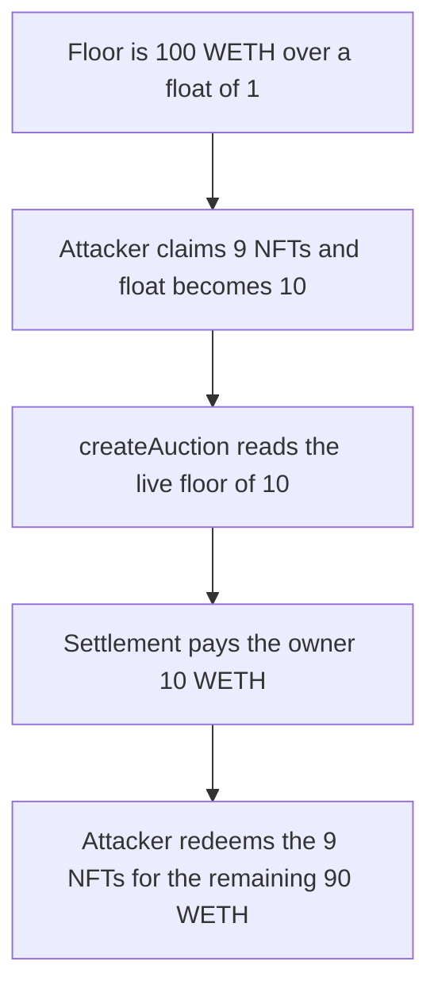

# apDAO: claiming NFTs before auction creation cuts the floor the owner is paid

> **Vulnerability classes:** `vuln/defi/sandwich-attack`

<!-- non-defihacklabs -->
<!-- source-auditvault: https://github.com/Auditware/AuditVault/blob/main/findings/44395-c-01-frontrunning-the-auction-creation-and-settlement-to-low.md -->
<!-- date: 2024-10 -->

## Key info

| Field | Value |
|---|---|
| **Loss** | Owner is paid 10 WETH instead of 100. The attacker redeems 90 WETH |
| **Vulnerable contract** | `Auction.createAuction` reading `Treasury.realFloorValue` |
| **Attacker EOA** | `0x1111111111111111111111111111111111111111` |
| **Attack contract** | `Exploit` |
| **Attack tx** | `Exploit.run()` |
| **Chain / block / date** | Local synthetic · 2024-10 |
| **Compiler** | solc 0.8.27, cancun, via IR |
| **Bug class** | Floor price is backing divided by a float that claim() can inflate |

## TL;DR

An auction lists at `treasury.realFloorValue()`, which is `(backing + backingLoanedOut) / float`. `claim()` mints `remainingClaimable` NFTs and increases `float` without adding backing. Before creation the treasury holds 100 WETH against a float of 1, so the floor is 100. The attacker claims 9 NFTs first. Float becomes 10 and the floor becomes 10. The auction lists at 10. With no bidders, settlement pays the owner 10 WETH. The attacker redeems the 9 NFTs for the remaining 90 WETH. Skipping the claim pays the owner the full 100.

## The vulnerable code

```solidity
uint256 value_ = (backing_ + backingLoanedOut_) / float_; // @> VULN
_mint(msg.sender, remainingClaimable); // @> VULN
uint256 currentRFV = treasury.realFloorValue(); // @> VULN
```

Settlement then calls `redeemItem`, which reads the same floor again, so both the listed price and the cash the owner receives are the diluted number.

## Root cause

`float` is the circulating NFT count and it is writable by `claim()` in the same window the auction reads it. More NFTs with the same backing means a lower redemption price for the NFT already being auctioned. The new NFTs are claims on the backing the owner no longer receives.

## Preconditions

- Treasury backing is 100 WETH and float starts at 1 (the NFT about to be auctioned).
- The attacker has `remainingClaimable` of 9.
- No higher bid replaces the floor redemption. The report's second path is exactly an auction with no bidders.

## Attack walkthrough

1. `realFloorValue` is 100 WETH.
2. `claim` mints 9 NFTs. `floatSupply` becomes 10. The floor is 10 WETH.
3. `createAuction` stores `currentRFV` of 10.
4. `settle` redeems one NFT at the live floor and forwards 10 WETH to the owner.
5. The attacker redeems 9 NFTs at 10 WETH each and receives 90 WETH. The treasury is empty.

## Diagrams



## Impact

The NFT owner is underpaid by 90 WETH on a 100 WETH floor. That 90 WETH is what the attacker's newly claimed NFTs redeem for. A creation that is not front-run pays the owner the full 100 WETH.

## How to reproduce

```bash
cd 44395-c-01-frontrunning-the-auction-creation-and-settlement-to-low_exp
forge test -vv
```

## Sources

- AuditVault finding: https://github.com/Auditware/AuditVault/blob/main/findings/44395-c-01-frontrunning-the-auction-creation-and-settlement-to-low.md
- Report: https://github.com/pashov/audits/blob/master/team/md/apDAO-security-review_2024-10-03.md
- Blamed lines: `Auction` `currentRFV = treasury.realFloorValue()`, `Treasury` `(backing + backingLoanedOut) / float`, and `claim` `_mint(msg.sender, remainingClaimable)`, as quoted in that review
