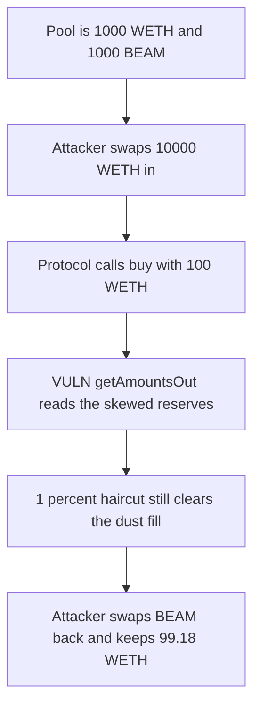

# BuyBurner: the slippage floor is the spot price, so a sandwich buys dust BEAM

> **Vulnerability classes:** `vuln/oracle/spot-price` · `vuln/oracle/price-manipulation`

<!-- non-defihacklabs -->
<!-- source-auditvault: https://github.com/Auditware/AuditVault/blob/main/findings/44430-h-01-manipulatable-oracle-and-breaking-slippage-protection-p.md -->
<!-- date: 2024-12 -->

## Key info

| Field | Value |
|---|---|
| **Loss** | Protocol spends 100 WETH and receives under 1 BEAM. Attacker profit is 99.180327868852459007 WETH |
| **Vulnerable contract** | `BuyBurner._getTokenAmountPrice` |
| **Attacker EOA** | `0x1111111111111111111111111111111111111111` |
| **Attack contract** | `Exploit` |
| **Attack tx** | `Exploit.run()` |
| **Chain / block / date** | Ethereum model · block 0 · 2024-12 |
| **Compiler** | solc 0.8.27, cancun |
| **Bug class** | amountOutMin is read from manipulable reserves |

## TL;DR

`_getTokenAmountPrice` calls `router.getAmountsOut` on the current pair. That quote is the Uniswap V2 spot reserves. The attacker swaps 10000 WETH into a 1000/1000 pool first. The protocol then buys with 100 WETH. Its minimum out is 99 percent of the already-skewed quote, so the check passes and the protocol receives `0.819` BEAM. The attacker sells the BEAM back and keeps `99.180327868852459007` WETH.

## Background

Pashov Audit Group's 14 December 2024 BuyBurner review, finding H-01. The blamed lines are the two `getAmountsOut` calls inside `_getTokenAmountPrice` and `_getTokenAmountPrice3`. This reduction uses the two-hop form. The pair is constant product with no fee, which is enough to show that a percentage haircut on a spot quote does not bound the BEAM received.

## The vulnerable code

```solidity
uint256[] memory returnedParam = router.getAmountsOut(tokenAmount, path); // @> VULN: spot reserves set the floor
// FIX: take amountOutMin from the caller, or quote a TWAP / Chainlink price.
return returnedParam[1];
```

`_getAmountOutMin` then does `quoted * (10000 - slippageBps) / 10000` with `slippageBps = 100`.

## Root cause

The floor moves with the reserves the attacker just changed. A fixed percentage of a manipulated quote is still a manipulated number. The swap's actual output is computed from those same reserves, so it clears the floor while delivering almost no BEAM.

## Preconditions

- The pool starts at 1000 WETH and 1000 BEAM.
- The attacker can swap before `BuyBurner.buy`.
- The protocol will spend 100 WETH and will accept a 1 percent deviation from the spot quote.

## Attack walkthrough

1. The attacker swaps 10000 WETH for BEAM. The pair prices it from the spot reserves.
2. The protocol calls `buy(100 WETH)`.
3. `getAmountsOut` reads the skewed reserves.
4. The 1 percent haircut is applied to that quote. The dust fill satisfies it.
5. The attacker swaps the BEAM back to WETH.
6. Profit is `99180327868852459007` wei. The protocol's BEAM balance is under 1 ether, and its WETH balance is zero.

## Diagrams



## Impact

The protocol spends its 100 WETH and receives less than 1 BEAM. The attacker extracts `99.180327868852459007` WETH, which is the protocol's WETH minus the rounding left in the pool. Repeating the pattern on later buys drains each purchase the same way. The report's recommendation is a TWAP, Chainlink, or an absolute BEAM amount passed into `buy`.

## Remediation

Stop deriving `amountOutMin` from `getAmountsOut` in the same transaction. Take the minimum BEAM out from the caller, or quote a price that a single swap cannot set.

## How to reproduce

```bash
cd 44430-h-01-manipulatable-oracle-and-breaking-slippage-protection-p_exp
forge test -vv
```

`test_sandwich_buys_dust_beam` asserts profit `99180327868852459007` and a protocol BEAM balance under 1 ether. Captured output is `output.txt`.

## Sources

- AuditVault finding: https://github.com/Auditware/AuditVault/blob/main/findings/44430-h-01-manipulatable-oracle-and-breaking-slippage-protection-p.md
- Report: https://github.com/pashov/audits/blob/master/team/md/BuyBurner-security-review_2024-12-14.md
- Spot formula: https://github.com/Uniswap/v2-periphery/blob/master/contracts/libraries/UniswapV2Library.sol#L62-L70
