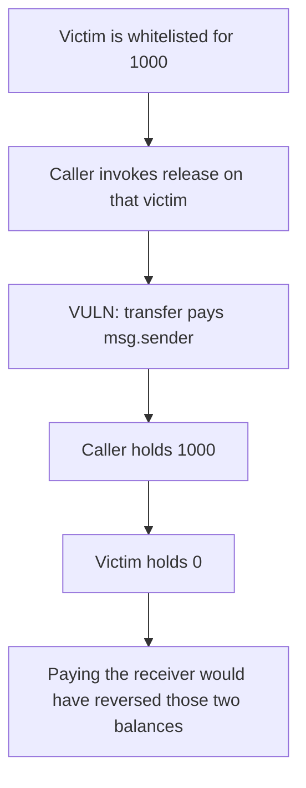

# Global Interlink — release pays the caller, not the whitelisted user

> **Vulnerability classes:** vuln/logic/missing-check · vuln/access-control/missing-auth

<!-- non-defihacklabs -->
<!-- source-auditvault: https://github.com/Auditware/AuditVault/blob/main/findings/44578-tx-sender-can-steal-the-released-tokens-of-any-whitelisted-u.md -->
<!-- date: 2023-03 -->

## Key info

| | |
|---|---|
| **Protocol** | Global Interlink |
| **Finding** | Zokyo, March 2023, AuditVault 44578 |
| **Vulnerable code** | `release` transfers to `msg.sender` |
| **Harm** | The caller receives 1000. The whitelisted receiver receives 0. |
| **Chain** | local synthetic (audited vesting rule) |

## TL;DR

`release(receiver)` checks that `receiver` is whitelisted and computes that account's vested amount. The transfer then pays `msg.sender`. Any caller can name a whitelisted user and take the release.

The victim is whitelisted for 1000. The vesting contract holds 1000. `release(victim)` pays the caller 1000. The victim's balance stays 0. The contract is empty.

`releaseToReceiver` on the same allocation pays the victim. The caller of that function receives 0.

## The vulnerable code

```solidity
require(whitelisted[receiver], "whitelist");
amount = allocation[receiver] - released[receiver];
require(amount > 0, "zero");
released[receiver] = allocation[receiver];
// @> VULN: the transfer pays the caller, not the whitelisted receiver.
token.transfer(msg.sender, amount);
```

The audited source is `token_vesting.move`. The transfer at the end of `release` uses the transaction sender. This Solidity reduction keeps that split: the checked address and the paid address are not the same.

## Root cause

The whitelist and the vested math are keyed by the `receiver` argument. The token movement is keyed by `msg.sender`. Nothing requires those two addresses to match, so the function is a pull of anyone's vested balance.

## Preconditions

The victim is whitelisted with allocation 1000, and the contract holds those tokens. The caller is not the victim. One transaction.

## Attack walkthrough

1. Confirm the victim is whitelisted and the allocation is 1000.
2. Call `release(victim)`.
3. The transfer sends 1000 to the caller.
4. The caller holds 1000. The victim holds 0. The vesting contract holds 0.

Control calls `releaseToReceiver(victim)`. The victim holds 1000. The caller holds 0.

## Diagrams



## Impact

The whitelisted user loses 1000 vested tokens. The caller who is not on the whitelist receives them.

## Remediation

Transfer to `receiver`, or require `msg.sender == receiver` and drop the address argument.

## How to reproduce

```bash
cd 44578-tx-sender-can-steal-the-released-tokens-of-any-whitelisted-u_exp
forge test -vv
```

## Sources

- AuditVault finding: https://github.com/Auditware/AuditVault/blob/main/findings/44578-tx-sender-can-steal-the-released-tokens-of-any-whitelisted-u.md
- Zokyo report: https://github.com/solodit/solodit_content/blob/main/reports/Zokyo/2023-03-27-Global%20Interlink.md
- `token_vesting.move` `release`, as described in that report. The Move sources are not in the finding. The paid-address mismatch is.
