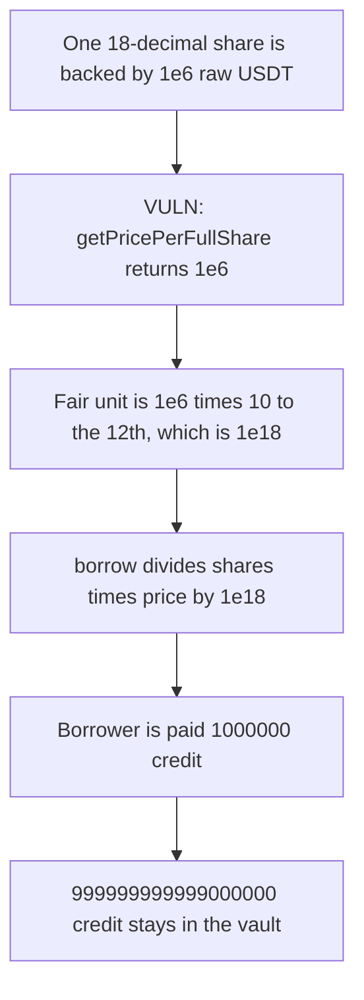

# Narwhal vault — share price flips from 1e18 to 6-decimal units

> **Vulnerability classes:** vuln/logic/price-calculation

<!-- non-defihacklabs -->
<!-- source-auditvault: https://github.com/Auditware/AuditVault/blob/main/findings/44679-methods-returning-price-in-the-wrong-units-zokyo-none-narwha.md -->
<!-- date: 2023-06 -->

## Key info

| | |
|---|---|
| **Protocol** | Narwhal Finance |
| **Finding** | Zokyo 2023-06-09, AuditVault 44679 |
| **Vulnerable code** | `TradingVaultV2.getPricePerFullShare` |
| **Harm** | A borrow against one share pays 1000000 credit. The price converted into the 1e18 unit pays 1000000000000000000. |
| **Chain** | local synthetic |

## TL;DR

`getPricePerFullShare` returns 1e18 when `totalSupply` is zero and `balance * 1e18 / totalSupply` otherwise. One 18-decimal share backed by 1 USDT (1e6 raw) makes that second value 1e6. `borrow` does `shares * price / 1e18`, which is the division that matches a 1e18 price. It pays 1e6 credit instead of 1e18. The control multiplies the raw price by `10**(18 - 6)` before the same division and pays 1e18.

## The vulnerable code

```solidity
function getPricePerFullShare() public view returns (uint256) {
    if (totalSupply == 0) {
        return 1e18;
    }
    // @> VULN: non-zero supply returns a 6-decimal USDT unit, not the 1e18 unit
    return (balance() * 1e18) / totalSupply;
}

function borrow(uint256 shares) external {
    uint256 price = getPricePerFullShare();
    uint256 creditOut = (shares * price) / 1e18;
    credit.transfer(msg.sender, creditOut);
}
```

`balance()` is the USDT balance, 6 decimals. `totalSupply` is the 18-decimal vault share supply.

## Root cause

The zero-supply branch hardcodes an 18-decimal price. The live branch mixes a 6-decimal balance into that same 1e18 scale and stops there. Callers that divide by 1e18, matching the zero-supply unit, are short by `10**12`.

## Preconditions

The vault has already issued one full share, so `totalSupply` is 1e18 and the USDT balance is 1e6. The borrower posts that one share. The vault holds 1e18 of 18-decimal credit, which is what the converted price would release.

## Attack walkthrough

1. The vault is seated with 1e18 shares and 1e6 raw USDT.
2. `getPricePerFullShare` takes the non-zero branch and returns 1e6. Scaling by `10**12` produces the fair 1e18 price.
3. The vault is funded with 1e18 credit.
4. `borrow(1e18)` computes `1e18 * 1e6 / 1e18` and transfers 1e6 credit.
5. `999999999999000000` credit stays in the vault.

The control converts the price with `price * 10**(18 - USDT_DECIMALS)` and the same borrow pays 1e18.

## Diagrams



## Impact

The borrower receives 1000000 credit instead of 1000000000000000000. The difference stays in the vault. Any mint or borrow that treats the live price as the 1e18 unit used at zero supply is short by the same 12 decimal places.

## Remediation

Return one unit from both branches. For the 1e18 unit, scale the live price by `10**(18 - USDT.decimals())` before callers divide by 1e18. For a 6-decimal unit, return `10**USDT.decimals()` when supply is zero.

## How to reproduce

```bash
cd 44679-methods-returning-price-in-the-wrong-units-zokyo-none-narwha_exp
forge test -vv
```

## Sources

- AuditVault finding: https://github.com/Auditware/AuditVault/blob/main/findings/44679-methods-returning-price-in-the-wrong-units-zokyo-none-narwha.md
- Zokyo report: https://github.com/solodit/solodit_content/blob/main/reports/Zokyo/2023-06-09-Narwhal Finance.md
- Vulnerable function: `TradingVaultV2.getPricePerFullShare`
