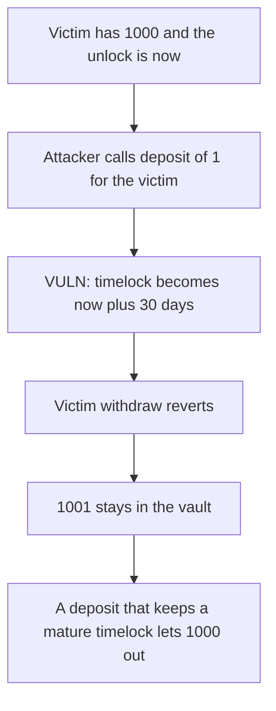

# Vaultka — a 1-unit deposit resets the victim's unlock

> **Vulnerability classes:** vuln/dos/frozen-funds · vuln/governance/timelock-bypass

<!-- non-defihacklabs -->
<!-- source-auditvault: https://github.com/Auditware/AuditVault/blob/main/findings/44897-an-attacker-can-make-victims-deposit-be-locked-forever-zokyo.md -->
<!-- date: 2023-08 -->

## Key info

| | |
|---|---|
| **Protocol** | Vaultka |
| **Finding** | Zokyo, August 2023, AuditVault 44897 |
| **Vulnerable code** | `Water.deposit` writes `userTimelock[receiver]` |
| **Harm** | The victim's 1000 stays in the vault. Withdraw reverts for another 30 days. |
| **Chain** | local synthetic (audited Ethereum contracts) |

## TL;DR

`deposit(amount, receiver)` always sets `userTimelock[receiver]` to `block.timestamp + lockTime`. It does not matter that `receiver` already has a deposit whose lock has elapsed.

The victim has 1000 in the vault and the unlock time is the current timestamp, so `withdraw` would succeed. The attacker deposits 1 with `receiver` set to the victim. The unlock moves 30 days forward. The victim's withdraw reverts. The vault still holds 1001, and the victim's wallet is unchanged.

`depositFixed` leaves a non-zero timelock alone. After that deposit the victim withdraws 1000.

## The vulnerable code

```solidity
token.transferFrom(msg.sender, address(this), amount);
assets[receiver] += amount;
// @> VULN: depositing for receiver resets their unlock to now + lockTime.
userTimelock[receiver] = block.timestamp + lockTime;
```

`withdraw` then requires `block.timestamp >= userTimelock[msg.sender]`.

## Root cause

The timelock is per receiver, and every deposit overwrites it with a full `lockTime` measured from now. A deposit made for someone else is enough. Repeating a 1-unit deposit before the new unlock keeps the funds frozen. `lockTime` here is 30 days.

## Preconditions

The victim's earlier deposit has matured: assets are 1000 and `userTimelock` equals the current timestamp. The attacker has 1 unit and approval. One transaction. The maturity is the starting state, not a second warp inside `run`.

## Attack walkthrough

1. The vault holds the victim's 1000. `seedMatured` records assets 1000 and a timelock of `block.timestamp`.
2. That timelock is not in the future, and assets are 1000.
3. The attacker approves 1 and calls `deposit(1, victim)`.
4. `userTimelock` becomes `block.timestamp + 30 days`.
5. The victim's `withdraw(1000)` reverts. Assets are 1001. The victim received 0.

Control calls `depositFixed(1, victim)` on a mature timelock. The timelock stays at `block.timestamp`. `withdraw(1000)` pays the victim 1000.

## Diagrams



## Impact

The victim cannot withdraw 1000. Each further 1-unit deposit from anyone resets the same timer, so the freeze lasts as long as the attacker keeps paying the dust.

## Remediation

Stop taking a `receiver` other than the caller, or do not extend a timelock that is already set.

## How to reproduce

```bash
cd 44897-an-attacker-can-make-victims-deposit-be-locked-forever-zokyo_exp
forge test -vv
```

## Sources

- AuditVault finding: https://github.com/Auditware/AuditVault/blob/main/findings/44897-an-attacker-can-make-victims-deposit-be-locked-forever-zokyo.md
- Zokyo report: https://github.com/solodit/solodit_content/blob/main/reports/Zokyo/2023-08-30-Vaultka.md
- `Water.sol` `deposit`, as described in that report. `lockTime` and the `userTimelock[receiver] = block.timestamp + lockTime` write are the blamed lines.
