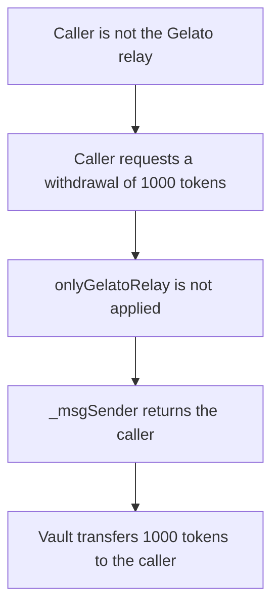

# Tradable Side Vault — `withdrawalRequestForUser` has no `onlyGelatoRelay`, so any caller is paid

> **Vulnerability classes:** vuln/access-control/missing-modifier · vuln/logic/missing-check

<!-- non-defihacklabs -->
<!-- source-auditvault: https://github.com/Auditware/AuditVault/blob/main/findings/44920-missing-onlygelatorelay-modifier-zokyo-none-tradable-markdow.md -->
<!-- date: 2023-09 -->

## Key info

| Field | Value |
|---|---|
| **Loss** | 1000 tokens paid from the vault to a caller that is not the Gelato relay |
| **Vulnerable contract** | `TradableSideVault.withdrawalRequestForUser` |
| **Attacker EOA** | `0x1111111111111111111111111111111111111111` |
| **Attack contract** | `Exploit` |
| **Attack tx** | `Exploit.run()` |
| **Chain / block / date** | Ethereum model · block 0 · 2023-09 |
| **Compiler** | solc 0.8.27, cancun, via IR |
| **Bug class** | Relay-only function is missing its modifier |

## TL;DR

`stakingAccountDepositForUser`, `stakeFromMarginAccountForUser`, and `withdrawalRequestForUser` are the Gelato entry points. They take the user from `_msgSender()`. On this codebase `_msgSender()` is OpenZeppelin `Context` and returns `msg.sender`. None of the three functions has `onlyGelatoRelay`. Any address can call `withdrawalRequestForUser` and the vault transfers the requested amount to that address. A call for 1000 tokens empties the vault. The same call on a vault that adds `onlyGelatoRelay` reverts with `onlyGelatoRelay`, and the 1000 tokens stay.

## Background

Zokyo reviewed Tradable in September 2023. The side vault is supposed to accept gasless withdrawals through Gelato. A sibling finding in the same report says the project uses `GelatoRelayContext` incorrectly and that `_msgSender()` comes from `Context.sol`, which returns `msg.sender` rather than an ERC-2771 original sender. The missing-modifier finding is separate: the ForUser functions were given their own entry points so the relay could call them, and those entry points were never restricted to the relay.

The production `withdrawalRequest` encodes a cross-chain `marginAccountWithdrawal` for the user and the amount. This reduction pays that withdrawal in the same transaction, from the vault's token balance to `_msgSender()`, so the missing modifier shows up as a token movement. The function signature and the missing modifier are the audited surface. `stakingAccountDepositForUser` and `stakeFromMarginAccountForUser` have the same missing modifier and are not given a second transfer here.

## The vulnerable code

```solidity
function withdrawalRequestForUser(
    WithdrawalType withdrawalType,
    address withdrawalToken,
    uint256 amount
) external {
    address user = _msgSender();
    require(
        withdrawalType == WithdrawalType.Stake || withdrawalType == WithdrawalType.Margin,
        "type"
    );
    require(amount > 0, "amount");
    MockToken(withdrawalToken).transfer(user, amount);
}

function _msgSender() internal view returns (address) {
    // @> VULN: missing onlyGelatoRelay, Context returns the caller so any caller is paid
    return msg.sender;
}
```

The fix is the modifier the report asks for:

```diff
+    modifier onlyGelatoRelay() {
+        require(msg.sender == gelato, "onlyGelatoRelay");
+        _;
+    }
     function withdrawalRequestForUser(
         WithdrawalType withdrawalType,
         address withdrawalToken,
         uint256 amount
-    ) external {
+    ) external onlyGelatoRelay {
```

## Root cause

The ForUser functions exist so a relay can submit a user's action. The only difference from the direct functions is `_msgSender()`. Without `onlyGelatoRelay`, that difference does not restrict the caller. `_msgSender()` returns the caller, and the body pays `amount` to that address out of the vault. There is no check that the caller deposited `amount`, and there is no check that the caller is Gelato.

## Preconditions

- The vault holds 1000 tokens. That is the balance a withdrawal pays out of.
- `gelato` is set to a relay address. The caller of `run()` is not that address.
- The caller passes `WithdrawalType.Margin` and `amount` of 1000.

## Attack walkthrough

1. The exploit checks it is not the relay stored on the vault.
2. It calls `withdrawalRequestForUser(Margin, token, 1000 ether)`.
3. `_msgSender()` returns the exploit. The type and amount checks pass.
4. The vault transfers 1000 tokens to the exploit. The vault balance is 0.

## Diagrams



## Impact

An address that is not Gelato receives 1000 tokens from the vault. The vault balance goes from 1000 to 0. The control vault uses the same function with `onlyGelatoRelay`. The same caller and the same arguments revert with `onlyGelatoRelay`. The vault still holds 1000 tokens and the caller holds 0.

## PoC

```bash
cd 44920-missing-onlygelatorelay-modifier-zokyo-none-tradable-markdow_exp
forge test -vv
```

`test_exploit_any_caller_withdraws` asserts the caller holds 1000 tokens, the vault holds 0, and the caller is not the relay. `test_control_restricts_caller` asserts the fixed function reverts with `onlyGelatoRelay` and the vault still holds 1000 tokens.

## Sources

- AuditVault finding: https://github.com/Auditware/AuditVault/blob/main/findings/44920-missing-onlygelatorelay-modifier-zokyo-none-tradable-markdow.md
- Zokyo report: https://github.com/solodit/solodit_content/blob/main/reports/Zokyo/2023-09-01-Tradable.md
- Reviewed contract: `TradableSideVault.withdrawalRequestForUser` in that report
