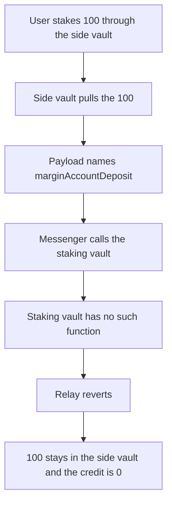

# Tradable — side-vault stake encodes the wrong function

> **Vulnerability classes:** vuln/bridge/missing-validation · vuln/logic/wrong-condition

> **Reproduction:** a self-contained Foundry PoC that compiles and runs offline
> with only `forge-std` — no fork and no RPC. Trace: [output.txt](output.txt).
> PoC: [test/44921-methods-related-to-staking-on-sidevault-contract-encode-inco_exp.sol](test/44921-methods-related-to-staking-on-sidevault-contract-encode-inco_exp.sol).

<!-- non-defihacklabs -->
<!-- source-auditvault: https://github.com/Auditware/AuditVault/blob/main/findings/44921-methods-related-to-staking-on-sidevault-contract-encode-inco.md -->
<!-- date: 2023-09 -->

---

## Key info

| | |
|---|---|
| **Impact** | **HIGH** — a stake of **100** reverts on the base staking vault. The staking vault credits **0** and the **100** stays in the side vault |
| **Protocol** | Tradable `SideVault.stakingAccountDeposit` |
| **Vulnerable code** | `abi.encodeWithSignature("marginAccountDeposit(address,(address,uint8,bool),uint256)", ...)` |
| **Bug class** | The cross-chain stake names a function the staking vault does not implement |
| **Finding** | Zokyo — Tradable, 1 September 2023 · id 44921 |
| **Report** | [Zokyo Tradable report](https://github.com/solodit/solodit_content/blob/main/reports/Zokyo/2023-09-01-Tradable.md) |
| **Source** | [AuditVault finding](https://github.com/Auditware/AuditVault/blob/main/findings/44921-methods-related-to-staking-on-sidevault-contract-encode-inco.md) |
| **Status** | Resolved by encoding the staking vault's own function. Reproduced here as a local synthetic. |
| **Compiler** | solc 0.8.27, cancun, via IR |

---

## TL;DR

`stakingAccountDeposit` pulls the user's tokens into the side vault and builds a message for `dstBaseStakingVault`. The inner signature is `marginAccountDeposit(address,(address,uint8,bool),uint256)`.

The staking vault implements `stakingAccountDeposit`, not `marginAccountDeposit`. The messenger's call returns false and the relay reverts. The side vault catches that revert. The user is credited **0** on the staking vault, and the **100** tokens remain on the side vault.

`run()` does not warp.

## The vulnerable code

```solidity
bytes memory payload = abi.encode(
    "md",
    dstBaseStakingVault,
    abi.encodeWithSignature(
        "marginAccountDeposit(address,(address,uint8,bool),uint256)", // @> VULN
        msg.sender,
        getAcceptedTokenInfo(address(token)),
        amount
    )
);
```

The fixed payload uses `stakingAccountDeposit(address,(address,uint8,bool),uint256)`. The side vault approves the staking vault, the relay succeeds, the staking vault pulls the **100**, and `staked[user]` becomes **100**.

## Root cause

The side vault and the margin vault do not share a deposit function. The stake path was encoded with the margin selector and aimed at the staking vault. The selector does not exist there, so every stake through this function reverts at the destination.

## Preconditions

- The destination address is the staking vault.
- The staking vault implements `stakingAccountDeposit` and does not implement `marginAccountDeposit`.
- The user has **100** tokens and has approved the side vault.
- No timestamp change happens inside `run()`.

## Attack walkthrough

1. The user calls `stakingAccountDeposit(100)`. The side vault pulls the **100**.
2. The payload's inner signature is `marginAccountDeposit(...)`.
3. The messenger calls the staking vault with that calldata. The call returns false.
4. The messenger reverts. The side vault's low-level call records failure and returns.
5. The side vault still holds **100**. `staked[user]` on the staking vault is **0**.

Control: the same amount with `stakingAccountDeposit(...)` encoded instead. The relay succeeds, the staking vault's balance is **100**, the user's staked balance is **100**, and the side vault is left at **0**.

## Diagrams



## Impact

The user cannot stake. **100** tokens sit in the side vault, and the staking vault records a credit of **0**. The same amount with the staking selector is credited in full and the tokens move to the staking vault.

## Remediation

Encode `stakingAccountDeposit(address,(address,uint8,bool),uint256)` when the destination is the staking vault. Keep `marginAccountDeposit` for the margin vault only.

## Sources

- [AuditVault finding 44921](https://github.com/Auditware/AuditVault/blob/main/findings/44921-methods-related-to-staking-on-sidevault-contract-encode-inco.md)
- [Zokyo Tradable report, 1 September 2023](https://github.com/solodit/solodit_content/blob/main/reports/Zokyo/2023-09-01-Tradable.md)

### Taxonomy

- `severity/high`
- `vuln/bridge/missing-validation`
- `vuln/logic/wrong-condition`
