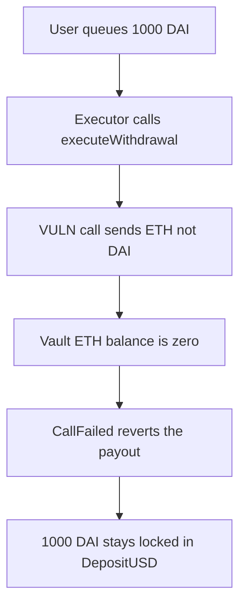

# Nexus: executeWithdrawal sends ETH and locks the deposited DAI

> **Vulnerability classes:** `vuln/logic/incorrect-state-transition` · `vuln/dos/frozen-funds`

<!-- non-defihacklabs -->
<!-- source-auditvault: https://github.com/Auditware/AuditVault/blob/main/findings/44978-c-01-wrong-token-transfer-in-executewithdrawal-pashov-audit.md -->
<!-- date: 2024-11 -->

## Key info

| Field | Value |
|---|---|
| **Loss** | 1000 DAI locked in DepositUSD. The receiver gets no DAI and no ETH |
| **Vulnerable contract** | `DepositUSD.executeWithdrawal` |
| **Attacker EOA** | `0x1111111111111111111111111111111111111111` |
| **Attack contract** | `Exploit` |
| **Attack tx** | `Exploit.run()` |
| **Chain / block / date** | Ethereum model · block 0 · 2024-11 |
| **Compiler** | solc 0.8.27, cancun |
| **Bug class** | Stablecoin withdrawal is an ETH value call |

## TL;DR

`DepositUSD.executeWithdrawal` pays a queued USD withdrawal with `call{value: amount}`. The contract holds DAI, not ETH. The call fails, `CallFailed` reverts, and the 1000 DAI never leaves the vault. The receiver's DAI and ETH balances stay zero.

## Background

Pashov Audit Group's 29 November 2024 Nexus review, finding C-01. Users deposit a stablecoin such as DAI or sDAI. `executeWithdrawal` is supposed to send that token back. The implementation forwards the stored amount as native value instead.

## The vulnerable code

```solidity
(bool success, bytes memory returndata) = _receiver.call{value: withdrawals[_receiver][_hash].amount, gas: 10000}(""); // @> VULN: sends ETH instead of the deposited USD token
// FIX: usd.transfer(_receiver, withdrawals[_receiver][_hash].amount);
if (!success) {
    if (returndata.length == 0) revert CallFailed();
```

The fixed path is `executeWithdrawalFixed`, which `usd.transfer`s the same amount. The control test pays the receiver 1000 DAI and leaves the vault empty.

## Root cause

The payout asset does not match the asset that was deposited. The amount field is reused as an ETH value. A vault that was never funded with ETH cannot complete the call, and the failure path reverts the whole withdrawal instead of transferring the token.

## Preconditions

- A user has queued a withdrawal of 1000 DAI. The DAI sits on `DepositUSD`.
- The caller is `strategyExecutor`.
- The contract's ETH balance is zero.

## Attack walkthrough

1. The user approves and queues 1000 DAI for a receiver.
2. The executor calls `executeWithdrawal`.
3. The sender check passes.
4. The contract attempts an ETH call of 1000. It has no ETH, so the call returns false.
5. Empty returndata becomes `CallFailed`. The DAI is not transferred.
6. After the revert is caught, the vault still holds 1000 DAI. The receiver holds none.

## Diagrams



## Impact

The depositor's 1000 DAI is locked. The intended receiver receives neither the stablecoin nor ETH. Every later call to the same function hits the same empty-ETH path, so the queued balance is not recoverable through `executeWithdrawal`. The fixed function transfers the DAI and clears the queue.

## Remediation

Transfer `usd` for `withdrawals[receiver][hash].amount`. Do not use the token amount as `call{value}`.

## How to reproduce

```bash
cd 44978-c-01-wrong-token-transfer-in-executewithdrawal-pashov-audit_exp
forge test -vv
```

`test_executeWithdrawal_locks_dai` asserts the revert, a 1000 DAI balance on the vault, and a zero DAI balance on the receiver. `test_control_fixed_sends_dai` asserts the token transfer pays the receiver. Captured output is `output.txt`.

## Sources

- AuditVault finding: https://github.com/Auditware/AuditVault/blob/main/findings/44978-c-01-wrong-token-transfer-in-executewithdrawal-pashov-audit.md
- Report: https://github.com/pashov/audits/blob/master/team/md/Nexus-security-review_2024-11-29.md
- Blamed function: `DepositUSD.executeWithdrawal`, as quoted in the finding. The surrounding queue is the minimum scaffolding that gives the call a DAI balance to lock.
