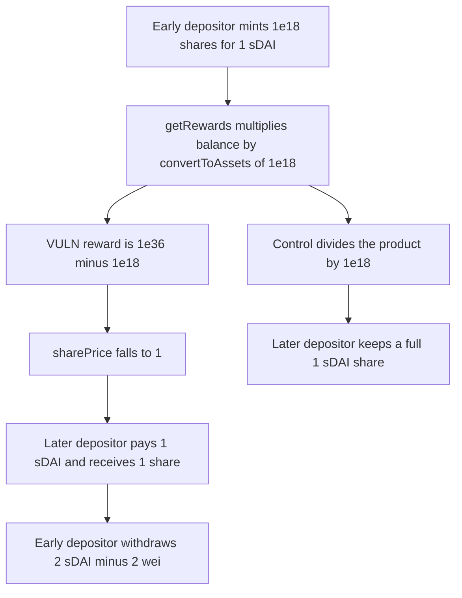

# Nexus: getRewards is scaled by 1e18, so a later depositor gets 1 share and the early depositor redeems both

> **Vulnerability classes:** `vuln/arithmetic/decimal-mismatch` · `vuln/logic/reward-calculation`

<!-- non-defihacklabs -->
<!-- source-auditvault: https://github.com/Auditware/AuditVault/blob/main/findings/44979-c-02-incorrect-reward-calculation-due-to-decimal-handling-pa.md -->
<!-- date: 2024-11 -->

## Key info

| Field | Value |
|---|---|
| **Loss** | Later depositor pays 1 sDAI and receives 1 share. Early depositor withdraws 1.999999999999999998 sDAI |
| **Vulnerable contract** | `DSRStrategy.getRewards` |
| **Attacker EOA** | `0x1111111111111111111111111111111111111111` (the early depositor) |
| **Attack contract** | `Exploit` |
| **Attack tx** | `Exploit.run()` |
| **Chain / block / date** | Ethereum model · block 0 · 2024-11 |
| **Compiler** | solc 0.8.27, cancun, via IR |
| **Bug class** | `balance * convertToAssets(1e18)` is missing `/ 1e18` |

## TL;DR

`getRewards` multiplies the vault's sDAI balance by `convertToAssets(1e18)` and does not divide by `1e18`. At a 1:1 rate that product is `1e36` for a 1 sDAI balance. `DepositUSD` folds the result into `sharePrice`, which falls from `1e18` to 1. The next depositor of 1 sDAI receives 1 share. The early depositor, who holds `1e18` shares out of `1e18 + 1`, withdraws `2e18 - 2` wei and keeps the later deposit. Dividing by `1e18` leaves rewards at 0, `sharePrice` at `1e18`, and the later depositor with a full 1 sDAI of shares.

## Background

Pashov Audit Group's Nexus review of 29 November 2024, finding C-02, against `Nexus-2023/NativeYield` at `a2c729ef6523d622510b17d2f87533d66cd70090`. `DSRStrategy.getRewards` is what `DepositUSD.updateRewards` uses before it recomputes `sharePrice`. The report says the missing division inflates rewards by `1e18` and later depositors receive fewer shares than they should.

## The vulnerable code

```solidity
uint256 balance_strategy = _strategyBalance.valueDeposited
    + _strategyBalance.rewardsEarned - _strategyBalance.valueWithdrawn;
// @> VULN: balance * convertToAssets(1e18) is 1e18 times too large because the rate is not divided back out
uint256 assetBalance = token.balanceOf(receiver) * SDai(address(token)).convertToAssets(1e18);
if (assetBalance > balance_strategy) {
    return assetBalance - balance_strategy;
}
```

The report's fix:

```diff
- uint256 assetBalance = IERC20(TOKEN_ADDRESS).balanceOf(receiver) * sDAI(TOKEN_ADDRESS).convertToAssets(1e18);
+ uint256 assetBalance = IERC20(TOKEN_ADDRESS).balanceOf(receiver) * sDAI(TOKEN_ADDRESS).convertToAssets(1e18) / 1e18;
```

`sharePrice` in this reduction is the report's formula, `nMinted * 1e18 / (deposited - withdrawn + rewardsClaimed)`. A deposit after the first one mints `sharePrice * assets / 1e18` shares.

## Root cause

`convertToAssets(1e18)` is the asset value of one 18-decimal share. Multiplying a raw token balance by that number counts the balance in a 36-decimal unit. The strategy balance is still in 18 decimals, so the subtraction reports about `1e18` times the real balance as newly earned rewards. Those rewards go into the share-price denominator and crush the shares minted for everyone who deposits afterward.

## Preconditions

- The sDAI rate is 1:1, so `convertToAssets(1e18)` returns `1e18`. The bug does not need a yield rate above 1.
- The early depositor deposits 1 sDAI while `nMinted` is 0 and receives `1e18` shares.
- `updateRewards` runs before the second deposit. That is the call that copies `getRewards` into `rewardsClaimed`.
- The later depositor deposits another 1 sDAI.

## Attack walkthrough

1. The early depositor approves and deposits 1 sDAI. The vault mints `1e18` shares because supply was 0.
2. `updateRewards` calls `getRewards`. The vault balance is 1 sDAI, the product is `1e36`, and the returned reward is `1e36 - 1e18`.
3. `sharePrice` becomes `1e18 * 1e18 / 1e36`, which is 1.
4. The later depositor deposits 1 sDAI. Shares are `1 * 1e18 / 1e18`, so they receive 1 share.
5. The early depositor withdraws `1e18` shares against a real balance of 2 sDAI and a supply of `1e18 + 1`. The payout is `2e18 * 1e18 / (1e18 + 1)`, which is `1999999999999999998` wei.
6. The vault is left with 2 wei. The control divides by `1e18`, rewards stay 0, and the later depositor's 1 sDAI is still in the vault after the early depositor withdraws only their own 1 sDAI.

## Diagrams



## Impact

The later depositor paid 1 sDAI and owns 1 share out of `1e18 + 1`. The early depositor withdraws `1.999999999999999998` sDAI. Relative to the 1 sDAI they deposited, that is a gain of `0.999999999999999998` sDAI, taken from the later deposit. The control leaves the later depositor's 1 sDAI in the vault.

## Remediation

Divide `balanceOf(receiver) * convertToAssets(1e18)` by `1e18` before comparing it with `balance_strategy`, as in the C-02 diff.

## How to reproduce

```bash
cd 44979-c-02-incorrect-reward-calculation-due-to-decimal-handling-pa_exp
forge test -vv
```

`test_exploit_late_depositor_gets_1_share_and_early_redeems_both` asserts `sharePrice` is 1, the later depositor has 1 share, and the early depositor holds `2e18 - 2` wei. `test_control_divide_by_1e18_gives_the_late_depositor_a_full_share` asserts a full share and a 1 sDAI withdrawal for the early depositor. Captured output is `output.txt`.

## Sources

- AuditVault finding: https://github.com/Auditware/AuditVault/blob/main/findings/44979-c-02-incorrect-reward-calculation-due-to-decimal-handling-pa.md
- Pashov report: https://github.com/pashov/audits/blob/master/team/md/Nexus-security-review_2024-11-29.md
- Reviewed tree: https://github.com/Nexus-2023/NativeYield/tree/a2c729ef6523d622510b17d2f87533d66cd70090
