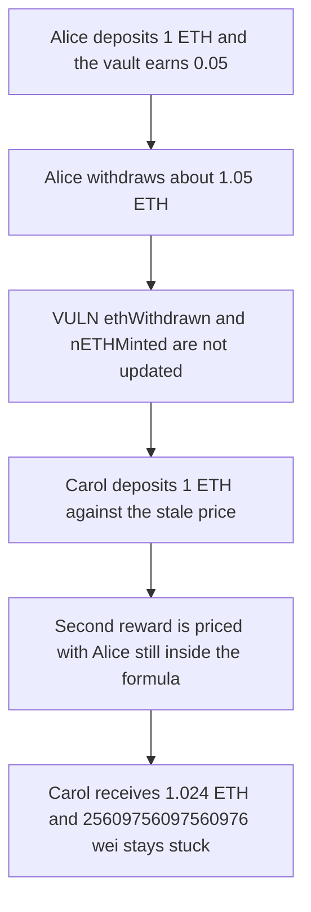

# Nexus: withdrawals are invisible to the share price, so Carol is underpaid

> **Vulnerability classes:** `vuln/logic/price-calculation` · `vuln/logic/state-update`

<!-- non-defihacklabs -->
<!-- source-auditvault: https://github.com/Auditware/AuditVault/blob/main/findings/44980-c-03-inaccurate-share-price-due-to-lack-of-withdrawal-tracki.md -->
<!-- date: 2024-11 -->

## Key info

| Field | Value |
|---|---|
| **Loss** | Carol receives 1024390243902439024 instead of her 1 ETH plus the 0.05 ETH reward. 25609756097560976 wei stays in the vault |
| **Vulnerable contract** | `DepositETH._updateSharePrice` and `DepositETH.withdraw` |
| **Attacker EOA** | `0x1111111111111111111111111111111111111111` |
| **Attack contract** | `Exploit` |
| **Attack tx** | `Exploit.run()` |
| **Chain / block / date** | Ethereum model · block 0 · 2024-11 |
| **Compiler** | solc 0.8.27, cancun, via IR |

## TL;DR

`withdraw` pays the asset amount and does not add it to `ethWithdrawn` or burn the shares in `nETHMinted`. The next share price still divides by `ethDeposited - ethWithdrawn + rewardsClaimed`. After Alice exits, her shares and her ETH are still inside that fraction. Carol deposits 1 ETH, earns a second 0.05 ETH, and is quoted 1.024 ETH instead of 1.05 ETH. The difference remains in the contract. Updating the two counters pays Carol the remaining rewards and leaves only the 1 wei of rounding dust.

## The vulnerable code

```solidity
sharePrice = (nETHMinted) * BASE / (ethDeposited - ethWithdrawn + rewardsClaimed); // @> VULN: ethWithdrawn stays 0 and nETHMinted still counts exited shares
```

```solidity
amount = shares * BASE / sharePrice;
sharesOf[msg.sender] -= shares;
// FIX: ethWithdrawn += amount; nETHMinted -= shares;
token.transfer(msg.sender, amount);
```

The report's scenario uses a 0.05 ETH reward. Integer division makes Alice's payout 1050000000000000001, so the run mints 1 wei of dust so that transfer can succeed. The dust is not the bug. The control, which writes both counters, pays Carol `1.05 ETH - 1 wei` and leaves that single wei.

## Root cause

The price formula treats withdrawn assets and burned shares as still present because the withdraw path never updates them. The second depositor is priced against a balance the contract no longer has.

## Preconditions

- `sharePrice` starts at 1e18 and the first deposit mints 1 share per 1 asset.
- Rewards are posted with `earn`, which is the report's `rewardsClaimed` update. No time lock is required.

## Attack walkthrough

1. Alice deposits 1 ETH and receives 1e18 shares.
2. The vault earns 0.05 ETH. `sharePrice` becomes 952380952380952380.
3. Alice withdraws 1050000000000000001. `ethWithdrawn` stays 0.
4. Carol deposits 1 ETH and receives 952380952380952380 shares.
5. The vault earns another 0.05 ETH. The price uses Alice's ghost shares.
6. Carol withdraws 1024390243902439024. The vault keeps 25609756097560976.

## Diagrams



## Impact

Carol, the only remaining depositor, does not receive the reward that accrued while she held the live shares. The shortfall is stuck in `DepositETH`. The same missing updates apply to the report's `DepositUSD` path. The numbers above are the report's 0.05 ETH scenario under integer division.

## Remediation

Before the transfer, add `ethWithdrawn += amount` and `nETHMinted -= shares`, which is the control contract. Carol then receives the assets that are actually still in the vault.

## How to reproduce

```bash
cd 44980-c-03-inaccurate-share-price-due-to-lack-of-withdrawal-tracki_exp
forge test -vv
```

`test_exploit_carol_is_underpaid_and_rewards_stick` asserts Carol's 1.024 ETH payout, a zero `ethWithdrawn`, and the stuck remainder. `test_control_tracking_withdrawals_pays_carol_the_full_reward` asserts the tracked path pays Carol `1.05 ETH - 1 wei`.

## Sources

- AuditVault finding: https://github.com/Auditware/AuditVault/blob/main/findings/44980-c-03-inaccurate-share-price-due-to-lack-of-withdrawal-tracki.md
- Pashov report: https://github.com/pashov/audits/blob/master/team/md/Nexus-security-review_2024-11-29.md
- The share-price formula and the seven-step scenario are quoted in the finding. The reduction keeps that formula.
