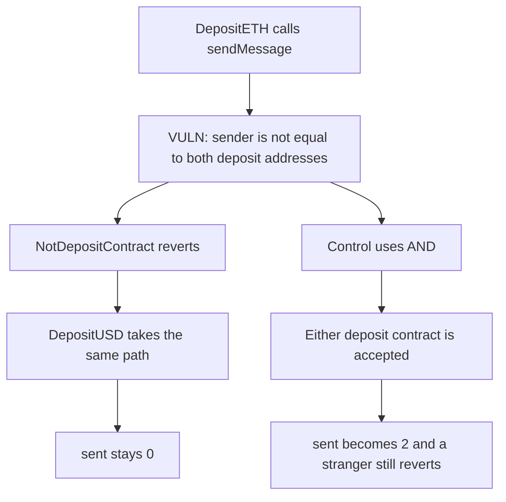

# Nexus: onlyDeposit reverts for both deposit contracts

> **Vulnerability classes:** `vuln/access-control/broken-logic` · `vuln/logic/wrong-condition`

<!-- non-defihacklabs -->
<!-- source-auditvault: https://github.com/Auditware/AuditVault/blob/main/findings/44981-h-01-incorrect-access-control-logic-in-onlydeposit-modifier.md -->
<!-- date: 2024-11 -->

## Key info

| Field | Value |
|---|---|
| **Loss** | `sendMessage` reverts for DepositETH and DepositUSD. No bridge message is delivered. `sent` stays 0 |
| **Vulnerable contract** | `Messaging.onlyDeposit` |
| **Attacker EOA** | `0x1111111111111111111111111111111111111111` |
| **Attack contract** | `Exploit` |
| **Attack tx** | `Exploit.run()` |
| **Chain / block / date** | Ethereum model · block 0 · 2024-11 |
| **Compiler** | solc 0.8.27, cancun, via IR |

## TL;DR

`onlyDeposit` uses `msg.sender != depositETH || msg.sender != depositUSD`. Every address fails at least one of those comparisons, including the two deposit contracts the modifier exists to allow. Both `bridge` calls revert. `Messaging.sent` stays 0, so the destination never sees a deposit. Replacing `||` with `&&` lets either deposit contract through and still rejects a stranger.

## The vulnerable code

```solidity
modifier onlyDeposit() {
    attempts++;
    if (fixedMode) {
        if (msg.sender != depositETH && msg.sender != depositUSD) revert NotDepositContract(msg.sender);
    } else if (msg.sender != depositETH || msg.sender != depositUSD) {
        revert NotDepositContract(msg.sender); // @> VULN: OR is true for every caller, including both deposit contracts
    }
    _;
}
```

The review's change:

```diff
- if (msg.sender != depositETH || msg.sender != depositUSD) revert NotDepositContract(msg.sender);
+ if (msg.sender != depositETH && msg.sender != depositUSD) revert NotDepositContract(msg.sender);
```

The same OR is present on `Messaging` and `MessagingBera`.

## Root cause

An address cannot equal two different deposit contracts at once. If the caller is DepositETH it is not DepositUSD, so the second comparison is true and the modifier reverts. The same thing happens for DepositUSD. A stranger reverts too, which is why a quick test that only uses an unauthorized caller looks fine.

## Preconditions

- `setDeposits` has recorded the two deposit contracts.
- Each deposit contract calls `sendMessage` from `bridge`. That call is the cross-chain announcement.
- The destination id used here is 101, which the body would accept if the modifier passed.

## Attack walkthrough

1. DepositETH calls `bridge`. The escrow line runs, then `sendMessage`.
2. The modifier increments `attempts` and hits the OR. `NotDepositContract` reverts the call.
3. The low-level call returns false. `sent` is still 0 because the revert rolled the attempt back.
4. DepositUSD takes the same path and also reverts.
5. `run` requires both rejections and `sent == 0`.
6. The control with `&&` delivers both messages and leaves `sent` at 2. A stranger still reverts.

## Diagrams



## Impact

The bridge cannot announce a deposit. Every call from the authorized deposit contracts reverts, so the destination credit stays 0. Users cannot complete the messaging step the deposit contracts exist to perform. This is a liveness break of `sendMessage`, not a permissionless drain. The fixed modifier shows the two intended callers succeed.

## How to reproduce

```bash
cd 44981-h-01-incorrect-access-control-logic-in-onlydeposit-modifier_exp
forge test -vv
```

`test_exploit_both_deposit_contracts_are_rejected` asserts both bridges revert and `sent` is 0. `test_control_and_lets_either_deposit_contract_send` asserts both messages are delivered and a stranger still reverts.

## Sources

- AuditVault finding: https://github.com/Auditware/AuditVault/blob/main/findings/44981-h-01-incorrect-access-control-logic-in-onlydeposit-modifier.md
- Pashov review: https://github.com/pashov/audits/blob/master/team/md/Nexus-security-review_2024-11-29.md
