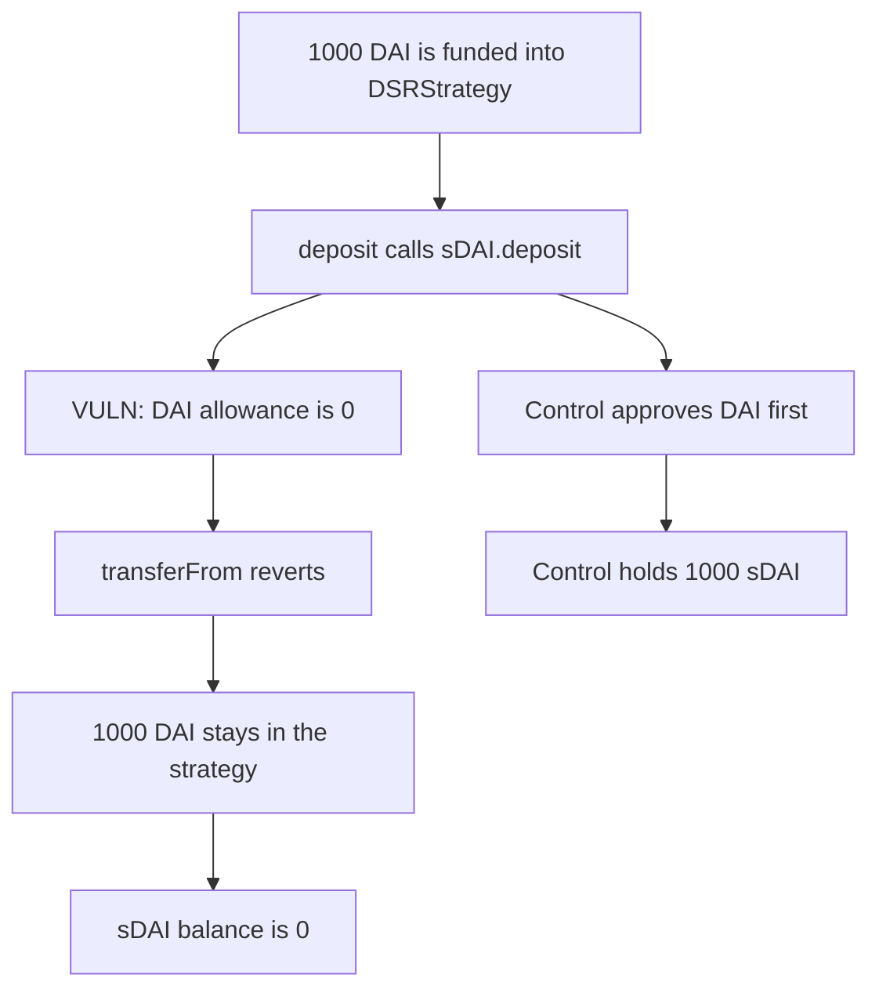

# Nexus: DSRStrategy.deposit never approves DAI, so 1,000 DAI cannot reach sDAI

> **Vulnerability classes:** `vuln/logic/missing-allowance` · `vuln/dos/frozen-funds`

<!-- non-defihacklabs -->
<!-- source-auditvault: https://github.com/Auditware/AuditVault/blob/main/findings/44982-h-02-lack-of-approval-before-depositing-dai-into-dsr-contrac.md -->
<!-- date: 2024-11 -->

## Key info

| Field | Value |
|---|---|
| **Loss** | 1,000 DAI stuck in DSRStrategy. sDAI minted is 0 |
| **Vulnerable contract** | `DSRStrategy.deposit` |
| **Attacker EOA** | `0x1111111111111111111111111111111111111111` |
| **Attack contract** | `Exploit` |
| **Attack tx** | `Exploit.run()` |
| **Chain / block / date** | Ethereum model · block 0 · 2024-11 |
| **Compiler** | solc 0.8.27, cancun, via IR |
| **Bug class** | Missing ERC-20 approval before `sDAI.deposit` pulls DAI |

## TL;DR

`deposit` calls `sDAI.deposit(_value, address(this))` and does not approve DAI. sDAI moves DAI with `transferFrom`, so the call reverts. The strategy already holds 1,000 DAI from `fund()`, the quoted function has no idle-DAI withdraw, and the sDAI balance stays 0. Adding `DAI.approve(sDAI, _value)` before the deposit mints 1,000 sDAI and leaves the strategy with no DAI.

## Background

Pashov Audit Group, Nexus security review dated 2024-11-29, finding H-02. The review's diff is one approval line in front of `sDAI(DSR_DEPOSIT_ADDRESS).deposit`. This reduction uses that function body and an sDAI mock whose `deposit` pulls DAI one-for-one, which is the Pot/sDAI shape the missing approval breaks.

## The vulnerable code

```solidity
function deposit(uint256 _value) public returns (uint256) {
    sdai.deposit(_value, address(this)); // @> VULN: no DAI.approve(sDAI) before deposit, so the pull reverts
    return 100;
}
```

The report's fix:

```diff
 function deposit(uint256 _value) public returns (uint256) {
+    IERC20(DAI_ADDRESS).approve(DSR_DEPOSIT_ADDRESS, _value);
     sDAI(DSR_DEPOSIT_ADDRESS).deposit(_value, address(this));
     return 100;
 }
```

## Root cause

`sDAI.deposit` spends the caller's DAI allowance. The strategy is the caller and its allowance is 0, so every deposit reverts after the DAI has already been transferred into the strategy by a separate `fund`.

## Preconditions

- 1,000 DAI has been transferred into `DSRStrategy`.
- `deposit` is the only path that moves that DAI into sDAI. The quoted function does not send idle DAI back out.
- No privileged role is required to call `deposit`. It is public, as in the report.

## Attack walkthrough

1. The depositor funds 1,000 DAI into the strategy.
2. `deposit(1000)` calls `sDAI.deposit` with no approval.
3. sDAI's `transferFrom` reverts because the allowance is 0.
4. The strategy still holds 1,000 DAI. Its sDAI balance is 0.
5. The control approves DAI, `deposit` returns 100, and the strategy holds 1,000 sDAI.

## Diagrams



## Impact

1,000 DAI sits in the strategy and cannot be deposited into the DSR. No sDAI is minted, so the position earns nothing, and the quoted contract has no withdraw that returns the idle DAI. The control moves the same 1,000 DAI into 1,000 sDAI.

## Remediation

Approve DAI to the sDAI contract for `_value` immediately before `deposit`, as the review diff shows.

## How to reproduce

```bash
cd 44982-h-02-lack-of-approval-before-depositing-dai-into-dsr-contrac_exp
forge test -vv
```

`test_exploit_deposit_reverts_and_dai_sticks` asserts the revert, a 1,000 DAI balance, and a 0 sDAI balance. `test_control_approve_mints_sdai` asserts the approval path returns 100 and mints 1,000 sDAI.

## Sources

- AuditVault finding: https://github.com/Auditware/AuditVault/blob/main/findings/44982-h-02-lack-of-approval-before-depositing-dai-into-dsr-contrac.md
- Pashov review: https://github.com/pashov/audits/blob/master/team/md/Nexus-security-review_2024-11-29.md
- Quoted function: `DSRStrategy.deposit`
