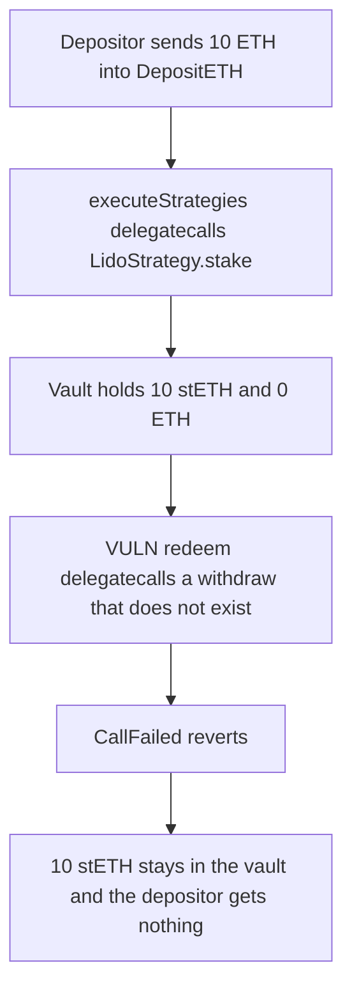

# Nexus: LidoStrategy can stake ETH and cannot return it

> **Vulnerability classes:** `vuln/dos/frozen-funds` · `vuln/logic/missing-check`

<!-- non-defihacklabs -->
<!-- source-auditvault: https://github.com/Auditware/AuditVault/blob/main/findings/44983-h-03-lack-of-withdrawal-functionality-in-strategy-contracts.md -->
<!-- date: 2024-11 -->

## Key info

| Field | Value |
|---|---|
| **Loss** | 10 stETH stuck in DepositETH. The depositor gets 0 ETH back |
| **Vulnerable contract** | `DepositETH.executeStrategies` |
| **Attacker EOA** | `0x1111111111111111111111111111111111111111` |
| **Attack contract** | `Exploit` |
| **Attack tx** | `Exploit.run()` |
| **Chain / block / date** | Ethereum model · block 0 · 2024-11 |
| **Compiler** | solc 0.8.27, cancun, via IR |
| **Bug class** | Strategy delegatecall with no withdraw |

## TL;DR

`DepositETH.executeStrategies` delegatecalls whatever the executor passes, and the Lido strategy only implements `stake`. Staking 10 ETH mints 10 stETH to the vault. The redemption delegatecall to `withdraw` reverts `CallFailed`. The depositor's ETH balance stays 0. A strategy that implements `withdraw` unwraps the stETH back into 10 ETH.

## Background

Pashov Audit Group's Nexus review of 29 November 2024, finding H-03. `LidoStrategy` and `DSRStrategy` take deposits and have no function that returns the asset plus yield. Share redemptions cannot be met.

## The vulnerable code

```solidity
(bool success, bytes memory returndata) =
    _executionData[i].strategy.delegatecall(_executionData[i].executionData); // @> VULN
if (!success) {
    if (returndata.length == 0) revert CallFailed();
}
```

`LidoStrategy.stake` burns the vault's ETH token and mints stETH to the vault, because the delegatecall's `address(this)` is the vault. There is no `withdraw`.

The fix is a `withdraw` that burns stETH and mints the ETH token back, and a redeem path that delegatecalls it.

## Root cause

The only strategy code the vault can run moves assets out of the redeemable token. Nothing moves them back, and a failed delegatecall reverts instead of returning funds.

## Preconditions

- `strategyExecutor` is the caller. The Lido strategy is registered.
- The depositor has approved 10 ETH tokens. The strategy has `stake` and does not have `withdraw`.

## Attack walkthrough

1. Deposit pulls 10 ETH tokens into the vault and mints 10 shares.
2. `stake` runs by delegatecall. The vault's ETH balance becomes 0 and its stETH balance becomes 10.
3. Redeem builds `withdraw(address,address,uint256)` and delegatecalls it.
4. The strategy has no such function. Returndata is empty, so the vault reverts `CallFailed`.
5. The low-level call is caught. stETH is still 10 and the depositor still has 0 ETH.

## Diagrams



## Impact

The depositor cannot redeem. 10 stETH is stuck on `DepositETH` and the ETH token balance of the depositor is 0. The control strategy's `withdraw` returns the 10 ETH token to the vault and burns the stETH.

## How to reproduce

```bash
cd 44983-h-03-lack-of-withdrawal-functionality-in-strategy-contracts_exp
forge test -vv
```

`test_exploit_steth_stuck` asserts the revert, a 10 stETH vault balance, and a 0 ETH depositor balance. `test_control_fixed_strategy_returns_eth` asserts the unwrap. Output is `output.txt`.

## Sources

- AuditVault finding: https://github.com/Auditware/AuditVault/blob/main/findings/44983-h-03-lack-of-withdrawal-functionality-in-strategy-contracts.md
- Report: https://github.com/pashov/audits/blob/master/team/md/Nexus-security-review_2024-11-29.md
