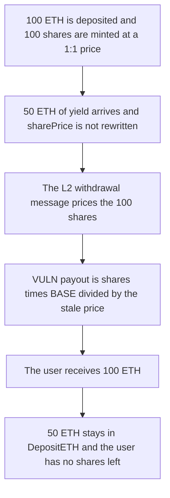

# Nexus: a withdrawal pays 100 ETH of a position that is backed by 150

> **Vulnerability classes:** `vuln/logic/state-update` · `vuln/logic/price-calculation`

<!-- non-defihacklabs -->
<!-- source-auditvault: https://github.com/Auditware/AuditVault/blob/main/findings/44984-h-04-stale-share-price-usage-leading-to-fund-loss-and-unfair.md -->
<!-- date: 2024-11 -->

## Key info

| Field | Value |
|---|---|
| **Loss** | 50 ETH of yield stuck in DepositETH. The withdrawer is paid 100 instead of about 150 |
| **Vulnerable contract** | `DepositETH.messageReceivedL2` |
| **Attacker EOA** | `0x1111111111111111111111111111111111111111` (the depositor) |
| **Attack contract** | `Exploit` |
| **Attack tx** | `Exploit.run()` |
| **Chain / block / date** | Ethereum model · block 0 · 2024-11 |
| **Compiler** | solc 0.8.27, cancun, via IR |
| **Bug class** | sharePrice is not refreshed after yield, and the withdrawal divides by that stale value |

## TL;DR

`DepositETH` prices deposits and L2 withdrawals with a stored `sharePrice` and does not recompute it when Lido yield arrives. A user deposits 100 ETH at a 1:1 price and receives 100 shares. 50 ETH of yield then lands in the contract. `sharePrice` is still `1e18`. The withdrawal pays `shares * BASE / sharePrice`, which is 100 ETH. The contract still holds 50 ETH, and the user has no shares left to claim it. Refreshing `sharePrice` before the withdrawal pays about 150 ETH.

## Background

Pashov Audit Group's 29 November 2024 Nexus review, finding H-04. `DepositETH` and `DepositUSD` convert deposits and withdrawals with `sharePrice`, which is meant to track Lido and sDAI yield. The report shows `_depositETH` and `messageReceivedL2` both reading the stored price. Between a withdrawal request and its execution, rewards can accrue. The execution then uses the old price and the user receives less than the backing of their shares.

## The vulnerable code

```solidity
function _depositETH(address receiver, uint256 _value) internal {
    uint256 nETHShares = (sharePrice * _value) / BASE_POINT; // @> VULN: deposit mints shares from the stale sharePrice
    ethDeposited += _value;
    nETHMinted += nETHShares;
    shares[receiver] += nETHShares;
}
```

```solidity
if (_id == 3) {
    uint256 _valueUSDCWithdraw = _value * BASE_POINT / sharePrice; // @> VULN: withdrawal pays the stale share price
    _withdrawFunds(_receiver, _value, _valueUSDCWithdraw);
}
```

`sharePrice` here is a shares-per-asset index. It starts at `BASE_POINT`. Yield should lower it so each share pays more assets. The withdrawal divides by the old, higher index and underpays.

Refreshing before the payout is the report's recommendation:

```diff
 function messageReceivedL2(uint256 _id, address _receiver, uint256 _value) external {
     if (_id == 3) {
+        sharePrice = nETHMinted * BASE_POINT / asset.balanceOf(address(this));
         uint256 _valueUSDCWithdraw = _value * BASE_POINT / sharePrice;
```

## Root cause

Yield changes the asset balance and nothing writes `sharePrice`. Both the deposit formula and the withdrawal formula trust the stored index. On the way out, a stale high index pays fewer assets than the shares are backed by. Burning the shares at the same time removes the user's claim on what was skipped.

## Preconditions

- `sharePrice` is `1e18` and `BASE_POINT` is `1e18`.
- The user deposits 100 ETH and receives 100 shares.
- 50 ETH of yield is transferred in before the L2 withdrawal, and no one calls the price update.

## Attack walkthrough

1. Deposit 100 ETH. `nETHShares = 1e18 * 100 ETH / 1e18`, so the user holds 100 shares. The vault holds 100 ETH.
2. 50 ETH of yield arrives. The vault holds 150 ETH. `sharePrice` is still `1e18`.
3. `messageReceivedL2` with id 3 prices the 100 shares: `100 ETH * 1e18 / 1e18 = 100 ETH`.
4. The user is paid 100 ETH. `shares` and `nETHMinted` go to 0. The vault still holds 50 ETH.
5. The control calls `updateSharePrice` after the yield. `sharePrice` falls below `1e18`, and the same withdrawal pays more than 150 ETH aside from a few wei of inverse rounding.

## Diagrams



## Impact

The depositor is paid 100 ETH for shares backed by 150 ETH. The 50 ETH of yield stays in `DepositETH`. Because the withdrawal burns the shares, the user has no remaining balance to claim it, and the stored price will keep underpaying anyone else who exits before an update. The refreshed-price control pays the yield back.

## Remediation

Recompute `sharePrice` from `nETHMinted` and the current asset balance at the start of every deposit, withdrawal, and fee quote. That is the change the report asks for. Do not burn shares against a price that has not seen the yield.

## How to reproduce

```bash
cd 44984-h-04-stale-share-price-usage-leading-to-fund-loss-and-unfair_exp
forge test -vv
```

`test_exploit_withdrawal_leaves_50_ether_stuck` asserts the price is still 1:1, the user is paid 100 ETH, and 50 ETH remains with zero shares outstanding. `test_control_refreshed_price_pays_the_yield` asserts a refreshed price pays more than 150 ETH. Captured output is `output.txt`.

## Sources

- AuditVault finding: https://github.com/Auditware/AuditVault/blob/main/findings/44984-h-04-stale-share-price-usage-leading-to-fund-loss-and-unfair.md
- Pashov report: https://github.com/pashov/audits/blob/master/team/md/Nexus-security-review_2024-11-29.md
- Vulnerable lines: the `_depositETH` and `messageReceivedL2` snippets quoted in that report. The finding does not name an audited commit.
