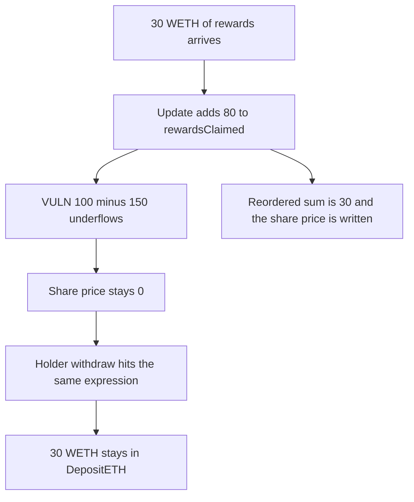

# Nexus: DepositETH share price underflows and 30 WETH of rewards stay locked

> **Vulnerability classes:** `vuln/arithmetic/underflow` · `vuln/logic/price-calculation`

<!-- non-defihacklabs -->
<!-- source-auditvault: https://github.com/Auditware/AuditVault/blob/main/findings/44985-h-05-arithmetic-underflow-in-total-balance-calculation-pasho.md -->
<!-- date: 2024-11 -->

## Key info

| Field | Value |
|---|---|
| **Loss** | 30 WETH stuck in DepositETH; share price never updates and withdraw reverts |
| **Vulnerable contract** | `DepositETH._updateSharePrice` |
| **Attacker EOA** | `0x1111111111111111111111111111111111111111` |
| **Attack contract** | `Exploit` |
| **Attack tx** | `Exploit.run()` |
| **Chain / block / date** | Ethereum model · block 0 · 2024-11 |
| **Compiler** | solc 0.8.27, cancun, via IR |
| **Bug class** | `ethDeposited - ethWithdrawn + rewardsClaimed` subtracts before it adds |

## TL;DR

`_updateSharePrice` computes the ETH balance as `ethDeposited - ethWithdrawn + rewardsClaimed`. Solidity evaluates that left to right. With 100 deposited, 150 withdrawn, and 80 of rewards just claimed, the true balance is 30, but `100 - 150` underflows and the call reverts. The 30 WETH that was delivered as rewards stays in the contract. Withdraw calls the same update and reverts too. Reordering to `ethDeposited + rewardsClaimed - ethWithdrawn` yields 30 and writes the share price.

## Background

Pashov Audit Group, Nexus review dated 2024-11-29, finding H-05. Withdrawals tracked by the protocol include principal and earned rewards, so `ethWithdrawn` grows past `ethDeposited` in ordinary operation. `DepositUSD._updateSharePrice` has the same expression. The report's fix adds the rewards before subtracting the withdrawals, and divides by that total once.

## The vulnerable code

```solidity
rewardsClaimed += _rewardsEarned;
uint256 totalEthBalance = (ethDeposited - ethWithdrawn + rewardsClaimed); // @> VULN
sharePrice = (nETHMinted) * BASE_POINT / (ethDeposited - ethWithdrawn + rewardsClaimed);
```

```diff
- uint256 totalEthBalance = (ethDeposited - ethWithdrawn + rewardsClaimed);
+ uint256 totalEthBalance = ethDeposited + rewardsClaimed - ethWithdrawn;
- sharePrice = (nETHMinted) * BASE_POINT / (ethDeposited - ethWithdrawn + rewardsClaimed);
+ sharePrice = (nETHMinted * BASE_POINT) / totalEthBalance;
```

## Root cause

`+` and `-` have the same precedence and associate left to right. The subtraction is not saved by the rewards that are added afterwards. On 0.8 the underflow reverts instead of wrapping, so every caller of the update, including withdraw, reverts. The contract can be solvent and still be unable to account or to pay out.

## Preconditions

- `ethDeposited` is 100 ether, `ethWithdrawn` is 150 ether, and `nETHMinted` is 100 ether.
- This update adds 80 ether of rewards. `100 + 80 - 150` is 30.
- 30 WETH has been transferred in, which is the solvent balance the reverted update refuses to recognize.

## Attack walkthrough

1. 30 WETH is transferred to DepositETH.
2. `poke(80 ether)` calls `_updateSharePrice`.
3. `100 - 150` reverts. `sharePrice` stays 0.
4. The holder calls `withdraw`.
5. Withdraw passes the shares check and calls the same update.
6. The update reverts again. The holder receives 0. DepositETH still holds 30 WETH.

## Diagrams



## Impact

Holders cannot withdraw. The 30 WETH that represents the solvent balance after rewards stays in DepositETH, and `sharePrice` is never stored. The reordered update records 80 ether of rewards and sets `sharePrice` to `100 ether * 1e18 / 30 ether`.

## Remediation

Add `rewardsClaimed` to `ethDeposited` before subtracting `ethWithdrawn`, and use that total for the share-price division. Apply the same reorder in `DepositUSD`.

## How to reproduce

```bash
cd 44985-h-05-arithmetic-underflow-in-total-balance-calculation-pasho_exp
forge test -vv
```

`test_exploit_share_price_underflow_locks_30` asserts the 30 WETH balance and a zero share price. `test_control_reordered_sum_sets_share_price` asserts the reordered total of 30 and the resulting price. Captured output is `output.txt`.

## Sources

- AuditVault finding: https://github.com/Auditware/AuditVault/blob/main/findings/44985-h-05-arithmetic-underflow-in-total-balance-calculation-pasho.md
- Pashov report: https://github.com/pashov/audits/blob/master/team/md/Nexus-security-review_2024-11-29.md
