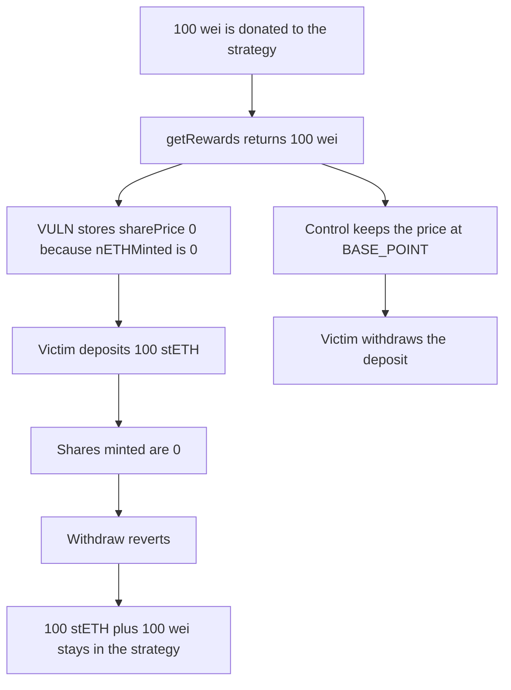

# Nexus: a 100 wei donation sets the share price to 0 and traps a 100 stETH deposit

> **Vulnerability classes:** `vuln/logic/price-calculation` · `vuln/dos/frozen-funds`

<!-- non-defihacklabs -->
<!-- source-auditvault: https://github.com/Auditware/AuditVault/blob/main/findings/44986-h-06-share-price-manipulation-pashov-audit-group-none-nexus.md -->
<!-- date: 2024-11 -->

## Key info

| Field | Value |
|---|---|
| **Loss** | 100 stETH plus 100 wei stuck in the strategy, with 0 shares minted |
| **Vulnerable contract** | `DepositETH._updateSharePrice` |
| **Attacker EOA** | `0x1111111111111111111111111111111111111111` |
| **Attack contract** | `Exploit` |
| **Attack tx** | `Exploit.run()` |
| **Chain / block / date** | Ethereum model · block 0 · 2024-11 |
| **Compiler** | solc 0.8.27, cancun, via IR |
| **Bug class** | Share price uses `nETHMinted` while it is still 0 |

## TL;DR

`getRewards` treats any stETH above the accounted strategy balance as a reward. A direct transfer of 100 wei does that while `nETHMinted` is 0. `_updateSharePrice` stores `0 * BASE_POINT / 100`, so the price is 0. The next depositor pays 100 stETH and receives 0 shares. Withdraw reverts. The 100 stETH stays in the strategy. The control keeps the price at `BASE_POINT` when no shares exist, and the depositor withdraws.

## Background

Pashov Audit Group's Nexus review of 2024-11-29, finding H-06. The same shape is described for the ETH vault's `LidoStrategy.getRewards` and for the USD vault's DSR strategy. The recommended mitigation is to mint an initial share amount so the price cannot be zeroed by the first donation.

## The vulnerable code

```solidity
function getRewards(address receiver, StrategyStruct memory _strategyBalance) public view returns (uint256) {
    uint256 balance_strategy = _strategyBalance.valueDeposited + _strategyBalance.rewardsEarned - _strategyBalance.valueWithdrawn;
    if (IERC20Like(TOKEN_ADDRESS).balanceOf(receiver) > balance_strategy) {
        return IERC20Like(TOKEN_ADDRESS).balanceOf(receiver) - balance_strategy;
    } else {
        return 0;
    }
}

// @> VULN: nETHMinted is 0, so sharePrice becomes 0 and the next deposit mints no shares
sharePrice = (nETHMinted) * BASE_POINT / (ethDeposited - ethWithdrawn + rewardsClaimed);
```

The deposit then does:

```solidity
uint256 nETHShares = (sharePrice * _value) / BASE_POINT;
```

## Root cause

The price is `shares * BASE / assets` with no virtual offset. A reward that arrives before the first share mint makes the numerator 0 and the denominator positive. Every later deposit mints 0 shares and still transfers the assets in.

## Preconditions

- The vault is new: `nETHMinted` is 0 and `ethDeposited` is 0.
- Anyone can transfer stETH to the strategy. That transfer is not a deposit.
- A later user calls `deposit`.

## Attack walkthrough

1. The attacker transfers 100 wei of stETH to the strategy.
2. `updateRewards` sees a 100 wei surplus and calls `_updateSharePrice`.
3. `sharePrice` is stored as 0.
4. The victim deposits 100 stETH. The share mint is 0. The tokens move to the strategy.
5. `withdraw` reverts because the victim has no shares.
6. The strategy balance is 100 stETH plus 100 wei.

## Diagrams



## Impact

The depositor paid 100 stETH and cannot withdraw it. Together with the 100 wei donation, the strategy holds 100.000000000000000100 stETH and no shares exist to claim it. The control returns the deposit to the victim and leaves the strategy empty.

## Remediation

If `nETHMinted` is 0, keep `sharePrice` at `BASE_POINT`, or mint a virtual starting supply before rewards can be accounted. Do not divide a zero share supply by a positive balance.

## How to reproduce

```bash
cd 44986-h-06-share-price-manipulation-pashov-audit-group-none-nexus_exp
forge test -vv
```

`test_exploit_zero_share_price_locks_100_steth` asserts price 0, zero shares, a blocked withdraw, and the stuck balance. `test_control_keeps_share_price_when_no_shares_exist` asserts the victim receives at least 100 stETH. Captured output is `output.txt`.

## Sources

- AuditVault finding: https://github.com/Auditware/AuditVault/blob/main/findings/44986-h-06-share-price-manipulation-pashov-audit-group-none-nexus.md
- Pashov report: https://github.com/pashov/audits/blob/master/team/md/Nexus-security-review_2024-11-29.md
