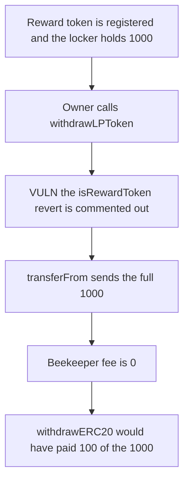

# InterPol: reward tokens leave through withdrawLPToken and skip the fee

> **Vulnerability classes:** `vuln/defi/fee-manipulation` · `vuln/logic/missing-check`

<!-- non-defihacklabs -->
<!-- source-auditvault: https://github.com/Auditware/AuditVault/blob/main/findings/45074-h-01-reward-tokens-can-be-withdrawn-without-fee-pashov-audit.md -->
<!-- date: 2024-12 -->

## Key info

| Field | Value |
|---|---|
| **Loss** | 1000 reward tokens withdrawn. The 10 percent fee, 100 tokens, is not paid |
| **Vulnerable contract** | `HoneyLocker.withdrawLPToken` |
| **Attacker EOA** | `0x1111111111111111111111111111111111111111` |
| **Attack contract** | `Exploit` |
| **Attack tx** | `Exploit.run()` |
| **Chain / block / date** | Ethereum model · block 0 · 2024-12 |
| **Compiler** | solc 0.8.27, cancun, via IR |
| **Bug class** | Commented-out reward-token check on the LP withdraw path |

## TL;DR

`withdrawERC20` charges `HoneyQueen.computeFees`. With `protocolFees` of 1000, that is 10 percent, rounded up: 1000 tokens cost 100. `withdrawLPToken` is supposed to reject reward tokens. Both checks, `isRewardToken` and `expirations == 0`, are commented out. The owner calls `withdrawLPToken` on a registered reward token and receives all 1000. The beekeeper receives 0. `withdrawERC20` on the same balance pays the owner 900 and the beekeeper 100.

## Background

Pashov Audit Group's InterPol review of 24 December 2024, finding H-01. The locker stakes LP tokens and takes a cut of reward tokens on the way out. The reward-token lines in `withdrawLPToken` were left commented, so that cut can be skipped.

## The vulnerable code

```solidity
function withdrawLPToken(address _LPToken, uint256 _amountOrId) external onlyUnblockedTokens(_LPToken) onlyOwnerOrOperator {
    // if (honeyQueen.isRewardToken(_LPToken)) revert HoneyLocker__HasToBeLPToken();
    // if (expirations[_LPToken] == 0) revert HoneyLocker__HasToBeLPToken();
    if (block.timestamp < expirations[_LPToken]) revert HoneyLocker__NotExpiredYet();
    Token(_LPToken).transferFrom(address(this), recipient(), _amountOrId); // @> VULN
}
```

`computeFees` is solady `mulDivUp(amount, protocolFees, 10000)`. At 1000 bps and 1000 tokens the fee is exactly 100.

The fix is to restore the `isRewardToken` revert so reward tokens must use `withdrawERC20`.

## Root cause

The fee lives on one withdraw function. The other withdraw function transfers the same ERC20 and the guard that would have forced the fee path is commented out.

## Preconditions

- The token is flagged `isRewardToken`. `protocolFees` is 1000.
- The locker holds 1000 of it. `expirations` is 0, the unlocked-locker value, so the remaining timestamp check does not revert.
- The caller is the owner.

## Attack walkthrough

1. The owner confirms `isRewardToken` is true.
2. `withdrawLPToken` evaluates the timestamp check. Expiration 0 does not revert. The commented reward check never runs.
3. The locker approves itself and `transferFrom` sends all 1000 tokens to the owner.
4. The beekeeper's balance is 0.
5. The control calls `withdrawERC20`. The owner receives 900 and the beekeeper receives 100.

## Diagrams



## Impact

The owner keeps 100 tokens that `withdrawERC20` would have sent to the beekeeper. On this balance that is the entire 10 percent protocol fee. The beekeeper's balance stays 0, and `distributeFees` is never called.

## How to reproduce

```bash
cd 45074-h-01-reward-tokens-can-be-withdrawn-without-fee-pashov-audit_exp
forge test -vv
```

`test_exploit_reward_leaves_with_no_fee` asserts the owner received 1000 and the beekeeper received 0. `test_control_withdrawERC20_pays_10_percent` asserts a 900 and 100 split. Output is `output.txt`.

## Sources

- AuditVault finding: https://github.com/Auditware/AuditVault/blob/main/findings/45074-h-01-reward-tokens-can-be-withdrawn-without-fee-pashov-audit.md
- Report: https://github.com/pashov/audits/blob/master/team/md/Interpol-security-review_2024-12-24.md
- HoneyLocker: https://github.com/0xHoneyJar/interpol-contracts/blob/main/src/HoneyLocker.sol
