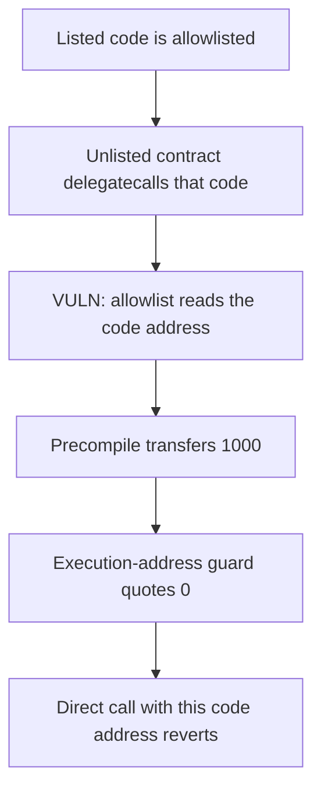

# Kakarot — precompile allowlist keys the caller code address

> **Vulnerability classes:** vuln/access-control/broken-logic · vuln/access-control/missing-auth

<!-- non-defihacklabs -->
<!-- source-auditvault: https://github.com/Auditware/AuditVault/blob/main/findings/45168-h-01-unauthorized-contracts-can-bypass-precompile-authorizat.md -->
<!-- date: 2024-09 -->

## Key info

| | |
|---|---|
| **Protocol** | Kakarot zkEVM |
| **Finding** | Code4rena, September 2024, AuditVault 45168 |
| **Vulnerable code** | `exec_precompile` whitelists `caller_code_address` |
| **Harm** | An unlisted contract pulls 1000 custodied units. An execution-address check pays 0. |
| **Chain** | local synthetic (audited zkEVM rule, modeled in Solidity) |

## TL;DR

`exec_precompile` authorizes Kakarot precompiles with `caller_code_address` and never looks at `caller_address`. Delegatecall runs another contract's bytecode at the caller's address, and immutables in that bytecode still name the listed contract. The precompile therefore treats the delegatecall as a call from listed code.

The precompile custodies 1000 units. The unlisted contract delegatecalls the listed code and receives all 1000. `guardedPull` on the execution address returns 0. A direct call that presents the unlisted contract as the code address reverts.

## The vulnerable code

The Cairo check is `is_caller_whitelisted(caller_code_address)`. The synthetic precompile is the same predicate. The code address is the listed contract's immutable, which delegatecall does not rewrite.

```solidity
function privilegedPull(address callerCode, address to, uint256 amount) external {
    // @> VULN: the allowlist is the caller code address, not the execution address.
    require(allowed[callerCode], "unauthorized");
    asset.transfer(to, amount);
}
```

The execution-address control:

```solidity
function guardedPull(address execution, uint256 amount) external view returns (uint256) {
    if (!allowed[execution]) return 0;
    return amount;
}
```

## Root cause

The allowlist key is the code being executed, not the account whose storage and balance the call runs against. Delegatecall splits those two. Any listed contract that can be delegatecalled, including one that forwards a caller-supplied recipient, becomes a pass for every other contract.

## Preconditions

One whitelisted contract whose bytecode calls the precompile and carries its own address as an immutable. The precompile holds 1000 units. No second block.

## Attack walkthrough

1. The listed code address is on the allowlist. This contract's address is not.
2. Delegatecall `pull(this, 1000)` on the listed code. The immutable still names the listed contract. The execution address is this contract.
3. `privilegedPull` accepts the code address and transfers 1000.
4. This contract's balance is 1000 and the precompile's balance is 0.
5. `guardedPull(this, 1000)` returns 0.
6. A direct `privilegedPull` that passes this contract as the code address reverts.

## Diagrams



## Impact

The unlisted contract takes the 1000 units the precompile was holding for listed code. The same pull guarded on the execution address pays 0.

## Remediation

Authorize `caller_address`, or reject delegatecall into custom precompiles. Listed contracts must not assume `address(this)` is their own account.

## How to reproduce

```bash
cd 45168-h-01-unauthorized-contracts-can-bypass-precompile-authorizat_exp
forge test -vv
```

## Sources

- AuditVault finding: https://github.com/Auditware/AuditVault/blob/main/findings/45168-h-01-unauthorized-contracts-can-bypass-precompile-authorizat.md
- Code4rena report: https://code4rena.com/reports/2024-09-kakarot
