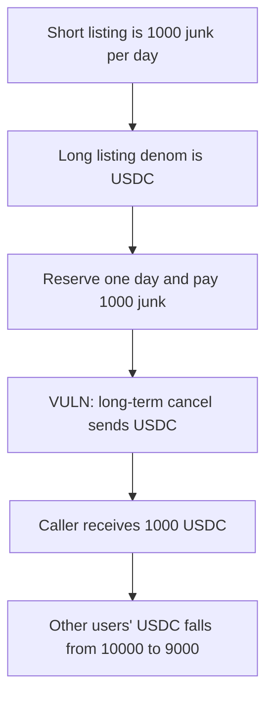

# Coded Estate — long-term cancel refunds USDC for a junk booking

> **Vulnerability classes:** vuln/logic/wrong-condition · vuln/logic/missing-validation

<!-- non-defihacklabs -->
<!-- source-auditvault: https://github.com/Auditware/AuditVault/blob/main/findings/45191-h-04-lack-of-differentiation-between-rental-types-leads-to-l.md -->
<!-- date: 2024-10 -->

## Key info

| | |
|---|---|
| **Protocol** | Coded Estate |
| **Finding** | Code4rena, October 2024, AuditVault 45191 |
| **Vulnerable code** | `cancelreservationbeforeapprovalforlongterm` pays `longterm_rental.denom` |
| **Harm** | A 1000 useless-coin booking is refunded as 1000 USDC. The other users' 10000 USDC falls to 9000. |
| **Chain** | local synthetic (audited CosmWasm rule, modeled in Solidity) |

## TL;DR

Short-term and long-term rentals share one `rentals` vector. `rental_type` is stored and never checked. The long-term cancel matches the caller and the dates, reads `deposit_amount` from that row, and sends `token.longterm_rental.denom`.

The report's numbers: one day at 1000 useless-coin, contract already holding 10000 USDC. Cancel pays 1000 USDC. The control cancel pays the booked denom and leaves the 10000 USDC in place.

## The vulnerable code

```solidity
address denom = longTerm.denom;
// @> VULN: the short-term deposit is refunded in the long-term denom.
Coin(denom).transfer(msg.sender, amount);
accounted[denom] -= amount;
```

`amount` is the short-term `deposit_amount`. The fair cancel uses `item.denom`.

## Root cause

The two listing denoms are independent, but every cancel path indexes the shared vector by sender and period only. The long-term function then hardcodes the long-term denom for the bank send.

## Preconditions

The attacker owns a property and can list both rental types. The contract holds USDC deposited by other users. The short-term price for the chosen period equals the USDC amount they want out. Here that amount is 1000. No second block.

## Attack walkthrough

1. List the short term in useless coin at 1000 per day.
2. List the long term in USDC.
3. Reserve one day, start `1700000000`, end one day later. Pay 1000 junk.
4. The contract now holds that junk and still holds 10000 USDC.
5. Call the long-term cancel with the same dates.
6. The transfer denom is USDC and the amount is 1000.
7. The caller holds 1000 USDC. The contract's USDC is 9000. The junk was not returned.

Control `cancelInBookedDenom` returns the 1000 junk and leaves USDC at 10000.

## Diagrams



## Impact

The caller pays 1000 of the cheap token and receives 1000 USDC that other users had deposited. The fair refund is 1000 of the cheap token, and the 10000 USDC stays.

## Remediation

Branch on `rental_type` and refund `item.denom`, not the long-term listing's denom.

## How to reproduce

```bash
cd 45191-h-04-lack-of-differentiation-between-rental-types-leads-to-l_exp
forge test -vv
```

## Sources

- AuditVault finding: https://github.com/Auditware/AuditVault/blob/main/findings/45191-h-04-lack-of-differentiation-between-rental-types-leads-to-l.md
- Code4rena report: https://code4rena.com/reports/2024-10-coded-estate
