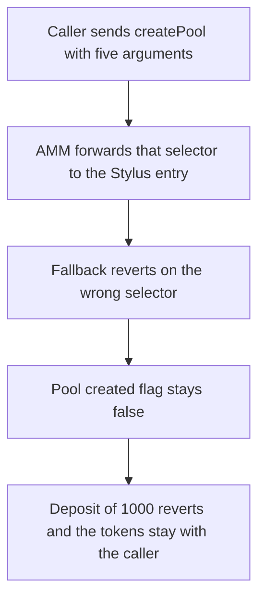

# Superposition Seawater — `createPoolD650E2D0` reverts because the Solidity and Stylus signatures disagree

> **Vulnerability classes:** vuln/logic/wrong-condition · vuln/dos/permanent

<!-- non-defihacklabs -->
<!-- source-auditvault: https://github.com/Auditware/AuditVault/blob/main/findings/45235-h-01-createpoold650e2d0-will-not-work-due-to-mismatch-in-sol.md -->
<!-- date: 2024-10 -->

## Key info

| Field | Value |
|---|---|
| **Loss** | Pool creation reverts. 1000 liquidity tokens stay with the caller and cannot be deposited |
| **Vulnerable contract** | `SeawaterAMM.createPoolD650E2D0` |
| **Attacker EOA** | `0x1111111111111111111111111111111111111111` |
| **Attack contract** | `Exploit` |
| **Attack tx** | `Exploit.run()` |
| **Chain / block / date** | Ethereum model · block 0 · 2024-10 |
| **Compiler** | solc 0.8.27, cancun, via IR |
| **Bug class** | Solidity ABI does not match the Stylus entry |

## TL;DR

`createPoolD650E2D0` on `SeawaterAMM` takes a token, a sqrt price, a fee, a tick spacing, and a max liquidity. The Stylus function it delegates to, `create_pool_D650_E2_D0`, takes only the pool address, the price, and the fee. A create encoded with the Solidity selector reverts. The pool is never created, so a following deposit of 1000 tokens reverts and the tokens stay with the caller. The control encodes the three-argument Stylus selector. The pool is created and the same 1000 tokens are deposited.

This playground has no Stylus VM. The Rust entry is an external contract. The production path is `directDelegate` into the Stylus executor. Here that delegate is an external call that forwards `msg.data`. The five-argument selector does not match `create_pool_D650_E2_D0`, so the fallback reverts with `stylus: wrong selector`. That is the mismatch, not a second invented bug.

## Background

Code4rena reviewed Superposition in October 2024. ZanyBonzy reported H-01. `SeawaterAMM.createPoolD650E2D0` is the admin entry that should initialize a pool. Its body is `directDelegate` to the executor. The executor's Rust function is declared with three parameters. The Solidity declaration adds `tickSpacing` and `maxLiquidityPerTick`. The calldata the delegate receives is not what the Stylus decoder expects, so every create fails and no pool position can be opened.

## The vulnerable code

```solidity
function createPoolD650E2D0(
    address /* token */,
    uint256 /* sqrtPriceX96 */,
    uint32 /* fee */,
    uint8 /* tickSpacing */,
    uint128 /* maxLiquidityPerTick */
) external {
    // @> VULN: five-argument selector; Stylus create_pool_D650_E2_D0 takes pool, price, fee
    (bool ok, bytes memory ret) = address(stylus).call(msg.data);
    if (!ok) {
        assembly {
            revert(add(ret, 0x20), mload(ret))
        }
    }
}
```

The Stylus side of the same call, reduced to the three-argument entry the report quotes:

```rust
pub fn create_pool_D650_E2_D0(
    &mut self,
    pool: Address,
    price: U256,
    fee: u32,
) -> Result<(), Revert>
```

The fix drops the two extra Solidity parameters and encodes the three-argument selector:

```diff
-function createPoolD650E2D0(
-    address token, uint256 sqrtPriceX96, uint32 fee, uint8 tickSpacing, uint128 maxLiquidityPerTick
-) external {
-    directDelegate(_getExecutorAdmin());
-}
+function createPoolD650E2D0(address pool, uint256 sqrtPriceX96, uint32 fee) external {
+    stylus.create_pool_D650_E2_D0(pool, sqrtPriceX96, fee);
+}
```

## Root cause

The Solidity function's selector is `createPoolD650E2D0(address,uint256,uint32,uint8,uint128)`. The program that actually creates the pool only decodes `(address,uint256,uint32)`. Forwarding `msg.data` sends the five-argument selector. The external Stylus stand-in has no such function, so execution falls through to `fallback` and reverts. `created` stays false. `deposit` requires `created` and reverts before `transferFrom`.

## Preconditions

- The caller holds 1000 liquidity tokens and has approved the AMM.
- `createPoolD650E2D0` is invoked with a token, a sqrt price, a fee, a tick spacing, and a max liquidity. Those are the five words the Solidity signature demands.
- No pool has been created yet.

## Attack walkthrough

1. The exploit mints itself 1000 tokens and approves the AMM.
2. It calls `createPoolD650E2D0` with the five arguments. The AMM forwards that calldata.
3. The Stylus contract's fallback reverts with `stylus: wrong selector`. `created` is false.
4. The exploit calls `deposit(1000 ether)`. The AMM reverts with `no pool`. `transferFrom` does not run.
5. The caller still holds 1000 tokens. Recorded liquidity is 0.

## Diagrams



## Impact

No pool is created. The 1000 tokens the caller intended to deposit are still in the caller's balance, and the pool's liquidity is 0. The control uses `create_pool_D650_E2_D0(address,uint256,uint32)`. After that call, `created` is true, the stored price and fee match the arguments, and `deposit` of the same 1000 tokens succeeds. The AMM holds 1000 and the caller holds 0.

## PoC

```bash
cd 45235-h-01-createpoold650e2d0-will-not-work-due-to-mismatch-in-sol_exp
forge test -vv
```

`test_exploit_create_reverts_and_liquidity_stays` asserts the create reverted, the deposit reverted, `created` is false, liquidity is 0, and the caller still holds 1000. `test_control_matching_signature_creates_pool` asserts the three-argument call creates the pool and the deposit records 1000 of liquidity.

## Sources

- AuditVault finding: https://github.com/Auditware/AuditVault/blob/main/findings/45235-h-01-createpoold650e2d0-will-not-work-due-to-mismatch-in-sol.md
- Code4rena report: https://code4rena.com/reports/2024-10-superposition
- Solidity: https://github.com/code-423n4/2024-10-superposition/blob/7ad51104a8514d46e5c3d756264564426f2927fe/pkg/sol/SeawaterAMM.sol
- Stylus: https://github.com/code-423n4/2024-10-superposition/blob/7ad51104a8514d46e5c3d756264564426f2927fe/pkg/seawater/src/lib.rs
