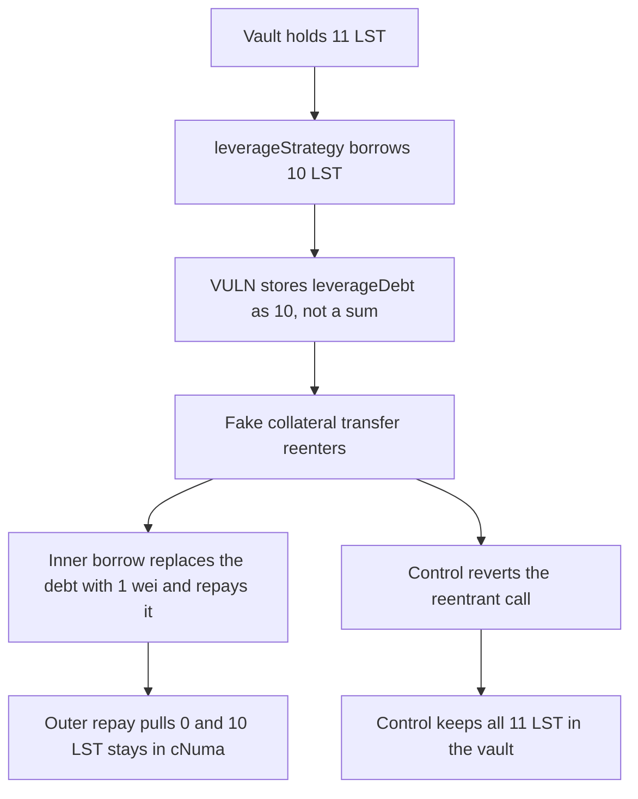

# Reentered leverageStrategy leaves 10 LST stuck in cNuma and drops the vault price

> **Vulnerability classes:** vuln/reentrancy/single-function · vuln/logic/state-update · vuln/dos/frozen-funds

<!-- non-defihacklabs -->
<!-- source-auditvault: https://github.com/Auditware/AuditVault/blob/main/findings/45276-h-1-cnumatokenleveragestrategy-can-be-re-entered-causing-all.md -->
<!-- date: 2024-12 -->

## Key info

| Field | Value |
|---|---|
| **Loss** | 10 LST moved out of the vault into cNuma and never repaid. Vault balance falls from 11 LST to 1 LST |
| **Vulnerable contract** | `Vault.borrowLeverage` called from `CNuma.leverageStrategy` |
| **Attacker EOA** | `0x1111111111111111111111111111111111111111` |
| **Attack contract** | `Exploit` |
| **Attack tx** | `Exploit.run()` |
| **Chain / block / date** | Ethereum model · block 0 · 2024-12 |
| **Compiler** | solc 0.8.27, cancun, via IR |
| **Bug class** | Caller-chosen collateral reenters leverage and overwrites `leverageDebt` |

## TL;DR

`leverageStrategy` lets the caller pass the collateral token. That token's `transfer` calls `leverageStrategy` again before `repayLeverage`. `borrowLeverage` stores `leverageDebt = _amount` instead of adding. The inner 1 wei borrow replaces the outer 10 LST debt, the inner repay zeroes it, and the outer repay pulls 0. 10 LST sits in cNuma. A reentrancy guard reverts the same call and the vault keeps all 11 LST.

## Background

Sherlock's December 2024 Numa audit, issue 39 (H-1), reported by Vidus, jokr, and juaan. `CNumaToken.leverageStrategy` flash-borrows LST from `NumaVault.borrowLeverage` and repays it with `repayLeverage`. Both functions key off a single `leverageDebt` word. The PoC in the report moves vault LST into the cNuma contract by reentering through a fake collateral token.

## The vulnerable code

```solidity
lst.transfer(msg.sender, _amount);
// @> VULN: leverageDebt is replaced, not added, so a reentrant borrow erases the outer flash debt
leverageDebt = _amount;
```

`repayLeverage` then transfers whatever `leverageDebt` currently is and sets it to 0. After the inner call, that value is 0, so the outer 10 LST is not returned.

## Root cause

The collateral address is an argument, and `transfer` on it runs before `repayLeverage`. Combined with a debt word that stores only the latest borrow, the inner repay settles a 1 wei debt and clears the outer one.

## Preconditions

- The vault holds 11 LST.
- The attacker calls `leverageStrategy` with a collateral token whose `transfer` calls `leverageStrategy(0, 1, ...)`.
- No reentrancy lock is set on `leverageStrategy`.

## Attack walkthrough

1. The vault balance is read: 11 LST.
2. `leverageStrategy` borrows 10 LST. `leverageDebt` becomes 10 LST.
3. The fake collateral `transfer` reenters and borrows 1 wei. `leverageDebt` becomes 1.
4. The inner `repayLeverage` pulls that 1 wei and sets `leverageDebt` to 0.
5. The outer repay pulls 0. cNuma holds 10 LST. The vault holds 1 LST.

## Diagrams



## Impact

cNuma holds 10 LST that the vault no longer counts. The vault price, which tracks its LST balance, falls from 11 to 1. `leverageDebt` is 0, so a later honest repay cannot pull the stuck tokens back. The guarded control reverts and leaves the vault at 11 LST.

## Remediation

Reject reentry in `leverageStrategy` before the collateral transfer, and accumulate `leverageDebt` instead of replacing it. The guard alone rolls the flash borrow back.

## How to reproduce

```bash
cd 45276-h-1-cnumatokenleveragestrategy-can-be-re-entered-causing-all_exp
forge test -vv
```

`test_exploit_reentered_leverage_sticks_10_lst_in_cnuma` asserts 10 LST in cNuma, 1 LST left in the vault, and a cleared debt. `test_control_reentrancy_guard_keeps_the_vault_whole` asserts the same fake collateral reverts and the vault still holds 11 LST. Captured output is `output.txt`.

## Sources

- AuditVault finding: https://github.com/Auditware/AuditVault/blob/main/findings/45276-h-1-cnumatokenleveragestrategy-can-be-re-entered-causing-all.md
- Sherlock judging issue 39: https://github.com/sherlock-audit/2024-12-numa-audit-judging/issues/39
- Blamed function: https://github.com/sherlock-audit/2024-12-numa-audit/blob/ae1d7781efb4cb2c3a40c642887ddadeecabb97d/Numa/contracts/lending/CNumaToken.sol#L141
