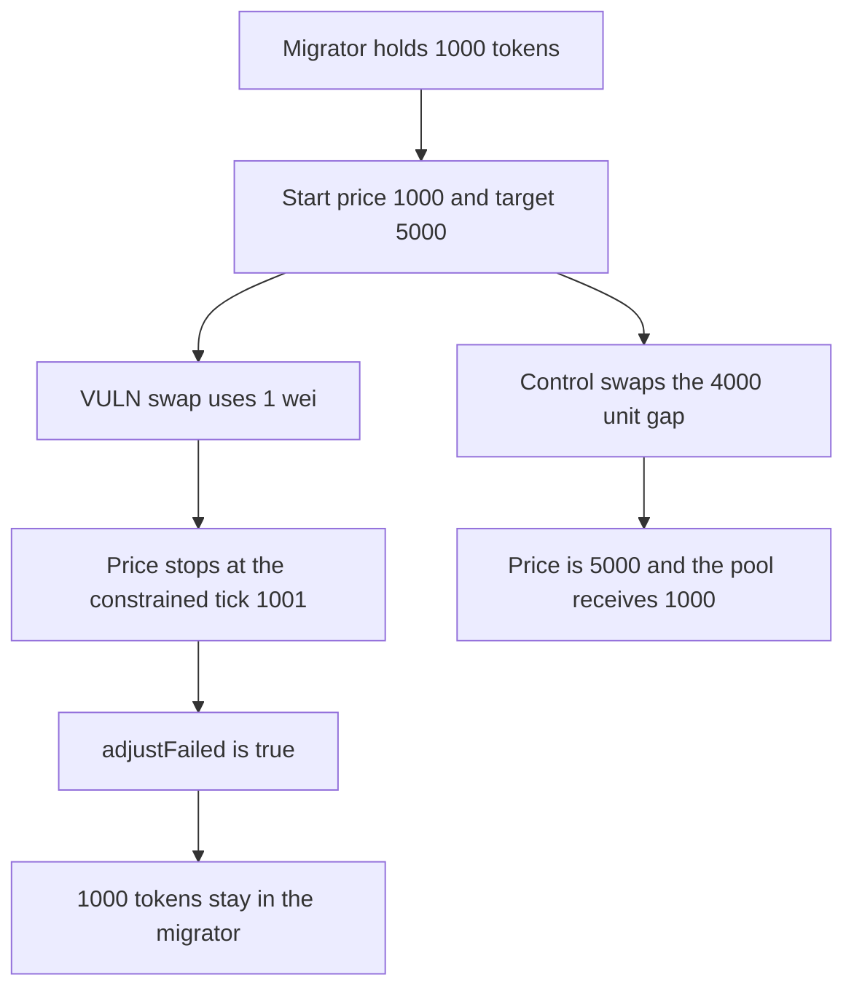

# g8keep: migration swaps 1 wei and leaves 1000 tokens unmigrated

> **Vulnerability classes:** `vuln/dos/frozen-funds` · `vuln/logic/price-calculation`

<!-- non-defihacklabs -->
<!-- source-auditvault: https://github.com/Auditware/AuditVault/blob/main/findings/45306-h-01-migration-will-fail-trying-to-swap-1-wei-of-tokens-to-r.md -->
<!-- date: 2024-12 -->

## Key info

| Field | Value |
|---|---|
| **Loss** | 1000 tokens stay in the migrator. The pool receives 0 |
| **Vulnerable contract** | `Migrator._adjustPoolPrice` |
| **Attacker EOA** | `0x1111111111111111111111111111111111111111` |
| **Attack contract** | `Exploit` |
| **Attack tx** | `Exploit.run()` |
| **Chain / block / date** | Ethereum model · block 0 · 2024-12 |
| **Compiler** | solc 0.8.27, cancun, via IR |
| **Bug class** | Hardcoded 1 wei swap cannot reach the target sqrt price |

## TL;DR

`_adjustPoolPrice` adds temporary liquidity, then swaps. When the pool price is below the target it calls `swap` with `int256(uint256(1))`. One wei stops at the constrained tick, sqrt price 1001. The target is 5000, so `adjustFailed` stays true and `migrate` returns without moving the inventory. 1000 tokens remain in the migrator and the pool balance is 0. Swapping the 4000 units between the start price and the target reaches 5000 and moves all 1000 tokens.

## Background

Pashov Audit Group's g8keep review of 12 December 2024, finding H-01, against `g8keep/audit-v2` at `7ed875cf8104c6267be505ca8c31372448a6f16e`. The curve migrates its inventory into a Uniswap V3 pool only after the pool price equals the target. The report says a 1 wei ETH swap reaches `constrainedTickUpper` and not the target, so migration cannot complete.

## The vulnerable code

```solidity
if (sqrtPriceX96Start > sqrtPriceX96) {
    pool.swap(address(this), true, int256(uint256(tokenAmount)), sqrtPriceX96, "");
} else {
    // @> VULN: 1 wei stops at constrainedTickUpper and cannot reach sqrtPriceX96
    pool.swap(address(this), false, int256(uint256(1)), sqrtPriceX96, "");
}
(uint160 sqrtPriceX96New,,,,,,) = pool.slot0();
adjustFailed = sqrtPriceX96 != sqrtPriceX96New;
```

The recommended change uses the amount required to reach the target, and allows a small tolerance when comparing the resulting price with that target.

```diff
- pool.swap(address(this), false, int256(uint256(1)), sqrtPriceX96, "");
+ pool.swap(address(this), false, int256(sqrtPriceX96 - sqrtPriceX96Start), sqrtPriceX96, "");
```

## Root cause

The upward swap hardcodes 1 wei. In this reduction the pool moves one price unit per wei and caps an amount of 1 at the constrained tick, which is start plus 1. Start is 1000 and the target is 5000, so the post-swap `slot0` price is 1001. `adjustFailed` is true and the transfer into the pool is skipped.

The pool here is a mock of that price step. It is not a full Uniswap V3 deployment. The mocked step is the one the report describes: 1 wei reaches the constrained tick and not the target.

## Preconditions

- The curve already holds the migration inventory. This run uses 1000 tokens.
- The current sqrt price is 1000 and the target is 5000, so the code takes the `else` branch.
- Temporary liquidity is added before the swap, as in `_adjustPoolPrice`.

## Attack walkthrough

1. 1000 tokens are minted and transferred to the migrator.
2. `migrate` reads the start price 1000 and the target 5000.
3. Temporary liquidity is recorded, then `swap` is called with amount 1.
4. The pool price becomes 1001. `slot0` does not match 5000.
5. `adjustFailed` is stored and `migrate` returns. The pool balance stays 0.
6. The control swaps 4000 units, the price becomes 5000, and the pool holds the 1000 tokens.

## Diagrams



## Impact

The migration inventory of 1000 tokens never leaves the migrator. The Uniswap pool that should have received them holds 0. Holders cannot complete the move to the secondary pool. The control, which swaps the distance to the target, empties the migrator and leaves 1000 tokens in the pool.

## Remediation

Pass the amount that reaches `sqrtPriceX96`, not `1`, and compare the resulting price with a small tolerance instead of strict equality. That is the change recommended on H-01.

## How to reproduce

```bash
cd 45306-h-01-migration-will-fail-trying-to-swap-1-wei-of-tokens-to-r_exp
forge test -vv
```

`test_exploit_one_wei_swap_leaves_1000_tokens_unmigrated` asserts `adjustFailed`, a price of 1001, and 1000 tokens still on the migrator. `test_control_exact_swap_migrates_1000_tokens` asserts a price of 5000 and 1000 tokens in the pool. Captured output is `output.txt`.

## Sources

- AuditVault finding: https://github.com/Auditware/AuditVault/blob/main/findings/45306-h-01-migration-will-fail-trying-to-swap-1-wei-of-tokens-to-r.md
- Pashov report: https://github.com/pashov/audits/blob/master/team/md/g8keep-security-review_2024-12-12.md
- Reviewed tree: https://github.com/g8keep/audit-v2/tree/7ed875cf8104c6267be505ca8c31372448a6f16e
