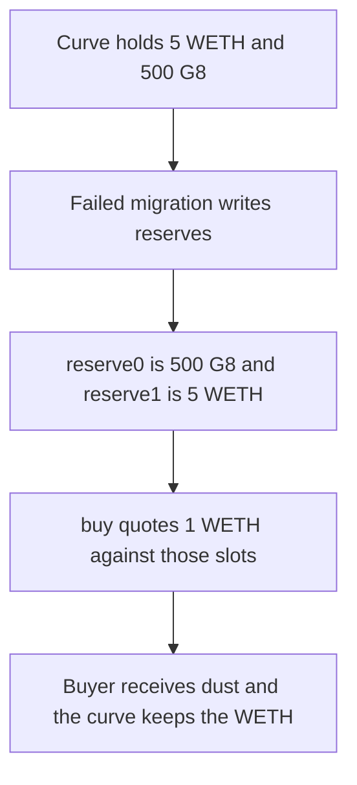

# g8keep: a failed migration stores the bonding-curve reserves backwards

> **Vulnerability classes:** `vuln/logic/state-update` · `vuln/logic/price-calculation`

<!-- non-defihacklabs -->
<!-- source-auditvault: https://github.com/Auditware/AuditVault/blob/main/findings/45307-h-02-incorrect-reserve-assignment-leads-to-reserve-mismatch.md -->
<!-- date: 2024-12 -->

## Key info

| Field | Value |
|---|---|
| **Loss** | 1 WETH buys dust G8; the fair quote is more than 80 G8 |
| **Vulnerable contract** | `BondingCurve._handleMigrationFailed` |
| **Attacker EOA** | `0x1111111111111111111111111111111111111111` |
| **Attack contract** | `Exploit` |
| **Attack tx** | `Exploit.run()` |
| **Chain / block / date** | Local synthetic · 2024-12 |
| **Compiler** | solc 0.8.27, cancun, via IR |
| **Bug class** | tokenAmount is written into reserve0, the ETH reserve |

## TL;DR

After a failed migration the curve holds 5 WETH and 500 G8. `_handleMigrationFailed` stores the token amount in `reserve0` and the ETH amount in `reserve1`. `buy` uses `reserve0` as the input reserve, so 1 WETH quotes dust instead of about 83 G8. The curve keeps the WETH.

## The vulnerable code

```solidity
function _handleMigrationFailed(uint256 ethAmount, uint112 tokenAmount) internal {
    curveStatus = curveStatus | 1;
    reserve0 = tokenAmount;
    reserve1 = uint112(ethAmount);
}
```

The assignment should be `reserve0 = uint112(ethAmount)` and `reserve1 = tokenAmount`.

## Root cause

The two reserve slots are filled in the opposite order from the one `buy` and `getAmountOut` assume.

## Preconditions

- The curve already holds 5 WETH and 500 G8.
- A failed migration is recorded with those amounts.

## Attack walkthrough

1. `handleMigrationFailed(5 WETH, 500 G8)` sets the failed-migration flag.
2. `reserve0` becomes 500 G8 and `reserve1` becomes 5 WETH.
3. The buyer pays 1 WETH.
4. The quote uses the swapped reserves. The output is less than a thousandth of the fair buy, and the curve's WETH balance is 6.

## Diagrams



## Impact

Buys and sells price the pool backwards. This run pays 1 WETH for dust G8 while the true reserves would return more than 80 G8.

## How to reproduce

```bash
cd 45307-h-02-incorrect-reserve-assignment-leads-to-reserve-mismatch_exp
forge test -vv
```

## Sources

- AuditVault finding: https://github.com/Auditware/AuditVault/blob/main/findings/45307-h-02-incorrect-reserve-assignment-leads-to-reserve-mismatch.md
- Pashov review: https://github.com/pashov/audits/blob/master/team/md/g8keep-security-review_2024-12-12.md
