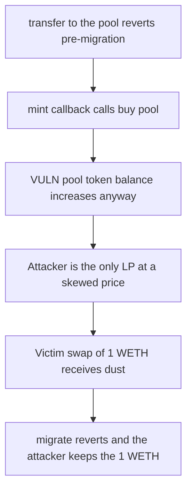

# g8keep: buy() funds the Uniswap V3 pool before migration

> **Vulnerability classes:** `vuln/logic/missing-validation` · `vuln/logic/price-calculation`

<!-- non-defihacklabs -->
<!-- source-auditvault: https://github.com/Auditware/AuditVault/blob/main/findings/45308-h-03-its-possible-to-add-liquidity-to-uniswapv3-while-token.md -->
<!-- date: 2024-12 -->

## Key info

| Field | Value |
|---|---|
| **Loss** | The victim's 1 WETH is taken. `migrate()` reverts while that liquidity is open |
| **Vulnerable contract** | `G8Token.buy` |
| **Attacker EOA** | `0x1111111111111111111111111111111111111111` |
| **Attack contract** | `Exploit` |
| **Attack tx** | `Exploit.run()` |
| **Chain / block / date** | Ethereum model · block 0 · 2024-12 |
| **Compiler** | solc 0.8.27, cancun, via IR |

## TL;DR

`transfer` to the Uniswap V3 pool reverts while the token is not migrated. `buy(to)` credits `to` with no such check. The mint callback calls `buy(pool)`, the pool's `balance0Before + amount0 <= balance0()` check passes, and the attacker is the only LP, with 1e15 tokens against 100 WETH. A victim who swaps 1 WETH receives dust tokens. `migrate()` reverts with `already liquid`. The attacker then burns and keeps the victim's 1 WETH. Their own 100 WETH comes back.

## The vulnerable code

```solidity
function transfer(address to, uint256 amount) external returns (bool) {
    if (!migrated && to == pool) revert("pre-migration");
    ...
}

function buy(address to, uint256 amount) external {
    balanceOf[to] += amount; // @> VULN: credits the unmigrated pool; transfer() would have reverted
    totalSupply += amount;
}
```

The pool check quoted in the finding is preserved:

```solidity
IUniswapV3MintCallback(msg.sender).uniswapV3MintCallback(amount0, amount1, "");
require(balance0Before + amount0 <= token.balanceOf(address(this)), "M0");
```

The report's fix is to reject `buy` when `to` is the pool. The control token does that, and migration of an empty pool succeeds.

## Root cause

The pre-migration ban is on `transfer` only. `buy` is a second way to increase the pool's balance, and Uniswap V3 mint only checks that the balance went up.

## Preconditions

- `migrated` is false and the pool address is set, so `transfer` to the pool reverts.
- The attacker can call `mint` and answer `uniswapV3MintCallback`. No admin key is required. That is the report's path.

## Attack walkthrough

1. `transfer(pool, 0)` reverts with `pre-migration`.
2. `mint` asks the callback for 1e15 tokens and 100 WETH.
3. The callback calls `buy(pool, 1e15)` and sends the WETH. Both balance checks pass.
4. The victim swaps 1 WETH into a pool priced at 100 WETH per 0.001 token and receives dust.
5. `migrate()` reverts because `totalLiq` is not 0.
6. The attacker burns the LP and sends the victim's 1 WETH to the sink.

## Diagrams



## Impact

Migration cannot start while the attacker's position is open, which is the report's denial of service. The same position sets the price, so the victim's 1 WETH is captured by the LP. The attacker's 100 WETH of capital is returned on burn. Net profit is the victim's 1 WETH.

## Remediation

Reject `buy` when the recipient is the pool and the token is not migrated, matching the existing `transfer` guard. The control's `buy` reverts with `no pool buy` and `migrate` then succeeds.

## How to reproduce

```bash
cd 45308-h-03-its-possible-to-add-liquidity-to-uniswapv3-while-token_exp
forge test -vv
```

`test_exploit_pre_migration_liquidity_steals_weth_and_bricks_migrate` asserts a failed migration, a 1 WETH sink balance, an empty victim, and the attacker's 100 WETH returned. `test_control_buy_to_pool_reverts_when_guarded_and_migrate_works` asserts the guarded `buy` reverts and migration succeeds.

## Sources

- AuditVault finding: https://github.com/Auditware/AuditVault/blob/main/findings/45308-h-03-its-possible-to-add-liquidity-to-uniswapv3-while-token.md
- Pashov report: https://github.com/pashov/audits/blob/master/team/md/g8keep-security-review_2024-12-12.md
- The finding quotes the Uniswap V3 mint balance check and `buy(to)`. The pool and the constant-product swap are the smallest reduction that makes that callback pay out in WETH.
