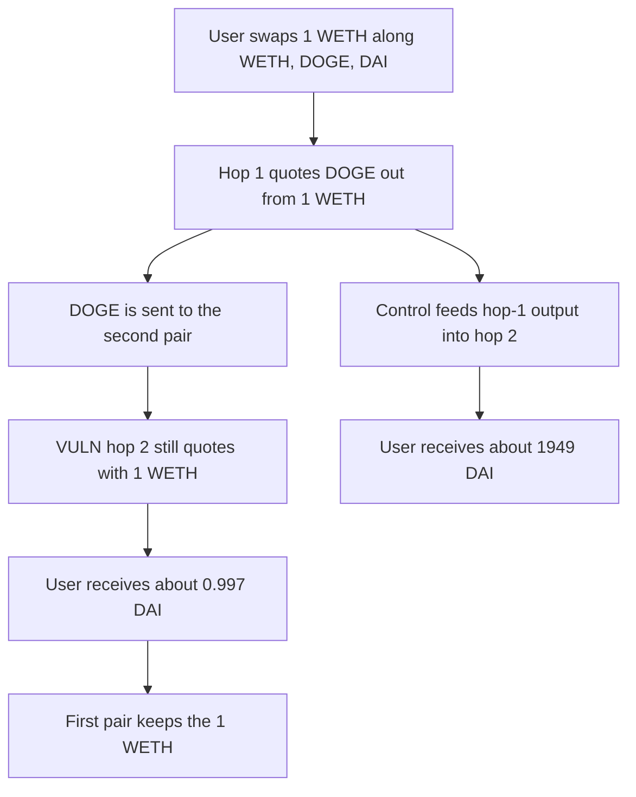

# Berabot: a path longer than two tokens quotes every hop with the original amountIn

> **Vulnerability classes:** `vuln/logic/price-calculation` · `vuln/defi/slippage`

<!-- non-defihacklabs -->
<!-- source-auditvault: https://github.com/Auditware/AuditVault/blob/main/findings/45354-h-01-berabotrouter-calculation-for-paths-longer-than-two-is.md -->
<!-- date: 2025-01 -->

**AuditVault taxonomy:** `severity/high` · `platform/shieldify` · `sector/dex`

## Key info

| Field | Value |
|---|---|
| **Loss** | 1 WETH taken by the first pair. The user receives 996995029979775550 wei of DAI, about 0.997, instead of 1949209071948685202240 wei, about 1949.209 DAI |
| **Vulnerable contract** | `BerabotRouter._executeV2Swap` |
| **Attacker EOA** | `0x1111111111111111111111111111111111111111` |
| **Attack contract** | `Exploit` |
| **Attack tx** | `Exploit.run()` |
| **Chain / block / date** | Ethereum model · block 0 · 2025-01 |
| **Compiler** | solc 0.8.27, cancun, via IR |
| **Bug class** | Multi-hop swap never replaces `amountIn` with the previous `amountOut` |

## TL;DR

`_executeV2Swap` loops over `path` but passes the original `amountIn` into `_calculateAmountOut` on every hop. WETH to DOGE is quoted correctly. DOGE to DAI is quoted as if 1 WETH of DOGE arrived, so the router asks the second pair for about 0.997 DAI. The pair accepts it, because the real DOGE input is much larger. The user spent 1 WETH. A router that writes `amountOut` back into the next input pays the full quote, 1949.209 DAI.

## Background

Shieldify's Berabot review, January 2025, H-01. BerabotRouter mirrors a Uniswap V2 router. A path such as WETH, DOGE, DAI is meant to chain the output of one pair into the input of the next. The published fix keeps a `_amountIn` local and sets `_amountIn = amountOut` at the end of the loop. The team marked the issue fixed.

## The vulnerable code

```solidity
amountOut = _calculateAmountOut(reserveIn, reserveOut, amountIn, _router);
// @> VULN: every hop quotes with the original amountIn, not the previous hop's amountOut
```

The recommended change from the report:

```diff
- amountOut = _calculateAmountOut(reserveIn, reserveOut, amountIn, _router);
+ amountOut = _calculateAmountOut(reserveIn, reserveOut, _amountIn, _router);
  Pair(pair).swap(...);
+ _amountIn = amountOut;
```

## Root cause

`amountIn` is the function argument. The loop assigns `amountOut` but never feeds it into the next iteration. Hop 0 is accidentally correct. Every later hop prices a different pair with the first token's input amount.

## Preconditions

- Two V2 pairs exist: WETH/DOGE with reserves 100 and 200000, and DOGE/DAI with reserves 200000 and 200000. Fee is 0.3 percent.
- The caller swaps 1 WETH along a path of length 3 and does not set an `amountOutMin` high enough to revert the dust output. With a correct minimum the same bug reverts the swap instead of underpaying.

## Attack walkthrough

1. The chained quote, which does replace the input, returns 1949209071948685202240 wei of DAI.
2. The router pulls 1 WETH into the first pair and quotes hop 1 with that 1 WETH.
3. Hop 2 still uses 1 WETH against the DOGE/DAI reserves. `amountOut` is 996995029979775550 wei.
4. The second pair's K check passes because the DOGE that actually arrived is the hop-1 output, not 1 wei-unit. The user is paid the dust.
5. The control router chains `amountOut` into the next input and pays the full quote.

## Diagrams



## Impact

The first pair's WETH balance rises by 1 WETH. The user receives 996995029979775550 wei of DAI. The fair multi-hop output on these reserves is 1949209071948685202240 wei. The difference stays in the pairs. If the caller had set `amountOutMin` to the fair quote, the swap would revert and the path would be unusable, which is the failure mode the report describes.

## Remediation

Track `_amountIn`, pass it to `_calculateAmountOut`, and set `_amountIn = amountOut` after each hop.

## How to reproduce

```bash
cd 45354-h-01-berabotrouter-calculation-for-paths-longer-than-two-is_exp
forge test -vv
```

`test_multihop_pays_dust_and_keeps_weth` logs the fair and actual DAI amounts. `test_control_chained_amount_in_pays_fair_dai` asserts they match once the input is chained. Captured output is `output.txt`.

## Sources

- AuditVault finding: https://github.com/Auditware/AuditVault/blob/main/findings/45354-h-01-berabotrouter-calculation-for-paths-longer-than-two-is.md
- Shieldify report: https://github.com/shieldify-security/audits-portfolio-md/blob/main/Berabot-Security-Review.md
- Portfolio entry: Shieldify audits portfolio, Berabot, January 2025, DEX aggregator
