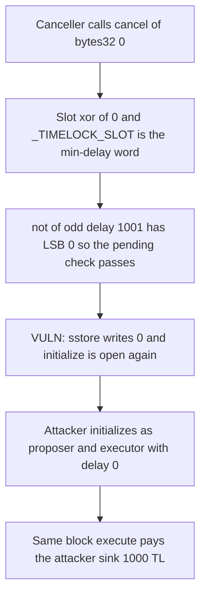

# Solady Timelock — `cancel(bytes32(0))` lets a canceller become proposer and executor

> **Vulnerability classes:** vuln/governance/timelock-bypass · vuln/access-control/broken-logic · vuln/logic/missing-validation

> **Reproduction:** self-contained Foundry PoC, no fork and no cheatcodes in the exploit. Trace: [output.txt](output.txt).

<!-- non-defihacklabs -->
<!-- source-auditvault: https://github.com/Auditware/AuditVault/blob/main/findings/45408-cancelling-bytes320-allows-timelock-takeover-spearbit-none-c.md -->
<!-- date: 2024-12 -->

## Key info

| | |
|---|---|
| **Impact** | **HIGH** — a canceller reinitializes the timelock as proposer and executor, then pays themselves 1000 TL with delay 0 |
| **Protocol** | Solady `Timelock` (Coinbase review) |
| **Vulnerable code** | `Timelock.cancel` slot `xor(shl(72, id), _TIMELOCK_SLOT)` |
| **Bug class** | Timelock storage collision / reinitialization |
| **Finding** | Spearbit — Solady / Coinbase, December 2024 · #45408 · Kaden |
| **Report** | [Solady-Coinbase-Spearbit-Security-Review-December-2024.pdf](https://github.com/spearbit/portfolio/blob/master/pdfs/Solady-Coinbase-Spearbit-Security-Review-December-2024.pdf) |
| **Source** | [AuditVault](https://github.com/Auditware/AuditVault/blob/main/findings/45408-cancelling-bytes320-allows-timelock-takeover-spearbit-none-c.md) |
| **Audited code** | `Vectorized/solady@28605fcdbefb5d0bc891db2bf08edbd9f6fa8f41` `src/accounts/Timelock.sol` |
| **Compiler** | solc 0.8.27, cancun, via_ir |

## TL;DR

`cancel` derives an operation's storage slot with `xor(shl(72, id), _TIMELOCK_SLOT)`. That slot is also where `not(minDelay)` lives. `cancel(bytes32(0))` therefore selects the delay slot. When the delay is odd, `not(delay)` has a cleared low bit, the "pending operation" check passes, and the slot is zeroed. `initialize` only refuses to run when that slot is non-zero, so the canceller initializes again, grants themselves `PROPOSER_ROLE` and `EXECUTOR_ROLE`, sets the delay to 0, and in the same block executes their own 1000 TL payout.

## The vulnerable code

```solidity
function cancel(bytes32 id) public virtual onlyRole(CANCELLER_ROLE) {
    // @> VULN: bytes32(0) selects _TIMELOCK_SLOT; this block sstores 0 over the min-delay word
    assembly {
        let s := xor(shl(72, id), _TIMELOCK_SLOT) // Operation slot.
        let p := sload(s)
        if or(and(1, p), iszero(p)) {
            // revert TimelockInvalidOperation — LSB 1, or an empty slot
        }
        sstore(s, 0) // Clears the operation's storage slot. bytes32(0) clears _TIMELOCK_SLOT.
        // FIX: s := keccak256(abi.encodePacked(id, bytes9(_TIMELOCK_SLOT)))
    }
}
```

`initialize` stores `not(initialMinDelay)` in `_TIMELOCK_SLOT` and reverts if that slot is already non-zero.

## Root cause

The operation id is not hashed into the slot. Shifting the id left by 72 bits and xoring the constant leaves the low 72 bits equal to `_TIMELOCK_SLOT` for every id, and leaves the high bits zero when the id itself is zero. The delay word is then indistinguishable from an operation. The pending check only rejects a set low bit or a zero word. `not(odd)` has a clear low bit and is non-zero, so it is wiped.

## Preconditions

The caller must already hold `CANCELLER_ROLE`. The configured min delay must be odd so `not(minDelay)` has LSB 0. No other role is required before the call. After the wipe, `initialize` is public.

## Attack walkthrough

1. Timelock is live with min delay 1001. The attacker is canceller, not proposer, not executor. Treasury holds 1000 TL (`1000000000000000000000`).
2. `cancel(bytes32(0))` zeroes `_TIMELOCK_SLOT`.
3. `initialize(0, attacker, [attacker], [attacker], [attacker])` succeeds. `minDelay()` is 0. The attacker now has `PROPOSER_ROLE` and `EXECUTOR_ROLE`.
4. They propose `treasury.pay(sink, 1000e18)` with delay 0 and execute it in the same block.
5. The sink holds 1000 TL. The treasury holds 0.

Controls, in the Foundry test only:

- Cancelling a real operation id leaves the delay slot at `not(1001)`.
- `cancel(bytes32(0))` reverts when the delay is even (1000), because `not(1000)` has LSB 1.
- The fixed hash `keccak256(id || _TIMELOCK_SLOT)` makes `cancel(0)` revert and leaves the delay at 1001. The caller does not gain a new path to `initialize`.

## Diagrams



## Impact

A canceller, who is not trusted to schedule or execute, becomes both proposer and executor and sets the delay to 0. They then move 1000 TL out of the timelock treasury in the same transaction. Any later operation the timelock was meant to gate can be replaced by one the attacker writes.

## Remediation

Do not derive the operation slot by shifting the caller-supplied id. Hash the id together with `_TIMELOCK_SLOT`, as in Solady PR 1231 (`keccak256(id || bytes9(_TIMELOCK_SLOT))`), so `cancel` cannot address the delay word.

## Sources

- AuditVault finding: https://github.com/Auditware/AuditVault/blob/main/findings/45408-cancelling-bytes320-allows-timelock-takeover-spearbit-none-c.md
- Spearbit report: https://github.com/spearbit/portfolio/blob/master/pdfs/Solady-Coinbase-Spearbit-Security-Review-December-2024.pdf
- Vulnerable source: https://github.com/Vectorized/solady/blob/28605fcdbefb5d0bc891db2bf08edbd9f6fa8f41/src/accounts/Timelock.sol
- Fix: https://github.com/Vectorized/solady/pull/1231 (merged 2024-12-17)
