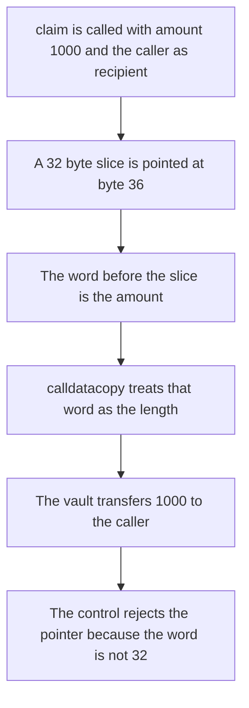

# Solady — a calldata slice is not an ABI array

> **Vulnerability classes:** vuln/input-validation/missing · vuln/logic/missing-check

> **Reproduction:** a self-contained Foundry PoC that compiles and runs offline
> with only `forge-std` — no fork and no RPC. Trace: [output.txt](output.txt).
> PoC: [test/45409-unsound-assumption-about-structure-of-calldata-arrays-spearb_exp.sol](test/45409-unsound-assumption-about-structure-of-calldata-arrays-spearb_exp.sol).

<!-- non-defihacklabs -->
<!-- source-auditvault: https://github.com/Auditware/AuditVault/blob/main/findings/45409-unsound-assumption-about-structure-of-calldata-arrays-spearb.md -->
<!-- date: 2024-12 -->

---

## Key info

| | |
|---|---|
| **Impact** | **HIGH** — a pointer aimed at the address argument makes the previous word, **1000**, the payment. **1000** moves to the caller. The control rejects the pointer and moves **0** |
| **Protocol** | Solady Lifebuoy / ERC1155 calldata copy |
| **Vulnerable code** | `calldatacopy(m, sub(data.offset, 0x20), add(0x20, data.length))` |
| **Bug class** | The word before a slice is not the slice length |
| **Finding** | Spearbit — Solady / Coinbase, December 2024 · id 45409 |
| **Report** | [Solady Spearbit review, December 2024](https://github.com/spearbit/portfolio/blob/master/pdfs/Solady-Coinbase-Spearbit-Security-Review-December-2024.pdf) |
| **Source** | [AuditVault finding](https://github.com/Auditware/AuditVault/blob/main/findings/45409-unsound-assumption-about-structure-of-calldata-arrays-spearb.md) |
| **Status** | Fixed in Solady PR 1237 by writing `data.length` instead of copying the previous word. Reproduced here as a local synthetic. |
| **Compiler** | solc 0.8.27, cancun, via IR |

---

## TL;DR

Solady copied a calldata bytes value by starting **32 bytes before** `data.offset`, on the assumption that the word there is the ABI length. That is true for an external `bytes` argument. It is not true for a slice or for a pointer built in assembly.

`claim(uint256 amount, address to)` points a 32-byte slice at byte 36, which is `to`. The word at byte 4 is `amount`. The copy reads that word as the length and the vault then transfers it. Calling `claim(1000 ether, caller)` transfers **1000** to the caller.

The control loads the same word and reverts unless it equals `data.length`. **1000 ether** is not **32**, so the call reverts and the tokens stay.

`run()` does not warp.

## The vulnerable code

```solidity
assembly {
    crafted.offset := 36
    crafted.length := 32
}
// inside _release
assembly {
    let m := mload(0x40)
    // @> VULN: the word before a slice is copied as the length and then spent
    calldatacopy(m, sub(data.offset, 0x20), add(0x20, data.length))
    paid := mload(m)
    dest := mload(add(m, 0x20))
}
token.transfer(dest, paid);
```

This is the Lifebuoy pattern the report quotes: `calldatacopy(..., sub(data.offset, 0x20), add(0x20, data.length))`. The fix writes `data.length` explicitly and copies from `data.offset`.

## Root cause

`bytes calldata` is a pointer with an offset and a length. Only a top-level ABI encoding places the length in the word immediately before the offset. A slice moves the offset and keeps a shorter length, so the previous word is some other argument. Spending that word as an amount, or as an array length, uses attacker-controlled calldata.

## Preconditions

- The copy starts at `data.offset - 32` and the first loaded word is used as the transfer amount.
- The caller can pass `claim(1000 ether, caller)`, which places **1000** in the word before the address.
- The vault holds **1000**.
- No timestamp change happens inside `run()`.

## Attack walkthrough

1. The caller invokes `claim(1000 ether, caller)`.
2. The slice offset is set to **36** and the length to **32**.
3. The copy starts at byte **4**. The first word is **1000 ether**. The next word is the caller.
4. The vault transfers **1000** to the caller. Its balance is **0**.
5. The fixed function reads the same word, sees that it is not **32**, and reverts. The **1000** stays in the vault.

## Diagrams



## Impact

The caller receives **1000** from the vault. The same calldata on the fixed path reverts, the caller receives **0**, and the vault still holds **1000**.

## Remediation

Write `data.length` into memory and copy from `data.offset`. Do not read the word before the offset unless the pointer is known to be a top-level ABI bytes value. Reject pointers whose preceding word is not the length.

## Sources

- [AuditVault finding 45409](https://github.com/Auditware/AuditVault/blob/main/findings/45409-unsound-assumption-about-structure-of-calldata-arrays-spearb.md)
- [Spearbit Solady review, December 2024](https://github.com/spearbit/portfolio/blob/master/pdfs/Solady-Coinbase-Spearbit-Security-Review-December-2024.pdf)
- Fix: Solady PR 1237, which writes `data.length` instead of copying the previous word

### Taxonomy

- `severity/high`
- `vuln/input-validation/missing`
- `vuln/logic/missing-check`
