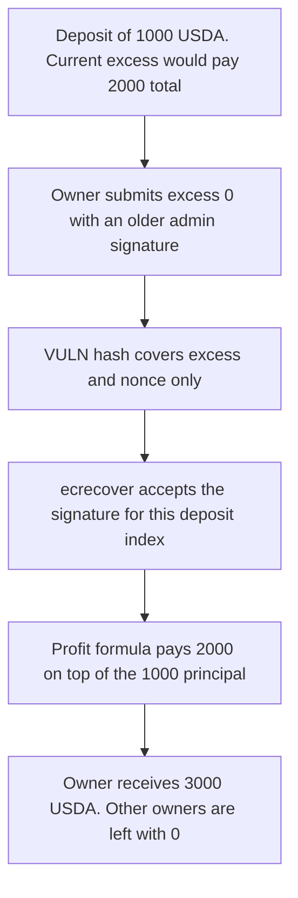

# Autonomint: a replayed excess pays 3,000 USDA instead of 2,000

> **Vulnerability classes:** `vuln/auth/signature-replay` · `vuln/access-control/missing-auth`

<!-- non-defihacklabs -->
<!-- source-auditvault: https://github.com/Auditware/AuditVault/blob/main/findings/45458-h-5-cds-owners-can-withdraw-more-than-expected-via-manipulat.md -->
<!-- date: 2024-11 -->

## Key info

| Field | Value |
|---|---|
| **Loss** | The CDS owner withdraws 3,000 USDA. The current excess would have paid 2,000, so 1,000 belonging to other owners is taken and the CDS is empty |
| **Vulnerable contract** | `CDS.withdraw` / `_verify` |
| **Attacker EOA** | `0x1111111111111111111111111111111111111111` |
| **Attack contract** | `Exploit` |
| **Attack tx** | `Exploit.run()` |
| **Chain / block / date** | Ethereum model · block 0 · 2024-11 |
| **Compiler** | solc 0.8.27, cancun |
| **Bug class** | Signed payload is `(excessProfitCumulativeValue, nonce)` and not the deposit index |

## TL;DR

`withdraw` accepts any admin signature over `(excessProfitCumulativeValue, nonce)`. The deposit index is not in the hash, so an older signature with excess 0 still verifies. Profit is `deposited * (valDiff - excess) / 1e11`. With `valDiff = 2e11` and excess 0, a 1,000 deposit pays 2,000 of profit. Principal plus profit is 3,000 USDA. The honest excess of `1e11` would have paid 2,000 total. The extra 1,000 was the other owners' balance, and the CDS is left at 0.

## The vulnerable code

```solidity
bytes32 hash = keccak256(abi.encode(excessProfitCumulativeValue, nonce)); // @> VULN: deposit index is not in the signed payload, so a smaller excess replays
uint256 profit = (depositedAmount * (VAL_DIFF - excessProfitCumulativeValue)) / 1e11;
```

```diff
- bytes32 hash = keccak256(abi.encode(excessProfitCumulativeValue, nonce));
+ bytes32 hash = keccak256(abi.encode(index, excessProfitCumulativeValue, nonce));
```

The signature in the synthetic is a raw `ecrecover` over that hash from the Anvil admin `0xf39Fd6e51aad88F6F4ce6aB8827279cffFb92266`, produced with `cast wallet sign --no-hash`.

## Root cause

The admin signature authorizes a number, not a specific deposit. Any previously valid smaller `excessProfitCumulativeValue` increases `(valDiff - excess)` and therefore the USDA paid out.

## Preconditions

- The caller has a 1,000 USDA deposit at index 1.
- `valDiff` is `2e11`. The current excess is `1e11`.
- A still-valid signature exists for excess 0 and nonce 1.
- The CDS holds 3,000 USDA, of which 1,000 is owed to other owners.

## Attack walkthrough

1. Deposit index 1 is opened for 1,000 USDA.
2. The CDS is funded with 3,000 USDA.
3. `withdraw` is called with excess 0 and the stale signature.
4. The hash omits the index and recovers the admin.
5. Profit is 2,000. The transfer is 3,000.
6. The CDS balance is 0. The honest payout would have been 2,000.

## Diagrams



## Impact

The withdrawing owner receives 3,000 USDA instead of 2,000. The other owners' 1,000 USDA is gone. Binding the deposit index into the signed payload stops the replay.

## How to reproduce

```bash
cd 45458-h-5-cds-owners-can-withdraw-more-than-expected-via-manipulat_exp
forge test -vv
```

## Sources

- AuditVault finding: https://github.com/Auditware/AuditVault/blob/main/findings/45458-h-5-cds-owners-can-withdraw-more-than-expected-via-manipulat.md
- Sherlock judging issue 469: https://github.com/sherlock-audit/2024-11-autonomint-judging/issues/469
- `CDS.withdraw`: https://github.com/sherlock-audit/2024-11-autonomint/blob/main/Blockchain/Blockchian/contracts/Core_logic/CDS.sol#L279
