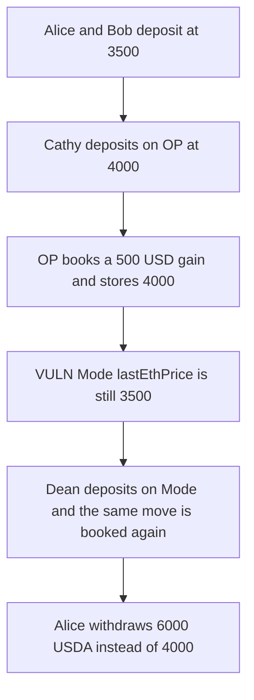

# Autonomint CDS: unsynced lastEthPrice books the same ETH move twice

> **Vulnerability classes:** `vuln/oracle/stale-price` · `vuln/logic/state-update`

<!-- non-defihacklabs -->
<!-- source-auditvault: https://github.com/Auditware/AuditVault/blob/main/findings/45459-h-6-lack-of-lastethprice-sync-between-different-chains-sherl.md -->
<!-- date: 2024-11 -->

## Key info

| Field | Value |
|---|---|
| **Loss** | Alice withdraws 6000 USDA instead of 4000. 2000 USDA is the repeated gain |
| **Vulnerable contract** | `CdsChain.updateLastEthPrice` |
| **Attacker EOA** | `0x1111111111111111111111111111111111111111` |
| **Attack contract** | `Exploit` |
| **Attack tx** | `Exploit.run()` |
| **Chain / block / date** | OP and Mode model · block 0 · 2024-11 |
| **Compiler** | solc 0.8.27, cancun, via IR |
| **Bug class** | Per-chain lastEthPrice against an omnichain cumulative index |

## TL;DR

CDS gain is the ETH move from `lastEthPrice` to the current price, and the result is added to a value shared by OP and Mode. Only the chain that is executing writes `lastEthPrice`. After OP books 3500 to 4000, Mode still has 3500, so Dean's deposit books that 500 USD move again. Alice, who deposited at an index of 0, is paid 6000 USDA. Syncing Mode to 4000 before Dean deposits pays her 4000.

## Background

Sherlock's November 2024 Autonomint contest, issue 533, reported by 0x37 and valuevalk. `CDSLib.calculateCumulativeValue` is pure and takes `lastEthPrice` as an argument. The chain then calls `updateLastEthPrice` locally. The report's sequence is Alice and Bob at 3500, Cathy on OP at 4000, Dean on Mode at 4000.

## The vulnerable code

```solidity
value = uint128((_amount * vaultBal * priceDiff * 1e6) / (PRECISION * totalCdsDepositedAmount));
// ...
function updateLastEthPrice(uint128 ethPrice) public {
    lastEthPrice = ethPrice; // @> VULN: only this chain's lastEthPrice moves
}
```

`_amount` is 1000 and `PRECISION` is 1e12, copied from `CDSLib`. With a 500 USD move and `vaultBal` of 1200 ether, Cathy's leg (total 2000 USDA) adds 3e11 and Dean's leg (total 3000 USDA) adds 2e11. Withdrawal profit is `depositedAmount * index / 1e11`.

The fix is to write the same `lastEthPrice` on every chain that shares `cumulativeValue`.

## Root cause

The price checkpoint is chain-local and the accumulator it feeds is not. A later chain replays every ETH move the earlier chain already recorded.

## Preconditions

- OP and Mode both start at `lastEthPrice` 3500, with a shared cumulative index of 0.
- Alice deposits 1000 USDA on OP and Bob's 1000 USDA is already in the omnichain total. Both were at 3500, so neither leg added a gain.
- Cathy deposits on OP at 4000. Dean then deposits on Mode at 4000, before Mode is told about Cathy's update.

## Attack walkthrough

1. Cathy's OP deposit computes the 3500 to 4000 gain and sets OP's `lastEthPrice` to 4000.
2. Dean's Mode deposit still loads 3500 and adds a second leg of 2e11.
3. Alice withdraws against an index of 5e11 and receives 6000 USDA.
4. The control sets Mode's `lastEthPrice` to 4000 before Dean. His leg is 0 and Alice receives 4000 USDA.

## Diagrams



## Impact

Alice's balance goes from 1000 USDA to 6000. The fair withdrawal is 4000 USDA, so 2000 USDA is taken from the treasury float that backs the other depositors. The synced control pays exactly 4000 and leaves the second leg at zero.

## How to reproduce

```bash
cd 45459-h-6-lack-of-lastethprice-sync-between-different-chains-sherl_exp
forge test -vv
```

`test_exploit_repeated_eth_move_overpays_alice` asserts a 6000 USDA payout and a 2e11 second leg. `test_control_synced_price_pays_4000` asserts the synced price pays 4000. Output is `output.txt`.

## Sources

- AuditVault finding: https://github.com/Auditware/AuditVault/blob/main/findings/45459-h-6-lack-of-lastethprice-sync-between-different-chains-sherl.md
- Sherlock issue 533: https://github.com/sherlock-audit/2024-11-autonomint-judging/issues/533
- Blamed library: https://github.com/sherlock-audit/2024-11-autonomint/blob/main/Blockchain/Blockchian/contracts/lib/CDSLib.sol
