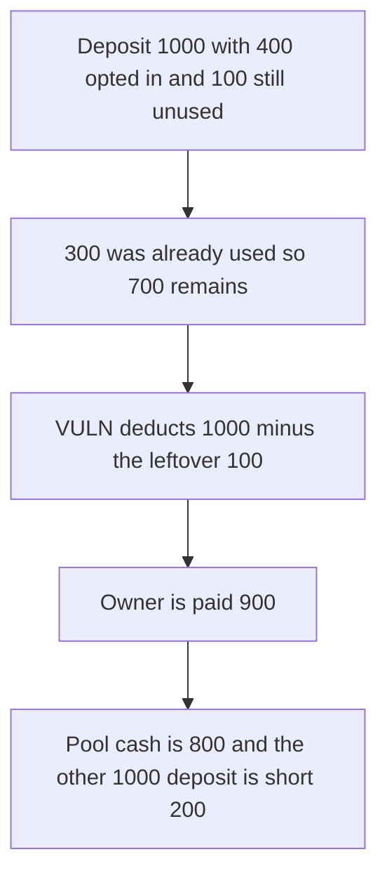

# Autonomint: withdrawUser pays 900 CDS when 700 of the deposit is left

> **Vulnerability classes:** `vuln/logic/liquidation-logic` · `vuln/logic/state-update`

<!-- non-defihacklabs -->
<!-- source-auditvault: https://github.com/Auditware/AuditVault/blob/main/findings/45460-h-7-incorrect-deducted-cds-deposit-amount-in-withdrawuser-sh.md -->
<!-- date: 2024-11 -->

## Key info

| Field | Value |
|---|---|
| **Loss** | The withdrawing CDS owner receives 900. Only 700 of that deposit is left. The other depositor is short 200 |
| **Vulnerable contract** | `CdsPool.withdrawUser` |
| **Attacker EOA** | `0x1111111111111111111111111111111111111111` |
| **Attack contract** | `Exploit` |
| **Attack tx** | `Exploit.run()` |
| **Chain / block / date** | Ethereum model · block 0 · 2024-11 |
| **Compiler** | solc 0.8.27, cancun, via IR |
| **Bug class** | Leftover liquidation capacity is treated as the amount already used |

## TL;DR

`liquidationAmount` on an opted-in CDS position is the liquidation capacity still left, not the amount already consumed. The position deposited 1000, opted in 400, and has 100 of that capacity left, so 300 was used and 700 remains. `withdrawUser` deducts `1000 - 100 = 900` from `totalCdsDepositedAmount` and pays 900. The pool started with 1700 of cash (700 left plus another depositor's 1000) and finishes with 800. The other depositor's record is still 1000.

## The vulnerable code

```solidity
uint256 deposit = depositedAmount[user];
uint256 leftLiquidation = liquidationAmount[user];
// @> VULN: liquidationAmount is the remainder, so this deducts more than the deposit left
totalCdsDepositedAmount -= (deposit - leftLiquidation);
require(asset.transfer(user, deposit - leftLiquidation), "pay");
```

The finding's expression is `depositedAmount - liquidationAmount`. The amount that should be deducted is `depositedAmount - (initialLiquidationAmount - liquidationAmount)`.

## Root cause

The same field is read as if it were the consumed liquidation. It is the unused remainder, so the subtraction removes too much from the global total and the payout matches that wrong figure.

## Preconditions

- Deposited 1000, initial liquidation opt-in 400, leftover liquidation 100.
- Another depositor has 1000 with no liquidation.
- The pool holds 1700, the cash still backing both remaining deposits.

## Attack walkthrough

1. Read the global total. It is 1700.
2. Withdraw. The deduction and the transfer are both 900.
3. The owner holds 900. The global total is 800. Pool cash is 800.
4. The other 1000 deposit is short 200.

## Diagrams



## Impact

The withdrawing owner takes 200 CDS that belongs to the other depositor. `totalCdsDepositedAmount` is 200 below the deposit that is still recorded for that other user. Deducting the true remainder pays 700 and leaves 1000 of cash.

## Remediation

Deduct `depositedAmount - (initialLiquidationAmount - liquidationAmount)` from the global total, and pay that same left deposit.

## How to reproduce

```bash
cd 45460-h-7-incorrect-deducted-cds-deposit-amount-in-withdrawuser-sh_exp
forge test -vv
```

## Sources

- AuditVault finding: https://github.com/Auditware/AuditVault/blob/main/findings/45460-h-7-incorrect-deducted-cds-deposit-amount-in-withdrawuser-sh.md
- Sherlock contest: https://github.com/sherlock-audit/2024-11-autonomint-judging/issues/563
- Reduced source: `test/45460-h-7-incorrect-deducted-cds-deposit-amount-in-withdrawuser-sh.sol`, from CDSLib.withdrawUser
