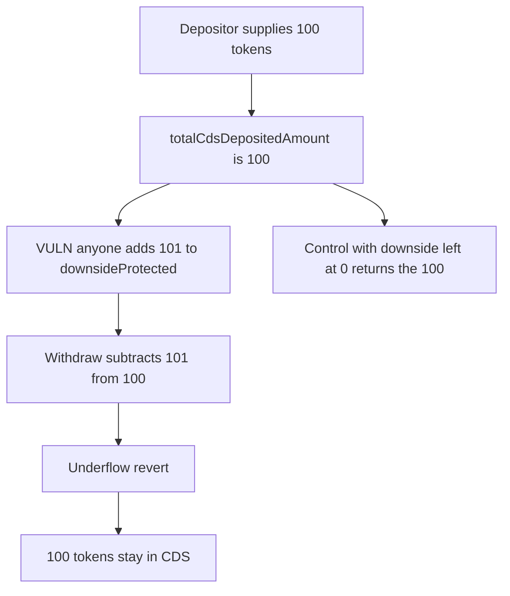

# Autonomint: anyone can set downsideProtected and freeze a 100 token CDS deposit

> **Vulnerability classes:** `vuln/access-control/missing-auth` · `vuln/arithmetic/underflow`

<!-- non-defihacklabs -->
<!-- source-auditvault: https://github.com/Auditware/AuditVault/blob/main/findings/45461-h-8-malicious-users-can-dos-the-protocol-by-setting-downside.md -->
<!-- date: 2024-11 -->

## Key info

| Field | Value |
|---|---|
| **Loss** | Depositor cannot withdraw 100 tokens after downsideProtected is set to 101 |
| **Vulnerable contract** | `CDS.updateDownsideProtected` |
| **Attacker EOA** | `0x1111111111111111111111111111111111111111` |
| **Attack contract** | `Exploit` |
| **Attack tx** | `Exploit.run()` |
| **Chain / block / date** | Ethereum model · block 0 · 2024-11 |
| **Compiler** | solc 0.8.27, cancun, via IR |
| **Bug class** | Permissionless addition to `downsideProtected` underflows the deposit total |

## TL;DR

`updateDownsideProtected` has no access control. It adds the caller's `uint128` to `downsideProtected`. `deposit` and `withdraw` subtract that value from `totalCdsDepositedAmount`. A depositor puts in 100 tokens. An attacker adds 101. The next withdraw underflows and reverts. The 100 tokens stay in CDS and the depositor's balance stays 0. With `downsideProtected` left at 0, the same withdraw returns the 100.

## Background

Sherlock, November 2024 Autonomint Colored Dollar V1, issue 624 (H-8). `CDS.updateDownsideProtected` is external. `_updateCurrentTotalCdsDepositedAmount` subtracts `downsideProtected` from both deposit totals and then zeroes it. That helper runs on deposit and withdraw. A value above the live total reverts both, so deposited assets cannot move.

## The vulnerable code

```solidity
function updateDownsideProtected(uint128 downsideProtectedAmount) external {
    downsideProtected += downsideProtectedAmount; // @> VULN: no access control
}

function _updateCurrentTotalCdsDepositedAmount() private {
    if (downsideProtected > 0) {
        totalCdsDepositedAmount -= downsideProtected; // underflows when downside exceeds deposits
        totalCdsDepositedAmountWithOptionFees -= downsideProtected;
        downsideProtected = 0;
    }
}
```

```diff
 function updateDownsideProtected(uint128 downsideProtectedAmount) external {
+    require(msg.sender == admin, "admin");
     downsideProtected += downsideProtectedAmount;
 }
```

## Root cause

The setter is permissionless, and the value it writes is later subtracted from a total that users can only increase by depositing. Nothing caps `downsideProtected` at `totalCdsDepositedAmount`. Once it is larger, every core call that runs the subtraction reverts, which is a permanent denial of service until the value is repaired by an upgrade.

## Preconditions

- `totalCdsDepositedAmount` is 100 tokens. That is one depositor's balance in this run.
- Anyone can call `updateDownsideProtected`. No role is checked.
- The attacker passes 101 ether, which fits in `uint128` and is greater than the deposit total.

## Attack walkthrough

1. The depositor supplies 100 tokens. The deposit succeeds because `downsideProtected` is still 0.
2. The attacker calls `updateDownsideProtected(101 ether)`.
3. The depositor calls `withdraw`.
4. `_updateCurrentTotalCdsDepositedAmount` computes `100 - 101` and reverts.
5. The low-level call reports failure.
6. CDS still holds 100 tokens. The depositor holds 0.

## Diagrams



## Impact

The depositor cannot withdraw. The 100 tokens are frozen in CDS for as long as `downsideProtected` stays above the deposit total. The same revert hits `deposit`, so new users cannot enter either. The control, which never calls the setter, returns the 100 tokens to the depositor and leaves CDS empty.

## Remediation

Restrict `updateDownsideProtected` to the admin, and reject an amount that would make `downsideProtected` larger than `totalCdsDepositedAmount`.

## How to reproduce

```bash
cd 45461-h-8-malicious-users-can-dos-the-protocol-by-setting-downside_exp
forge test -vv
```

`test_exploit_downside_underflow_locks_100` asserts `downsideProtected` of 101, a 100 token CDS balance, and a 0 depositor balance. `test_control_withdraw_succeeds_when_downside_is_unset` asserts a full withdrawal. Captured output is `output.txt`.

## Sources

- AuditVault finding: https://github.com/Auditware/AuditVault/blob/main/findings/45461-h-8-malicious-users-can-dos-the-protocol-by-setting-downside.md
- Sherlock judging issue 624: https://github.com/sherlock-audit/2024-11-autonomint-judging/issues/624
- Audited lines: https://github.com/sherlock-audit/2024-11-autonomint/blob/main/Blockchain/Blockchian/contracts/Core_logic/CDS.sol#L829-L839
