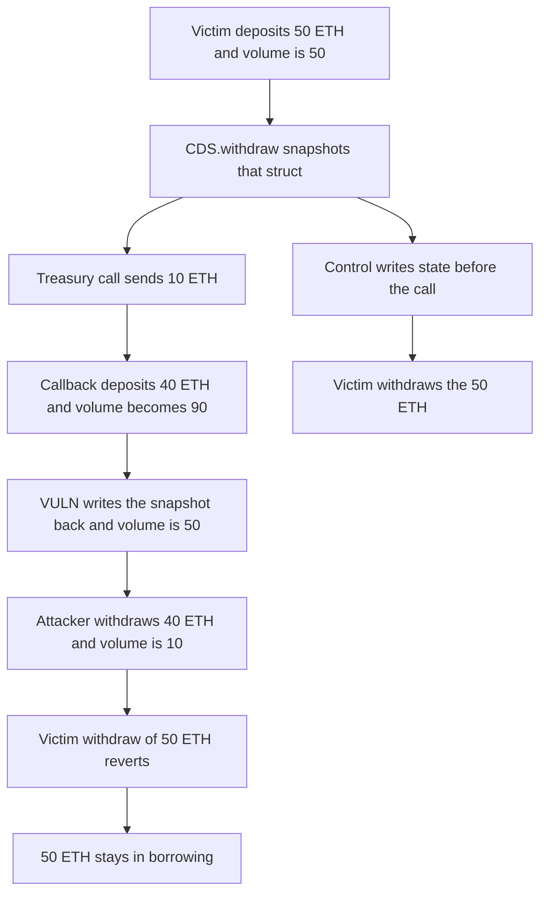

# Autonomint: CDS withdraw restores a stale volume and locks 50 ETH of a borrower

> **Vulnerability classes:** `vuln/reentrancy/cross-contract` · `vuln/dos/frozen-funds`

<!-- non-defihacklabs -->
<!-- source-auditvault: https://github.com/Auditware/AuditVault/blob/main/findings/45477-h-24-cross-contract-reentrancy-vulnerability-in-cds-withdraw.md -->
<!-- date: 2024-11 -->

## Key info

| Field | Value |
|---|---|
| **Loss** | 50 ETH stuck in the borrowing contract |
| **Vulnerable contract** | `CDS.withdraw` |
| **Attacker EOA** | `0x1111111111111111111111111111111111111111` |
| **Attack contract** | `Exploit` |
| **Attack tx** | `Exploit.run()` |
| **Chain / block / date** | Ethereum model · block 0 · 2024-11 |
| **Compiler** | solc 0.8.27, cancun, via IR |
| **Bug class** | Stale `omniChainData` written after an ETH callback |

## TL;DR

`CDS.withdraw` loads `omniChainData`, pays 10 ETH of liquidation gains with a raw call, then writes the in-memory struct back. During that call the attacker deposits 40 ETH, which raises `totalVolume` to 90. The write puts it back to 50. The attacker then withdraws the 40. Volume is 10, so the victim's 50 ETH withdrawal reverts. The borrowing contract still holds the 50 ETH. The control writes state before the call, and the victim withdraws.

## Background

Sherlock contest 2024-11-autonomint, issue H-24, reported by t.aksoy and valuevalk. `nonReentrant` on CDS does not stop the callback from entering the borrowing contract. The final `setOmniChainData` uses the struct captured at the start of the withdraw.

## The vulnerable code

```solidity
GlobalVariables.OmniChainData memory omniChainData = globalVariables.getOmniChainData();
omniChainData.collateralProfitsOfLiquidators -= totalWithdrawCollateralAmountInETH;
treasury.transferEthToCdsLiquidators(msg.sender, uint128(ethAmount));
// @> VULN: the in-memory snapshot overwrites omniChainData written by the borrower during the ETH callback
globalVariables.setOmniChainData(omniChainData);
```

`transferEthToCdsLiquidators` is the raw call from the report:

```solidity
(bool sent,) = payable(user).call{value: amount}("");
if (!sent) revert Treasury_EthTransferToCdsLiquidatorFailed();
```

## Root cause

Effects are applied from a memory copy taken before the interaction. Any global update made by the recipient is replaced by that copy.

## Preconditions

- A borrower already has 50 ETH of balance and the global volume is 50 ETH.
- The attacker is owed 10 ETH of liquidation gains, so the treasury call runs.
- The attacker contract can deposit into borrowing from its receive function.

## Attack walkthrough

1. The victim deposits 50 ETH. Volume is 50.
2. Liquidation profits are set to 10 ETH and the treasury is funded with 10 ETH.
3. `CDS.withdraw` snapshots volume 50 and profit 10, then subtracts the profit in memory.
4. Treasury sends 10 ETH. The callback deposits 40 ETH. Global volume becomes 90.
5. CDS writes the snapshot. Volume is 50 again.
6. The attacker withdraws 40 ETH. Volume falls to 10.
7. The victim's 50 ETH withdrawal reverts. Borrowing still holds 50 ETH.

## Diagrams



## Impact

The borrower is owed 50 ETH and cannot withdraw it, because `totalVolumeOfBorrowersAmountinWei` is 10 ETH. The 50 ETH remains in the borrowing contract. The control leaves volume consistent with balances, and the victim receives 50 ETH.

## Remediation

Write `omniChainData` before `transferEthToCdsLiquidators`, or reload it after the call. Do not store a struct that was copied before the recipient ran.

## How to reproduce

```bash
cd 45477-h-24-cross-contract-reentrancy-vulnerability-in-cds-withdraw_exp
forge test -vv
```

`test_exploit_stale_volume_locks_50_eth` asserts a 50 ETH borrowing balance, volume of 10 ETH, and a blocked victim. `test_control_write_before_call_lets_victim_withdraw` asserts the victim receives 50 ETH and the borrowing contract is empty. Captured output is `output.txt`.

## Sources

- AuditVault finding: https://github.com/Auditware/AuditVault/blob/main/findings/45477-h-24-cross-contract-reentrancy-vulnerability-in-cds-withdraw.md
- Sherlock issue: https://github.com/sherlock-audit/2024-11-autonomint-judging/issues/832
