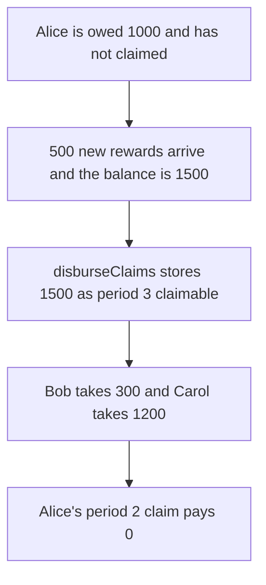

# GammaSwap: disburseClaims pays a new period with the previous period's unclaimed tokens

> **Vulnerability classes:** `vuln/logic/state-update`

<!-- non-defihacklabs -->
<!-- source-auditvault: https://github.com/Auditware/AuditVault/blob/main/findings/45529-c-01-disburseclaims-allows-theft-of-unclaimed-funds-pashov-a.md -->
<!-- date: 2024-12 -->

## Key info

| Field | Value |
|---|---|
| **Loss** | Alice's unclaimed 1000 GS is paid to period 3. Bob, entitled to 100, receives 300 |
| **Vulnerable contract** | `FundingVault.disburseClaims` |
| **Attacker EOA** | `0x1111111111111111111111111111111111111111` |
| **Attack contract** | `Exploit` (Bob) |
| **Attack tx** | `Exploit.run()` |
| **Chain / block / date** | Local synthetic · 2024-12 |
| **Compiler** | solc 0.8.27, cancun, via IR |
| **Bug class** | Current-period claimable amount is the whole token balance |

## TL;DR

`disburseClaims` sets `totalClaimable[period]` to the vault's entire token balance. That balance still holds rewards users have not claimed. Period-3 claimants are paid from Alice's period-2 balance. Bob's fair share of the new 500 is 100; he receives 300. Carol receives 1200. Alice's later claim pays 0.

## The vulnerable code

```solidity
totalClaimable[_period] = GammaSwapLibrary.balanceOf(claimToken, address(this)); // @> VULN
_claimable = GSMath.min(GammaSwapLibrary.balanceOf(claimToken, address(this)), _claimable);
GammaSwapLibrary.safeTransfer(claimToken, _to, _claimable);
```

The report's fix passes the new amount in as an argument instead of reading the live balance. `disburseClaimsFixed(500)` pays Bob 100, Carol 400, and still leaves Alice her 1000.

## Root cause

The vault keeps unclaimed rewards in the same token balance as the next period's funding. Booking that whole balance to the new period lets the new period's weights spend the old period's tokens.

## Preconditions

- Period 2 was disbursed for 1000 GS and Alice (weight 1000 of 1000) has not claimed.
- Period 3 is funded with 500 GS. Bob's weight is 100 and Carol's is 400, out of 500.
- The manager calls `disburseClaims` with no separate new-amount argument.

## Attack walkthrough

1. After period 2, the vault holds Alice's 1000. Period 3 adds 500. Balance is 1500.
2. `disburseClaims` stores 1500 as `totalClaimable[3]`.
3. Bob claims `1500 * 100 / 500 = 300`.
4. Carol claims `1500 * 400 / 500 = 1200`. The vault is empty.
5. Alice's period-2 claim is capped by `min(balance, 1000)` and pays 0.

## Diagrams



## Impact

Unclaimed rewards are stolen by the next period's claimants. In this run the stolen amount is Alice's full 1000 GS. Bob's personal take is 300 instead of 100, which is the profit the Playground records.

## How to reproduce

```bash
cd 45529-c-01-disburseclaims-allows-theft-of-unclaimed-funds-pashov-a_exp
forge test -vv
```

## Sources

- AuditVault finding: https://github.com/Auditware/AuditVault/blob/main/findings/45529-c-01-disburseclaims-allows-theft-of-unclaimed-funds-pashov-a.md
- Report: https://github.com/pashov/audits/blob/master/team/md/GammaSwap-security-review_2024-12-30.md
- Blamed line: `FundingVault.disburseClaims` balance assignment, as quoted in that review
