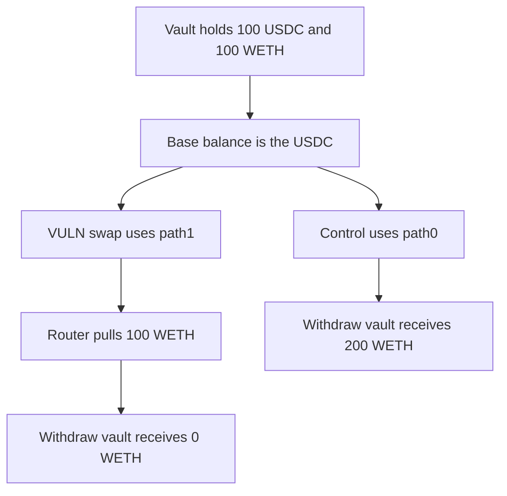

# GammaSwap: processWithdrawals always swaps along path1

> **Vulnerability classes:** `vuln/logic/wrong-condition`

<!-- non-defihacklabs -->
<!-- source-auditvault: https://github.com/Auditware/AuditVault/blob/main/findings/45530-h-01-incorrect-swapping-path-in-processwithdrawals-pashov-au.md -->
<!-- date: 2024-12 -->

## Key info

| Field | Value |
|---|---|
| **Loss** | Router takes 100 WETH. The withdraw vault receives 0 WETH instead of 200 |
| **Vulnerable contract** | `GammaVault.processWithdrawals` |
| **Attacker EOA** | `0x1111111111111111111111111111111111111111` |
| **Attack contract** | `Exploit` |
| **Attack tx** | `Exploit.run()` |
| **Chain / block / date** | Ethereum model · block 0 · 2024-12 |
| **Compiler** | solc 0.8.27, cancun |
| **Bug class** | base-token swap is hardcoded to path1 |

## TL;DR

When the asset token is token1, the base balance is token0. On Ethereum, WETH is token1 and USDC is token0, so the sell path for the base token is path0. `processWithdrawals` still passes `path1`. The router sells 100 WETH into USDC. The vault's WETH balance is then 0, and the withdraw vault receives nothing.

## The vulnerable code

```solidity
router.swapExactTokensForTokens(
    baseBalance,
    0,
    path1, // @> VULN: path1 even when the asset token is token1
    address(this),
    type(uint256).max
);
```

```diff
- path1,
+ isAssetToken0 ? path1 : path0,
```

## Root cause

`baseBalance` already switches on `isAssetToken0`, but the path argument does not. path1 is the token1 path. Using it while the base token is token0 sells the asset instead of the base.

## Preconditions

- Asset token is WETH, `isAssetToken0` is false, so the base token is USDC.
- The vault holds 100 USDC and 100 WETH and has approved the router for both.
- path0 is USDC to WETH. path1 is WETH to USDC.

## Attack walkthrough

1. `processWithdrawals` reads a base balance of 100 USDC.
2. The router is called with path1 and that amount.
3. The router pulls 100 WETH from the vault and returns 100 USDC.
4. The vault's WETH balance is 0, so the transfer to the withdraw vault sends 0.
5. The router holds 300 WETH, up 100.
6. The control passes path0 and the withdraw vault receives 200 WETH.

## Diagrams



## Impact

Withdrawers are paid in the asset token. This run pays them 0 WETH instead of 200. The 100 WETH that should have stayed, plus the 100 WETH the correct swap would have bought, never reaches the withdraw vault. The router keeps the 100 WETH it pulled.

## How to reproduce

```bash
cd 45530-h-01-incorrect-swapping-path-in-processwithdrawals-pashov-au_exp
forge test -vv
```

`output.txt` is the captured passing run. The control test checks the recommended fix.

## Sources

- AuditVault finding: https://github.com/Auditware/AuditVault/blob/main/findings/45530-h-01-incorrect-swapping-path-in-processwithdrawals-pashov-au.md
- Report: https://github.com/pashov/audits/blob/master/team/md/GammaSwap-security-review_2024-12-30.md
- Provenance: Pashov GammaSwap review dated 2024-12-30. The blamed path1 argument is quoted from processWithdrawals.
