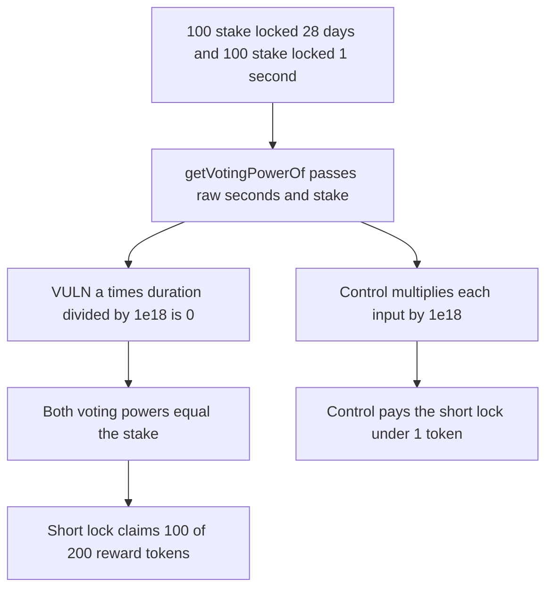

# A 1 second lock matches a 28 day lock and takes 100 of 200 reward tokens

> **Vulnerability classes:** vuln/arithmetic/precision-loss · vuln/logic/reward-calculation

<!-- non-defihacklabs -->
<!-- source-auditvault: https://github.com/Auditware/AuditVault/blob/main/findings/45546-c-01-scaling-of-ud60x18-variables-sent-to-calculatevotingpo.md -->
<!-- date: 2025-02 -->

## Key info

| Field | Value |
|---|---|
| **Loss** | 100 reward tokens paid to a 1 second lock. The scaled curve would pay that lock under 1 token |
| **Vulnerable contract** | `VeGuan.getVotingPowerOf` |
| **Attacker EOA** | `0x1111111111111111111111111111111111111111` |
| **Attack contract** | `Exploit` |
| **Attack tx** | `Exploit.run()` |
| **Chain / block / date** | Ethereum model · block 0 · 2025-02 |
| **Compiler** | solc 0.8.27, cancun, via IR |
| **Bug class** | Raw seconds and stake are passed into UD60x18 math, so the lock multiplier underflows |

## TL;DR

`_calculateVotingPower` treats its arguments as UD60x18 values, which are real numbers scaled by 1e18. `getVotingPowerOf` passes the raw curve factor, the raw remaining seconds, and the raw stake. `1 * 2419200 / 1e18` is 0, the multiplier becomes 1, and voting power equals stake for both a 28 day lock and a 1 second lock. The reward split of 200 tokens therefore pays the short lock 100. Scaling the three inputs by 1e18 drops that fair share under 1 token.

## Background

Shieldify's Guanciale Stake review, published February 2025, finding C-01. `veGUAN._calculateVotingPower` uses PaulRBerg's `UD60x18` type. The report shows a max-duration stake and a min-duration stake both returning voting power equal to the stake, including after time passes. The team fixed it by multiplying each input by 1e18 before the call.

## The vulnerable code

```solidity
uint256 remaining = _remaining(tokenId);
// @> VULN: raw seconds and stake are passed into UD60x18 math, so the lock multiplier underflows to zero
return _calculateVotingPower(votingPowerCurveAFactor, remaining, locked.stake);
```

`_calculateVotingPower` does `a * duration / 1e18` and then `stake * scaling / 1e18`. With raw inputs the first product is 0 and the second returns the stake unchanged.

## Root cause

The function divides by `UNIT` as if the inputs were already 18-decimal fixed point. Seconds and token amounts below 1e18 lose the entire lock term. A 1 second lock and a 28 day lock of the same stake get the same power.

## Preconditions

- `votingPowerCurveAFactor` is 1, the raw curve constant the fix multiplies by 1e18.
- One position locks 100 stake for 28 days. The attacker locks 100 stake for 1 second.
- The reward pot is 200 tokens, split by voting power.

## Attack walkthrough

1. Both positions are staked.
2. `getVotingPowerOf` returns 100 for the long lock and 100 for the short lock.
3. The same function with inputs multiplied by 1e18 gives the short lock a fair share under 1 token.
4. `claim` on the short lock transfers 100 reward tokens.

## Diagrams



## Impact

The short locker receives 100 reward tokens, half the pot, for a lock that should be almost worthless next to a 28 day lock of the same size. The long locker's voting weight never grows with time and never decays. The scaled preview pays the short lock under 1 token of the same 200 token pot.

## Remediation

Scale each argument by 1e18 at the call, which is the change in the report: `votingPowerCurveAFactor * 1e18`, `remainingLockDuration * 1e18`, and `stake * 1e18`.

## How to reproduce

```bash
cd 45546-c-01-scaling-of-ud60x18-variables-sent-to-calculatevotingpo_exp
forge test -vv
```

`test_exploit_one_second_lock_takes_half_the_rewards` asserts both powers are 100 ether, the claim pays 100 ether, and the scaled short share is under 1 ether. `test_control_scaled_short_lock_is_under_one_token` asserts the same split on a fresh veGUAN. Captured output is `output.txt`.

## Sources

- AuditVault finding: https://github.com/Auditware/AuditVault/blob/main/findings/45546-c-01-scaling-of-ud60x18-variables-sent-to-calculatevotingpo.md
- Shieldify report: https://github.com/shieldify-security/audits-portfolio-md/blob/main/Guanciale-Stake-Security-Review.md
- Blamed function: https://github.com/GuancialeAI/guan-staking-contracts/blob/f1f9d252d30edd7e7f04cc536dadae90a9daa509/src/veGUAN.sol#L369
