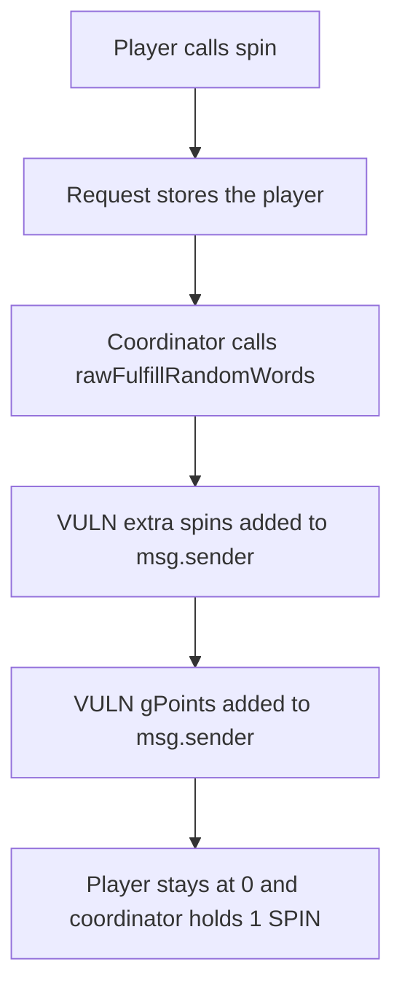

# Guanciale: Wheel rewards are credited to the VRF coordinator

> **Vulnerability classes:** `vuln/logic/reward-calculation`

<!-- non-defihacklabs -->
<!-- source-auditvault: https://github.com/Auditware/AuditVault/blob/main/findings/45547-c-02-incorrect-receiver-of-extraspins-and-gpoints-in-handle.md -->
<!-- date: 2024-12 -->

## Key info

| Field | Value |
|---|---|
| **Loss** | The player receives 0 extra spins and 0 gPoints. The VRF coordinator receives 1 spin and 5 gPoints |
| **Vulnerable contract** | `WheelOfGuantune._handleRewardPayout` |
| **Attacker EOA** | `0x1111111111111111111111111111111111111111` |
| **Attack contract** | `Exploit` |
| **Attack tx** | `Exploit.run()` |
| **Chain / block / date** | Ethereum model · local · 2024-12 |
| **Compiler** | solc 0.8.27, cancun |
| **Bug class** | Reward credited to `msg.sender` inside a VRF callback |

## TL;DR

`rawFulfillRandomWords` can only be called by the VRF coordinator. `_handleRewardPayout` still adds extra spins and gPoints to `msg.sender`. The player stored on the spin request stays at zero. One SPIN token is minted to the coordinator.

## Background

Shieldify's December 2024 review of Guanciale Stake, finding C-02, in `WheelOfGuantune`. The team marked the issue fixed. The blamed lines are the `extraSpinsOfUser[msg.sender]` and `gPointsOfUser[msg.sender]` updates.

## The vulnerable code

```solidity
$.extraSpinsOfUser[msg.sender] += extraSpins; // @> VULN: credits the VRF coordinator, not user
// FIX: $.extraSpinsOfUser[user] += extraSpins;
$.gPointsOfUser[msg.sender] += gPoints; // @> VULN: gPoints follow msg.sender as well
// FIX: $.gPointsOfUser[user] += gPoints;
```

## Root cause

The payout function receives the spinning `user` and does not use it. The only address allowed to enter the callback is the coordinator, so `msg.sender` is never the player.

## Preconditions

- A player calls `spin()` and the request stores that player.
- The coordinator later calls `rawFulfillRandomWords`.
- The drawn reward type is extra spins or gPoints.

## Attack walkthrough

1. The player calls `spin`. The request records the player.
2. The coordinator fulfills the request.
3. The extra-spin table returns 1. That 1 is added to the coordinator, and 1 SPIN is minted to the coordinator.
4. The gPoints table returns 5. Those 5 are added to the coordinator.
5. The player's spin balance and gPoints balance are both 0.

## Diagrams



## Impact

The player who paid for the spin does not receive the extra spin or the gPoints. The coordinator's extra-spin balance becomes 1 and its SPIN balance becomes 1e18. The same mis-credit applies to gPoints.

## Remediation

Write both balances to the `user` argument, which is the address stored on the spin request, as in the Shieldify diff.

## How to reproduce

```bash
cd 45547-c-02-incorrect-receiver-of-extraspins-and-gpoints-in-handle_exp
forge test -vv
```

`test_exploit_coordinator_receives_the_players_reward` asserts the player is at 0 and the coordinator holds 1 spin, 5 gPoints, and 1 SPIN. Captured output is `output.txt`.

## Sources

- AuditVault finding: https://github.com/Auditware/AuditVault/blob/main/findings/45547-c-02-incorrect-receiver-of-extraspins-and-gpoints-in-handle.md
- Shieldify report: https://github.com/shieldify-security/audits-portfolio-md/blob/main/Guanciale-Stake-Security-Review.md
- Blamed lines: https://github.com/GuancialeAI/guan-staking-contracts/blob/0762999070df6a738b8d0e22f09e5c776437672c/src/games/WheelOfGuantune.sol#L613-L628
