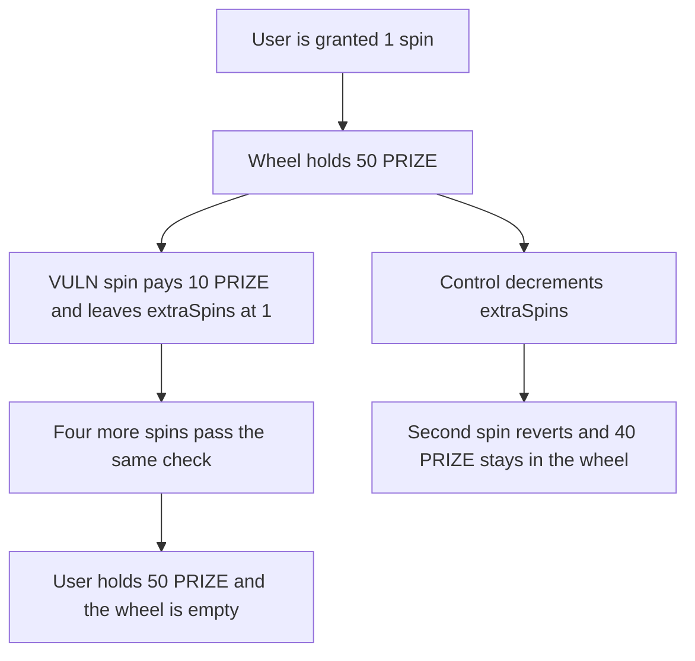

# Guanciale: one spin allocation drains 50 PRIZE

> **Vulnerability classes:** `vuln/logic/state-update` · `vuln/logic/missing-check`

<!-- non-defihacklabs -->
<!-- source-auditvault: https://github.com/Auditware/AuditVault/blob/main/findings/45548-c-03-number-of-available-spins-is-never-decreased-on-spin-or.md -->
<!-- date: 2024-12 -->

## Key info

| Field | Value |
|---|---|
| **Loss** | 50 PRIZE paid for a single allocated spin |
| **Vulnerable contract** | `WheelOfGuantune.spin` |
| **Attacker EOA** | `0xe9b7c7b41738cca584253874d96767d90789ec30` (the spinner) |
| **Attack contract** | `Exploit` |
| **Attack tx** | `Exploit.run()` |
| **Chain / block / date** | Ethereum model · block 0 · 2024-12 |
| **Compiler** | solc 0.8.27, cancun, via IR |
| **Bug class** | spin pays a prize and never decreases extraSpins |

## TL;DR

`spin` requires `getAvailableSpinsOf(msg.sender) > 0` and then transfers 10 PRIZE. It does not write `extraSpins`. A user who was granted 1 spin calls `spin` five times, receives 50 PRIZE, and `getAvailableSpinsOf` is still 1. The wheel is empty. The control decrements on the first spin, reverts the second, and leaves 40 PRIZE in the wheel.

## Background

Shieldify's December 2024 Guanciale Stake review, finding C-03. `getAvailableSpinsOf` is the allocation the wheel is supposed to consume. The in-scope `spin` path never decreases it, on the spin itself or when the spin is fulfilled. The published test logs the same available count before the spin, after the spin, and after a second spin.

## The vulnerable code

```solidity
function spin() external virtual returns (uint256 available) {
    available = getAvailableSpinsOf(msg.sender);
    require(available > 0, "no spins");
    // @> VULN: the prize is paid and extraSpins is left unchanged, so the same allocation can be spent again
    require(prizeToken.transfer(msg.sender, PRIZE), "prize");
}
```

`getAvailableSpinsOf` returns `extraSpins[user]`. `giveExtraSpins` is the only write.

## Root cause

The check and the state it is supposed to consume are not paired. The transfer is unconditional once the counter is non-zero, and the counter is not updated.

## Preconditions

- The user has been granted one spin.
- The wheel holds at least as many prize tokens as the user will claim. This run funds 50 PRIZE, five prizes of 10.

## Attack walkthrough

1. `giveExtraSpins` sets the user's counter to 1. The wheel holds 50 PRIZE.
2. The first `spin` reads 1, passes the check, and transfers 10 PRIZE.
3. `getAvailableSpinsOf` is still 1.
4. Four more `spin` calls each pass the same check and each pay 10 PRIZE.
5. The user holds 50 PRIZE. The wheel holds 0. The counter is still 1.
6. The control decrements to 0 on the first spin. The second spin reverts with `no spins`.

## Diagrams



## Impact

One allocated spin pays out the whole prize balance the wheel was funded with. The protocol's spin budget does not constrain the number of prizes. In this run that is 50 PRIZE instead of 10.

## Remediation

Decrement `extraSpins[msg.sender]` inside `spin` before the prize transfer, and do the same when a spin is fulfilled if fulfillment is a separate path.

## How to reproduce

```bash
cd 45548-c-03-number-of-available-spins-is-never-decreased-on-spin-or_exp
forge test -vv
```

`test_exploit_one_spin_drains_prize_pool` asserts five prizes, a remaining allocation of 1, and an empty wheel. `test_control_second_spin_reverts_after_decrement` asserts one prize and a revert on the second spin. Captured output is `output.txt`.

## Sources

- AuditVault finding: https://github.com/Auditware/AuditVault/blob/main/findings/45548-c-03-number-of-available-spins-is-never-decreased-on-spin-or.md
- Shieldify report: https://github.com/shieldify-security/audits-portfolio-md/blob/main/Guanciale-Stake-Security-Review.md
