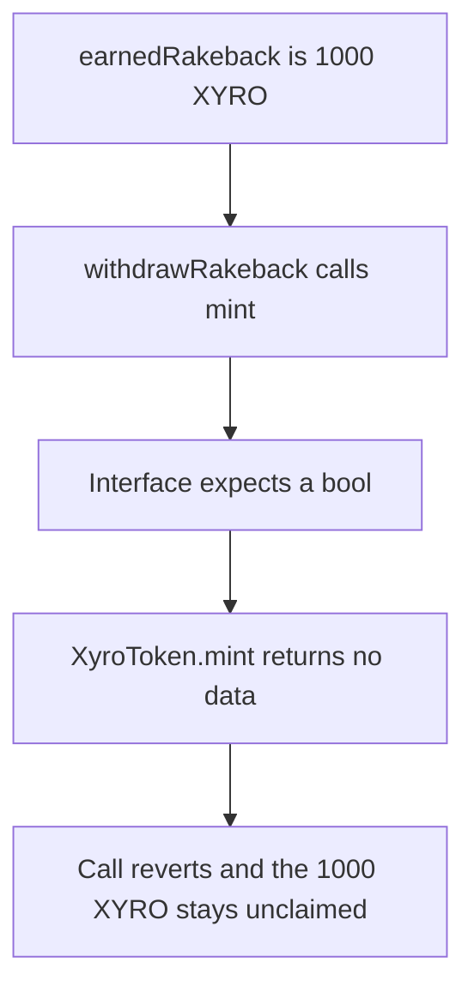

# Xyro: withdrawRakeback always reverts and earned XYRO stays in the treasury

> **Vulnerability classes:** `vuln/dependency/unsafe-external-call` · `vuln/dos/frozen-funds`

<!-- non-defihacklabs -->
<!-- source-auditvault: https://github.com/Auditware/AuditVault/blob/main/findings/45669-withdrawrakeback-function-will-always-be-failed-zokyo-none-x.md -->
<!-- date: 2024-08 -->

## Key info

| Field | Value |
|---|---|
| **Loss** | 1000 XYRO of earned rakeback cannot be withdrawn |
| **Vulnerable contract** | `Treasury.withdrawRakeback` |
| **Attacker EOA** | `0x1111111111111111111111111111111111111111` |
| **Attack contract** | `Exploit` |
| **Attack tx** | `Exploit.run()` |
| **Chain / block / date** | Local synthetic · 2024-08 |
| **Compiler** | solc 0.8.27, cancun, via IR |
| **Bug class** | Mint is called through an interface that expects a bool |

## TL;DR

`withdrawRakeback` debits `earnedRakeback` and calls `IERC20Mint.mint`, which is declared `returns (bool)`. `XyroToken.mint` writes the balance and returns no data. The ABI decode reverts, the debit rolls back, and the 1000 XYRO claim stays stuck. A mint that returns `true` pays the same claim.

## The vulnerable code

```solidity
function withdrawRakeback(uint256 amount) public {
    require(earnedRakeback[msg.sender] >= amount, "Amount is greated than earned rakeback");
    earnedRakeback[msg.sender] -= amount;
    IERC20Mint(address(token)).mint(msg.sender, amount);
}
```

Drop `returns (bool)` from the interface so it matches `XyroToken.mint`.

## Root cause

The treasury and the token disagree on the mint return type. The high-level call requires 32 bytes of returndata that the token never writes.

## Preconditions

- The caller has `earnedRakeback` of 1000 XYRO.
- The treasury's token is the Xyro token whose mint returns nothing.

## Attack walkthrough

1. Credit 1000 XYRO of earned rakeback. The credit event logs that stored balance.
2. `withdrawRakeback(1000)` debits the mapping and calls mint.
3. The call reverts because the returndata is empty.
4. The caller still holds 0 XYRO and `earnedRakeback` is still 1000.

## Diagrams



## Impact

Every rakeback claim reverts. The 1000 XYRO credited in this run cannot be withdrawn until the interface matches the token.

## How to reproduce

```bash
cd 45669-withdrawrakeback-function-will-always-be-failed-zokyo-none-x_exp
forge test -vv
```

## Sources

- AuditVault finding: https://github.com/Auditware/AuditVault/blob/main/findings/45669-withdrawrakeback-function-will-always-be-failed-zokyo-none-x.md
- Zokyo review: https://github.com/solodit/solodit_content/blob/main/reports/Zokyo/2024-08-29-Xyro.md
