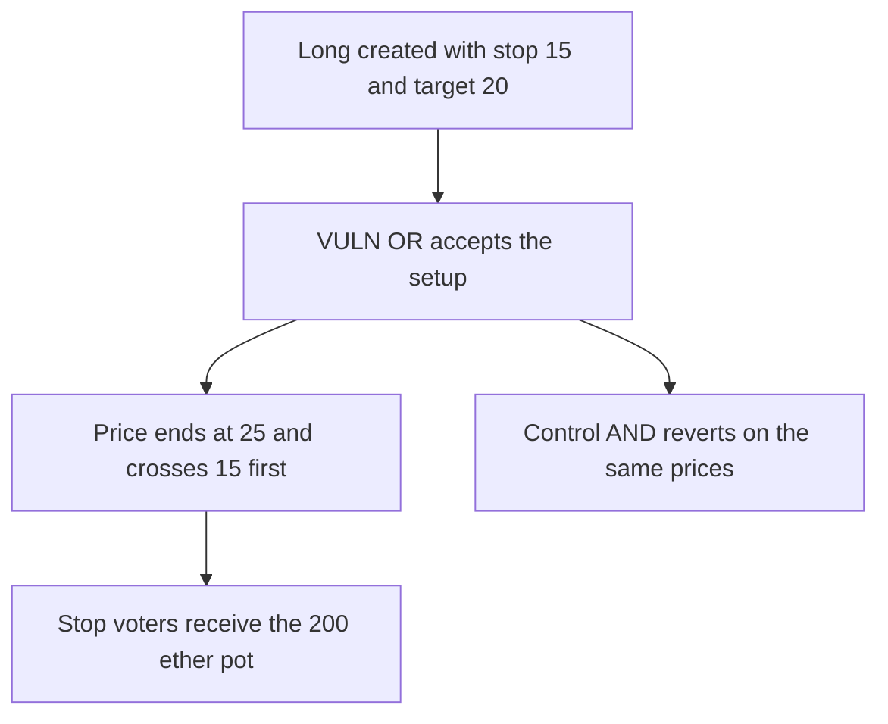

# A long whose stop sits above the start pays the stop-loss voters

> **Vulnerability classes:** `vuln/logic/wrong-condition`

<!-- non-defihacklabs -->
<!-- source-auditvault: https://github.com/Auditware/AuditVault/blob/main/findings/45670-stoploss-and-takeprofit-can-be-set-in-the-same-direction-lea.md -->
<!-- date: 2024-08 -->

## Key info

| Field | Value |
|---|---|
| **Loss** | 100 ether staked on take-profit |
| **Vulnerable contract** | `SetupGame.createSetup` |
| **Attacker EOA** | `0x1111111111111111111111111111111111111111` |
| **Attack contract** | `Exploit` |
| **Attack tx** | `Exploit.run()` |
| **Chain / block / date** | Ethereum model · block 0 · 2024-08 |
| **Compiler** | solc 0.8.27, cancun, via IR |
| **Bug class** | Stop and target checked with OR |

## TL;DR

The report's example is a long with start 10, take-profit 20, and stop 15. `createSetup` accepts it because the require uses `||`. The round ends at 25. The stop at 15 is hit before the target at 20, the stop side is paid the 200 ether pot, and the take-profit stake is gone. `SetupGameFixed` uses `&&` and reverts on those prices, while start 10, stop 5, target 20 is accepted.

## Background

Zokyo's 29 August 2024 Xyro review. `Setup.createSetup` requires `startingPrice / 1e14 > stopLossPrice || startingPrice / 1e14 < takeProfitPrice` for a long. The report says stop-loss voters are then always the winners.

## The vulnerable code

```solidity
bool accepted = stopBelow || targetAbove; // @> VULN: OR accepts a long whose stop is above the start
// FIX: accepted = stopBelow && targetAbove
require(accepted, "Wrong tp or sl price");
```

The change that removes the harm:

```diff
- bool accepted = stopBelow || targetAbove;
+ bool accepted = stopBelow && targetAbove;
```

## Root cause

One true side is enough to pass the require. The target being above the start hides a stop that is also above the start. Settlement walks the price from 10 to 25 and treats the first level, 15, as the stop.

## Preconditions

- `startingPrice` is `10 * 1e14`, so the compared price is 10.
- Take-profit stakes 100 ether and stop-loss stakes 100 ether.
- The end price is 25.

## Attack walkthrough

1. `createSetup(true, 20, 15)` is accepted.
2. Both sides stake 100 ether.
3. `resolve(25)` sets `slWon`.
4. The game transfers 200 ether to the attacker.
5. The fixed contract reverts on the same prices and accepts stop 5 with target 20.

## Diagrams



## Impact

The take-profit staker loses 100 ether. The attacker who voted stop receives the 200 ether pot, including their own stake and the take-profit stake.

## Remediation

Require both sides of the check with `&&`, which is the fix in the Zokyo report.

## How to reproduce

```bash
cd 45670-stoploss-and-takeprofit-can-be-set-in-the-same-direction-lea_exp
forge test -vv
```

`test_exploit` is the harm. The control test is the guarded path. Captured output is `output.txt`.

## Sources

- AuditVault finding: https://github.com/Auditware/AuditVault/blob/main/findings/45670-stoploss-and-takeprofit-can-be-set-in-the-same-direction-lea.md
- Zokyo report: https://github.com/solodit/solodit_content/blob/main/reports/Zokyo/2024-08-29-Xyro.md
