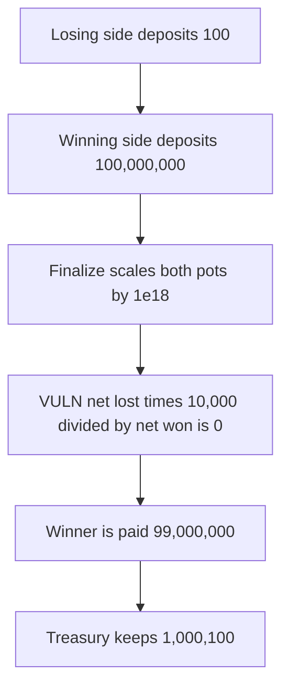

# Xyro: the UpDown payout rate rounds to zero

> **Vulnerability classes:** `vuln/arithmetic/precision-loss` · `vuln/logic/reward-calculation`

<!-- non-defihacklabs -->
<!-- source-auditvault: https://github.com/Auditware/AuditVault/blob/main/findings/45671-users-would-lose-rewards-if-a-huge-majority-bets-on-the-winn.md -->
<!-- date: 2024-08 -->

## Key info

| Field | Value |
|---|---|
| **Loss** | Winning side deposited 100,000,000 and is paid 99,000,000. 1,000,100 tokens stay in the treasury |
| **Vulnerable contract** | `Treasury.calculateUpDownRate` |
| **Attacker EOA** | `0x1111111111111111111111111111111111111111` |
| **Attack contract** | `Exploit` |
| **Attack tx** | `Exploit.run()` |
| **Chain / block / date** | Ethereum model · local · 2024-08 |
| **Compiler** | solc 0.8.27, cancun |
| **Bug class** | Payout rate rounded to 0 when winners dominate |

## TL;DR

`calculateUpDownRate` divides the net losing pot, times `FEE_DENOMINATOR`, by the net winning pot. With 100 on the losing side and 100,000,000 on the winning side, that quotient is 0. `distributeWithoutFee` then pays the winner their deposit minus the 1 percent fee and none of the other side. 1,000,100 tokens remain in the treasury.

## Background

Zokyo's 29 August 2024 Xyro review. The report shows the rate used by the UpDown game, and notes the same shape in the setup-game rate. The fee used here is 100 and `FEE_DENOMINATOR` is 10,000, which is 1 percent. The huge side is the winner, which is the case the title describes and the case in which the published division rounds to 0.

## The vulnerable code

```solidity
lostTeamTotal *= 10 ** token.decimals();
wonTeamTotal *= 10 ** token.decimals();
uint256 lostTeamFee = (lostTeamTotal * updownFee) / FEE_DENOMINATOR;
uint256 wonTeamFee = (wonTeamTotal * updownFee) / FEE_DENOMINATOR;
rate = ((lostTeamTotal - lostTeamFee) * FEE_DENOMINATOR) / (wonTeamTotal - wonTeamFee); // @> VULN: rounds to 0
```

```solidity
uint256 wonAmount = (initialDeposit - withdrawnFees) + ((initialDeposit - withdrawnFees) * rate) / FEE_DENOMINATOR;
```

## Root cause

The numerator is the small losing pot. The denominator is the large winning pot. No extra precision is applied, so the integer quotient is 0 whenever the losers are a small fraction of the winners.

## Preconditions

- Fee is 1 percent.
- Losing deposits are 100 tokens and winning deposits are 100,000,000 tokens.
- One player holds the winning side and is paid with `distributeWithoutFee`.

## Attack walkthrough

1. The losing side deposits 100 tokens.
2. The winning side deposits 100,000,000 tokens.
3. Finalize calls `calculateUpDownRate(100, 100_000_000, 100)`.
4. Both totals are scaled by 1e18, fees are subtracted, and the division is 0.
5. The winner is paid 99,000,000 tokens.
6. The treasury keeps 1,000,100 tokens: the 1,000,000 winner fee plus the 100 losing pot.

## Diagrams



## Impact

The winning depositor receives 1,000,000 tokens less than they deposited, and none of the losing pot. The treasury balance after the payout is 1,000,100 ether units. A rate that keeps an extra 1e18 in the numerator is non-zero for the same inputs.

## Remediation

Scale the rate numerator by an extra fixed-point factor before dividing, and divide the payout by the same factor, so a small losing pot still produces a non-zero rate.

## How to reproduce

```bash
cd 45671-users-would-lose-rewards-if-a-huge-majority-bets-on-the-winn_exp
forge test -vv
```

`test_exploit_rate_zero_pays_winner_99_and_locks_the_pot` asserts rate 0, a 99,000,000 payout, and a 1,000,100 treasury balance. `test_control_extra_precision_rate_is_nonzero` asserts the scaled rate is above 0. Captured output is `output.txt`.

## Sources

- AuditVault finding: https://github.com/Auditware/AuditVault/blob/main/findings/45671-users-would-lose-rewards-if-a-huge-majority-bets-on-the-winn.md
- Zokyo report: https://github.com/solodit/solodit_content/blob/main/reports/Zokyo/2024-08-29-Xyro.md
