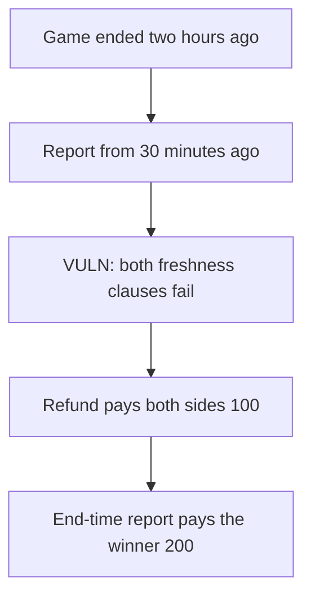

# Xyro UpDown — a late report refunds the loser and the winner only gets their stake

> **Vulnerability classes:** `vuln/oracle/stale-price` · `vuln/logic/wrong-condition`

<!-- non-defihacklabs -->
<!-- source-auditvault: https://github.com/Auditware/AuditVault/blob/main/findings/45672-finalizing-a-game-after-10-minutes-will-lock-users-earned-fu.md -->
<!-- date: 2024-08 -->

## Key info

| | |
|---|---|
| **Protocol** | Xyro UpDown |
| **Finding** | Zokyo, AuditVault 45672 |
| **Vulnerable code** | `finalizeGame` freshness `require` |
| **Harm** | Down is refunded 100. The end-time report pays up 200 on the control. |
| **Chain** | local synthetic |

## TL;DR

Two hours after the end, the report still on hand is 30 minutes old. It is more than 10 minutes after `endTime` and more than 10 minutes before the current block, so both clauses of the freshness check fail and `finalizeGame` reverts. The game master refunds every player, including the side that lost. The true winner gets their 100 stake back, not the 200 pot. Submitting the report from `endTime` itself still pays the winner 200.

## The vulnerable code

```solidity
require(
    priceTimestamp - endTime <= 10 minutes || block.timestamp - priceTimestamp <= 10 minutes,
    "Old chainlink report"
);
```

A report timestamp equal to `endTime` still passes the first clause at any later block. A report that is merely "recent" does not, once it is more than 10 minutes after the end and more than 10 minutes old.

## Root cause

The check is an OR of two windows. It does not mean "you may finalize only within 10 minutes." It rejects the report that is actually available after a delay, and the only recovery in this reduction is `refund`, which returns stakes to both sides.

## Preconditions

The block timestamp is 1700000000. `endTime` is two hours earlier. The available report is from 30 minutes ago, so it is 90 minutes after the end. The end-time price is 1100 and the later price is 900. Starting price is 1000. Each side staked 100.

## Attack walkthrough

1. The game is opened with `endTime = block.timestamp - 2 hours`.
2. `finalizeGame` is called with the 30-minute-old report.
3. Both comparisons fail and the `require` reverts.
4. `refund` sends 100 to up and 100 to down.
5. The control is finalized with `priceTimestamp == endTime`. Price 1100 pays up 200. Down receives 0.

## Diagrams



## Impact

Down, who lost on the end-time price, is refunded 100 instead of losing that stake. Up is paid 100 rather than 200. The control pays up the full 200 and pays down nothing.

## Remediation

Accept the report from `endTime` at any later block, and reject every other timestamp. Do not force a full refund when finalizing is merely late.

## How to reproduce

```bash
cd 45672-finalizing-a-game-after-10-minutes-will-lock-users-earned-fu_exp
forge test -vv
```

## Sources

- AuditVault finding: https://github.com/Auditware/AuditVault/blob/main/findings/45672-finalizing-a-game-after-10-minutes-will-lock-users-earned-fu.md
- Zokyo report: https://github.com/solodit/solodit_content/blob/main/reports/Zokyo/2024-08-29-Xyro.md
- Game contract, fixed on main: https://github.com/xyro-io/smart-contracts/blob/main/contracts/UpDown.sol
