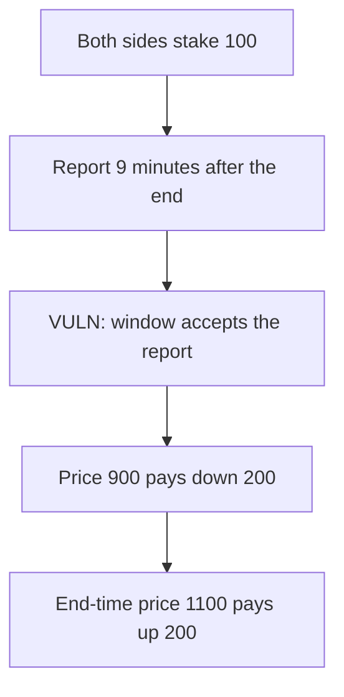

# Xyro UpDown — a price from 9 minutes after the end pays the wrong side

> **Vulnerability classes:** `vuln/oracle/stale-price` · `vuln/logic/price-calculation`

<!-- non-defihacklabs -->
<!-- source-auditvault: https://github.com/Auditware/AuditVault/blob/main/findings/45673-final-prices-within-a-threshold-of-10-minutes-are-accepted-l.md -->
<!-- date: 2024-08 -->

## Key info

| | |
|---|---|
| **Protocol** | Xyro UpDown |
| **Finding** | Zokyo, AuditVault 45673 |
| **Vulnerable code** | `finalizeGame` freshness `require` |
| **Harm** | Down is paid 200. The end-time report pays up 200 on the control. |
| **Chain** | local synthetic |

## TL;DR

Each game has an end time, and the pot should be settled on the Chainlink report from that time. `finalizeGame` accepts any report whose timestamp is within 10 minutes after the end. A report from 9 minutes later has price 900 instead of the end price 1100. The down side takes both 100 stakes. The same game settled on the end-time report pays the up side 200.

## The vulnerable code

```solidity
require(
    priceTimestamp - endTime <= 10 minutes || block.timestamp - priceTimestamp <= 10 minutes,
    "Old chainlink report"
);
```

The current `xyro-io/smart-contracts` tree checks `priceTimestamp - endTime <= 1 minutes` and drops the second clause. This reduction keeps the check the finding quotes.

## Root cause

The window is measured from `endTime`, not from an equality with `endTime`. Nine minutes of price movement is enough to cross the starting price, so the later report names the other winner.

## Preconditions

Both sides have staked 100. The starting price is 1000. The report at `endTime` is 1100. The report at `endTime + 9 minutes` is 900. The game master submits that later report. The first clause of the `require` is true, so the call does not revert.

## Attack walkthrough

1. Up and down each lock 100. `endTime` is this block.
2. `finalizeGame` is called with timestamp `endTime + 9 minutes`.
3. `priceTimestamp - endTime` is 9 minutes, which is inside the 10 minute window.
4. Price 900 is below 1000, so the contract transfers 200 to down. Up's balance stays 0.
5. The control contract accepts only `priceTimestamp == endTime`. Price 1100 pays up 200. Down receives nothing.

## Diagrams



## Impact

The up player, who won on the price at `endTime`, receives none of the 200 pot. The down player is paid 200. The control, which requires the end-time report, pays that 200 to up.

## Remediation

Require the report timestamp to be the game end, not any timestamp inside a 10 minute band around it.

## How to reproduce

```bash
cd 45673-final-prices-within-a-threshold-of-10-minutes-are-accepted-l_exp
forge test -vv
```

## Sources

- AuditVault finding: https://github.com/Auditware/AuditVault/blob/main/findings/45673-final-prices-within-a-threshold-of-10-minutes-are-accepted-l.md
- Zokyo report: https://github.com/solodit/solodit_content/blob/main/reports/Zokyo/2024-08-29-Xyro.md
- Game contract, fixed on main: https://github.com/xyro-io/smart-contracts/blob/main/contracts/UpDown.sol
