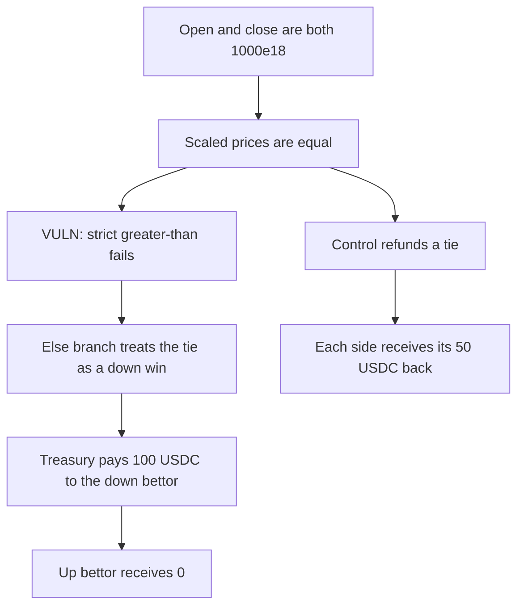

# Xyro UpDown: an unchanged price pays the down side both stakes, 100 USDC

> **Vulnerability classes:** `vuln/logic/wrong-condition`

<!-- non-defihacklabs -->
<!-- source-auditvault: https://github.com/Auditware/AuditVault/blob/main/findings/45674-one-side-players-have-more-probability-of-winning-than-the-o.md -->
<!-- date: 2024-08 -->

## Key info

| Field | Value |
|---|---|
| **Loss** | 50 USDC. The up bettor's stake is paid to the down bettor on a tie. The down bettor receives 100 |
| **Vulnerable contract** | `UpDown.finalizeGame` |
| **Attacker EOA** | `0x000000000000000000000000000000000000b26a` |
| **Attack contract** | `Exploit` |
| **Attack tx** | `Exploit.run()` |
| **Chain / block / date** | Ethereum model · block 0 · 2024-08 |
| **Compiler** | solc 0.8.27, cancun, via IR |
| **Bug class** | Equal price fails a strict greater-than check and is settled as a down win |

## TL;DR

Up bettors win only when `uint192(finalPrice / 1e14)` is strictly greater than `startingPrice`. If the price is unchanged, the comparison fails and the else branch pays the down side. Each side deposited 50 USDC at 1,000e18. Finalization pays the down bettor 100 USDC and the up bettor 0. The control adds an equal-price branch and refunds 50 to each side.

## Background

Zokyo's 29 August 2024 review of Xyro. Players bet that an asset price will be up or down versus the price when the round opened. The report says the down side also wins when the price is equal, so betting down is the better side by probability. The recommended third case refunds both sides when the price does not move.

## The vulnerable code

```solidity
uint256 finalPrice = oracle.price();
Game storage _game = _stored;
// @> VULN: a tie fails the strict greater-than check, so down betters take the whole pot
if (uint192(finalPrice / 1e14) > _game.startingPrice) {
    uint256 finalRate = treasury.calculateUpDownRate(_game.totalDepositsDown, _game.totalDepositsUp, fee);
    // pay upPlayers
} else {
    uint256 finalRate = treasury.calculateUpDownRate(_game.totalDepositsUp, _game.totalDepositsDown, fee);
    // pay downPlayers
}
```

`startingPrice` was stored as `uint192(openPrice / 1e14)`. An unchanged oracle price produces the same scaled integer, and `>` is false.

## Root cause

There are two branches and three outcomes. Equal is grouped with down. With a zero fee, `calculateUpDownRate(50, 50, 0)` is 2e18, so the down deposit of 50 is paid as 100.

## Preconditions

- One up player and one down player have each deposited 50 USDC. The treasury holds 100.
- The open price and the close price are both 1,000e18.
- The fee is 0.
- Anyone may call `finalizeGame` once the round is ready. This run calls it in the same transaction as the assertion.

## Attack walkthrough

1. The scaled close price is `1000e18 / 1e14`. The stored start price is the same integer.
2. The equality check in the exploit confirms the tie before finalization.
3. `finalizeGame` reads the oracle again and takes the else branch.
4. The treasury transfers 100 USDC to the down bettor.
5. The up bettor's balance stays 0. The down bettor holds the whole pot.
6. The control refunds 50 USDC to each player when the scaled prices are equal.

## Diagrams



## Impact

The up bettor loses 50 USDC on a round the price did not move. The down bettor receives 100 USDC, which is their own stake plus the up stake. Every tied round is a down win, so the down side has the higher probability the report describes. The control returns 50 to each side.

## Remediation

Add a third branch for `scaled == startingPrice` that refunds each player their deposit, which is the recommendation in the Zokyo report. Keep the strict greater-than branch for an up win and the less-than branch for a down win.

## How to reproduce

```bash
cd 45674-one-side-players-have-more-probability-of-winning-than-the-o_exp
forge test -vv
```

`test_exploit_tie_pays_down_the_whole_pot` asserts the scaled prices match, the down bettor receives 100 USDC, and the up bettor receives 0. `test_control_tie_refunds_both_sides` asserts each side is refunded 50. Captured output is `output.txt`.

## Sources

- AuditVault finding: https://github.com/Auditware/AuditVault/blob/main/findings/45674-one-side-players-have-more-probability-of-winning-than-the-o.md
- Zokyo report: https://github.com/solodit/solodit_content/blob/main/reports/Zokyo/2024-08-29-Xyro.md
