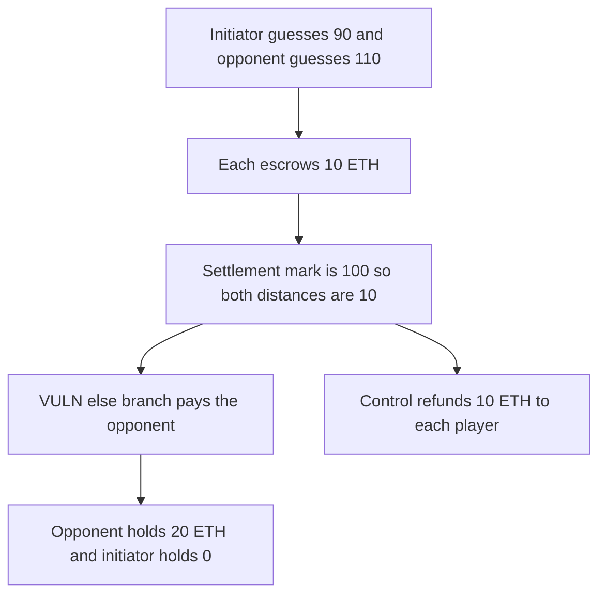

# Xyro: an exact-price tie pays both stakes to the opponent

> **Vulnerability classes:** `vuln/logic/wrong-condition` · `vuln/logic/missing-check`

<!-- non-defihacklabs -->
<!-- source-auditvault: https://github.com/Auditware/AuditVault/blob/main/findings/45675-the-opponent-has-a-higher-probability-of-winning-than-the-in.md -->
<!-- date: 2024-08 -->

## Key info

| Field | Value |
|---|---|
| **Loss** | Initiator's 10 ETH stake paid to the opponent. Opponent ends with 20 ETH |
| **Vulnerable contract** | `OneVsOneExactPrice.finalize` |
| **Attacker EOA** | `0x1111111111111111111111111111111111111111` |
| **Attack contract** | `Exploit` |
| **Attack tx** | `Exploit.run()` |
| **Chain / block / date** | Ethereum model · block 0 · 2024-08 |
| **Compiler** | solc 0.8.27, cancun, via IR |
| **Bug class** | `diff1 < diff2` pays the initiator. Every other case, including a tie, pays the opponent |

## TL;DR

Settlement pays the initiator only when their guess is strictly closer. If both guesses are the same distance from the price, the else branch pays the opponent the combined stake. Price mark 100, initiator 90, opponent 110. Both distances are 10. The opponent receives 20 ETH and the initiator receives 0. A tie refunds 10 ETH to each player.

## Background

Zokyo's 29 August 2024 Xyro review of `OneVsOneExactPrice`. Players cannot submit the same price, but they can still land equally far from the settlement price, one above and one below.

## The vulnerable code

```solidity
if (diff1 < diff2) {
    treasury.distribute(g.depositAmount * 2, g.initiator, g.depositAmount, g.fee);
} else {
    // @> VULN: a tie (diff1 == diff2) pays the opponent instead of refunding both stakes
    treasury.distribute(g.depositAmount * 2, g.opponent, g.depositAmount, g.fee);
}
```

`finalPrice / 1e14` is 100. `diff1` is `100 - 90`. `diff2` is `110 - 100`. The comparison is false, so the opponent is paid `depositAmount * 2`.

## Root cause

Equality is not a third outcome. The else branch treats a tie as an opponent win.

## Preconditions

- Each player escrows 10 ETH. The initiator's price is 90 and the opponent's is 110.
- Settlement price divides by `1e14` to 100. Fee is 0.
- `finalize` is callable once both stakes are in the treasury. It is not an owner-only action.

## Attack walkthrough

1. Both players approve and `createGame` pulls 10 ETH from each into the treasury.
2. `finalize` computes both distances as 10.
3. The else branch sends 20 ETH to the opponent.
4. The initiator balance is 0. The treasury is empty.
5. The control refunds 10 ETH to each address when the distances are equal.

## Diagrams



## Impact

The initiator loses the 10 ETH stake on a tie that should have been a push. The opponent is paid as if they were strictly closer. Every equal-distance game mis-pays the same way.

## Remediation

If `diff1 == diff2`, refund each deposit and finish the game. Pay the opponent only when `diff2 < diff1`.

## How to reproduce

```bash
cd 45675-the-opponent-has-a-higher-probability-of-winning-than-the-in_exp
forge test -vv
```

`test_exploit_tie_pays_the_opponent` asserts the opponent holds 20 ETH and the initiator holds 0. `test_control_tie_refunds_both_players` asserts each holds 10 ETH. Captured output is `output.txt`.

## Sources

- AuditVault finding: https://github.com/Auditware/AuditVault/blob/main/findings/45675-the-opponent-has-a-higher-probability-of-winning-than-the-in.md
- Zokyo report: https://github.com/solodit/solodit_content/blob/main/reports/Zokyo/2024-08-29-Xyro.md
