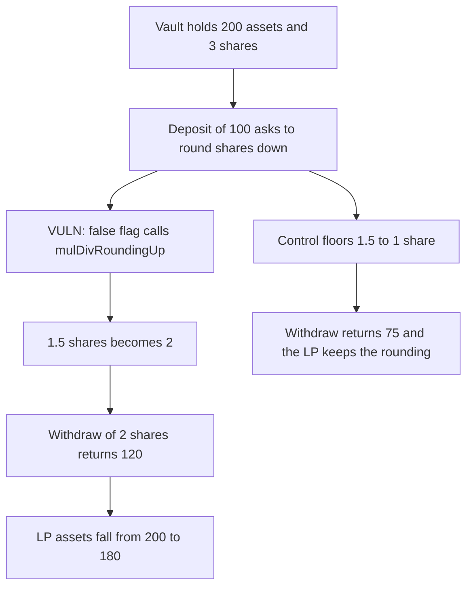

# Teahouse: fractionOfShares rounds the wrong way

> **Vulnerability classes:** `vuln/arithmetic/rounding-direction`

<!-- non-defihacklabs -->
<!-- source-auditvault: https://github.com/Auditware/AuditVault/blob/main/findings/45705-fractionofshares-function-in-teavaultambient-contract-may-ca.md -->
<!-- date: 2024-09 -->

## Key info

| Field | Value |
|---|---|
| **Loss** | A 100 asset deposit mints 2 shares instead of 1 and withdraws 120. Existing LPs' 200 is left at 180 |
| **Vulnerable contract** | `TeaVaultAmbient._fractionOfShares` |
| **Attacker EOA** | `0x1111111111111111111111111111111111111111` |
| **Attack contract** | `Exploit` |
| **Attack tx** | `Exploit.run()` |
| **Chain / block / date** | Ethereum model · block 0 · 2024-09 |
| **Compiler** | solc 0.8.27, cancun, via IR |

## TL;DR

`_fractionOfShares` calls `mulDivRoundingUp` when `_isRoundingUp` is false. A deposit that asks to round the minted shares down computes `3 * 100e18 / 200e18`. That quotient is 1.5, so the floor is 1 and the ceiling is 2. The vault mints 2. Redeeming those 2 shares of a 300-asset, 5-share vault returns 120. The depositor put in 100. The LP who still holds 3 shares is backed by 180 instead of 200.

## The vulnerable code

```solidity
if (fixedMode) {
    amount = _isRoundingUp
        ? _mulDivRoundingUp(_assetAmount, _shares, _totalShares)
        : _mulDiv(_assetAmount, _shares, _totalShares);
} else if (_isRoundingUp) {
    amount = _mulDiv(_assetAmount, _shares, _totalShares);
} else {
    amount = _mulDivRoundingUp(_assetAmount, _shares, _totalShares); // @> VULN: round-down request uses mulDivRoundingUp
}
```

Zokyo's recommended body is the `fixedMode` branch: round up only when the flag is true.

## Root cause

The two rounding helpers are attached to the wrong flag. `mulDiv` is `a * b / d`. `mulDivRoundingUp` adds 1 when `mulmod(a, b, d)` is not zero. `3 * 100e18` divided by `200e18` is 1 with a remainder, so the ceiling is 2. Deposit and withdraw both pass `false` because both should round against the user. The false branch rounds toward the user instead.

## Preconditions

- The vault holds 200 assets and 3 shares, all owned by an existing LP.
- The attacker deposits 100 assets.
- Shares minted are `_fractionOfShares(totalShares, assets, totalAssets, false)`.

## Attack walkthrough

1. The depositor approves 100 assets and calls `deposit`.
2. The false flag takes `mulDivRoundingUp(3, 100e18, 200e18)` and returns 2.
3. Total assets become 300 and total shares become 5. The depositor holds 2 of them.
4. `withdraw(2)` returns `300e18 * 2 / 5`, which is exactly 120.
5. The depositor's balance goes from 100 to 120. The vault holds 180.
6. The control rounds down, mints 1 share, and withdraws 75. The LP side keeps the rounding.

## Diagrams



## Impact

The depositor gains 20 assets. Those 20 assets come out of the 200 that backed the existing 3 shares. The LP's share count does not change. The same inverted flag also rounds a withdrawal the wrong way whenever the quotient is not exact. This deposit was chosen because the withdrawal quotient is exact, so the 20 asset gain is entirely from the mint.

## How to reproduce

```bash
cd 45705-fractionofshares-function-in-teavaultambient-contract-may-ca_exp
forge test -vv
```

`test_exploit_round_up_mints_an_extra_share` asserts the balance rose from 100 to 120 and the vault holds 180. `test_control_round_down_mints_one_share` asserts 1 share is minted and 75 assets come back.

## Sources

- AuditVault finding: https://github.com/Auditware/AuditVault/blob/main/findings/45705-fractionofshares-function-in-teavaultambient-contract-may-ca.md
- Zokyo report: https://github.com/solodit/solodit_content/blob/main/reports/Zokyo/2024-09-25-Teahouse.md
