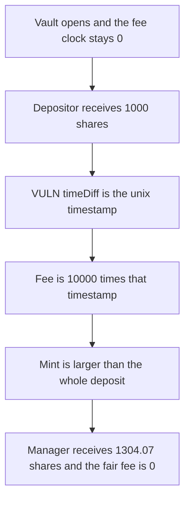

# Teahouse: the first management fee is charged since 1970

> **Vulnerability classes:** `vuln/logic/fee-calculation` · `vuln/data/uninitialized`

<!-- non-defihacklabs -->
<!-- source-auditvault: https://github.com/Auditware/AuditVault/blob/main/findings/45706-management-fee-for-the-first-time-will-be-way-larger-than-it.md -->
<!-- date: 2024-09 -->

## Key info

| Field | Value |
|---|---|
| **Loss** | 1304.073801061980755698 TEA fee shares minted on a 1000 TEA deposit. The fair same-block fee is 0 |
| **Vulnerable contract** | `TeaVaultAmbient._collectManagementFee` |
| **Attacker EOA** | `0x1111111111111111111111111111111111111111` |
| **Attack contract** | `Exploit` |
| **Attack tx** | `Exploit.run()` |
| **Chain / block / date** | Ethereum model · block 0 · 2024-09 |
| **Compiler** | solc 0.8.27, cancun |
| **Bug class** | Fee clock left at its zero default |

## TL;DR

`lastCollectManagementFee` is not set when the vault opens. The first collection uses `block.timestamp - 0`. At unix time `1784893842`, a 1 percent fee mints `1304073801061980755698` shares against a `1000e18` deposit. The same block measured from `openedAt` charges zero. Initializing the clock in the constructor charges zero as well.

## Background

Zokyo's 25 September 2024 Teahouse review. The report shows `_collectManagementFee` in `TeaVaultAmbient.sol` and says `lastCollectedManagementFee` must start at `block.timestamp`. The comment in the finding is `10000 * td`, so this reduction uses management fee `10000` and `FEE_MULTIPLIER` of `1_000_000`. The playground warps the whole replay to `1784893842`, which is the same value the forge test uses.

## The vulnerable code

```solidity
uint256 timeDiff = block.timestamp - lastCollectManagementFee; // @> VULN: lastCollect is 0, so timeDiff is the unix timestamp
// FIX: initialize lastCollectManagementFee = block.timestamp when the vault opens.
if (timeDiff > 0) {
    unchecked {
        uint256 feeTimesTimediff = feeConfig.managementFee * timeDiff;
        uint256 denominator = FEE_MULTIPLIER * SECONDS_IN_A_YEAR > feeTimesTimediff ? FEE_MULTIPLIER * SECONDS_IN_A_YEAR - feeTimesTimediff : 1;
        collectedShares = _mulDivUp(totalSupply, feeTimesTimediff, denominator);
    }
}
```

## Root cause

A storage variable that means "last time we charged" defaults to zero. The first subtraction is then the unix timestamp, not the time since the vault started taking deposits. The fee shares are minted to the manager and dilute everyone who deposited in that first interval.

## Preconditions

- The vault is constructed with `initClock = false`.
- A depositor mints 1000 shares in the open block.
- The block timestamp is `1784893842`. `openedAt` is that same timestamp.

## Attack walkthrough

1. Deposit 1000 shares. `openedAt` equals the block timestamp. The fee clock is still 0.
2. `collect` calls `_collectManagementFee`.
3. `timeDiff` is `1784893842`.
4. `feeTimesTimediff` is `10000 * 1784893842`.
5. Rounding up against the year denominator mints `1304073801061980755698` shares.
6. `fairFee`, which subtracts `openedAt`, is 0. The manager's TEA balance equals the minted fee.

## Diagrams



## Impact

The manager receives more fee shares than the depositor's entire position, in the same block the vault opened. Depositors are diluted immediately. A vault that sets the clock in the constructor mints zero shares for that same collection. The control test constructs with `initClock = true` and asserts `collect` returns 0.

## Remediation

Set `lastCollectManagementFee = block.timestamp` in the constructor, or at the end of initialization, before the first deposit.

## How to reproduce

```bash
cd 45706-management-fee-for-the-first-time-will-be-way-larger-than-it_exp
forge test -vv
```

The test warps to `1784893842`. `test_first_fee_exceeds_the_deposit` logs `feeMinted: 1304073801061980755698` and asserts it exceeds 1000 ether. `test_control_initialized_clock_charges_zero` asserts a zero collection. Captured output is `output.txt`.

## Sources

- AuditVault finding: https://github.com/Auditware/AuditVault/blob/main/findings/45706-management-fee-for-the-first-time-will-be-way-larger-than-it.md
- Report: https://github.com/solodit/solodit_content/blob/main/reports/Zokyo/2024-09-25-Teahouse.md
- Blamed function: `TeaVaultAmbient._collectManagementFee`, as quoted in the finding.
