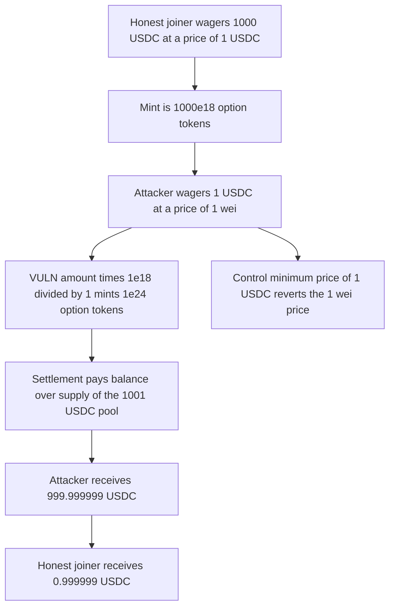

# Filament: a 1 wei option price mints 1e24 tokens and takes the wager pool

> **Vulnerability classes:** `vuln/logic/reward-calculation` · `vuln/input-validation/missing`

<!-- non-defihacklabs -->
<!-- source-auditvault: https://github.com/Auditware/AuditVault/blob/main/findings/45830-user-controlled-options-price-zokyo-none-filament-markdown.md -->
<!-- date: 2024-11 -->

## Key info

| Field | Value |
|---|---|
| **Loss** | 1 USDC joiner receives 999.999999 USDC. 1,000 USDC joiner receives 0.999999 USDC |
| **Vulnerable contract** | `FlashDuels.joinDuel` |
| **Attacker EOA** | `0x1111111111111111111111111111111111111111` |
| **Attack contract** | `Exploit` |
| **Attack tx** | `Exploit.run()` |
| **Chain / block / date** | Ethereum model · block 0 · 2024-11 |
| **Compiler** | solc 0.8.27, cancun, via IR |
| **Bug class** | Caller-supplied option price is the divisor of the option mint |

## TL;DR

`joinDuel` checks that the USDC wager is at least `_optionPrice`, then mints `(_amount * 1e18) / _optionPrice`. The caller chooses the price. An honest joiner wagers 1,000 USDC at a price of 1 USDC and receives 1,000e18 option tokens. The attacker wagers 1 USDC at a price of 1 wei and receives 1e24 option tokens. Settlement pays `balance / supply` of the 1,001 USDC pool. The attacker is paid 999.999999 USDC. The honest joiner is paid 0.999999 USDC. A minimum price of 1 USDC reverts the 1 wei price.

## Background

Zokyo, Filament, 21 November 2024, "User Controlled Options Price." The report's arithmetic is `1e6 * 1e18 / 1 = 1e24` option tokens for 1 USDC at a 1 wei price. The same report's settlement pays `(optionTokenBalance * 1e18) / totalSupply`, then `(winnerShare * pool) / 1e18`. Both formulas are in this reduction. USDC has 6 decimals.

## The vulnerable code

```solidity
require(_amount >= _optionPrice, "below price");
require(usdc.transferFrom(msg.sender, address(this), _amount), "usdc");
// @> VULN: the joiner picks _optionPrice, so 1 wei mints _amount * 1e18 tokens
uint256 amountTokenToMint = (_amount * 1e18) / _optionPrice;
// FIX: require(_optionPrice >= MIN_OPTION_PRICE) before this division.
optionToken.mint(msg.sender, amountTokenToMint);
```

## Root cause

The mint divisor is an argument of the same call that pays the wager. The only check is `amount >= price`, which a price of 1 wei always passes.

## Preconditions

- Both joiners use the same duel and the same option index, so they mint the same option token.
- Settlement pays each winner by that token's share of supply.
- The honest price is 1 USDC in base units, 1000000. The honest wager is 1,000 USDC, 1000000000 base units.

## Attack walkthrough

1. The honest wallet joins with price 1000000 and amount 1000000000. The mint is 1,000e18 option tokens.
2. The attacker joins with price 1 and amount 1000000. The mint is 1e24 option tokens.
3. The pool holds 1,001 USDC.
4. The honest share rounds to a payout of 999999 base units, 0.999999 USDC.
5. The attacker is paid 999999999 base units, 999.999999 USDC.
6. Net of the 1 USDC stake, the attacker gained 998999999 base units. One base unit of dust remains in the contract.
7. The control sets a minimum price of 1000000. The price of 1 reverts and the contract takes no USDC.

## Diagrams



## Impact

The honest joiner deposited 1,000 USDC and is paid 0.999999 USDC back. The attacker deposited 1 USDC and is paid 999.999999 USDC. The attacker's net gain is 998.999999 USDC, taken from the honest wager. The minimum-price control accepts no deposit from the 1 wei price.

## Remediation

Reject an option price below a floor, or take the price from an admin setter, which is the recommendation in the Zokyo report. Do not let the joiner choose the divisor of their own option mint.

## How to reproduce

```bash
cd 45830-user-controlled-options-price-zokyo-none-filament-markdown_exp
forge test -vv
```

`test_exploit_one_usdc_takes_the_wager_pool` asserts the attacker payout of 999999999 and the honest payout of 999999. `test_control_min_price_rejects_one_wei` asserts the 1 wei price reverts and the duel holds no USDC. Captured output is `output.txt`.

## Sources

- AuditVault finding: https://github.com/Auditware/AuditVault/blob/main/findings/45830-user-controlled-options-price-zokyo-none-filament-markdown.md
- Zokyo report: https://github.com/solodit/solodit_content/blob/main/reports/Zokyo/2024-11-21-Filament.md
